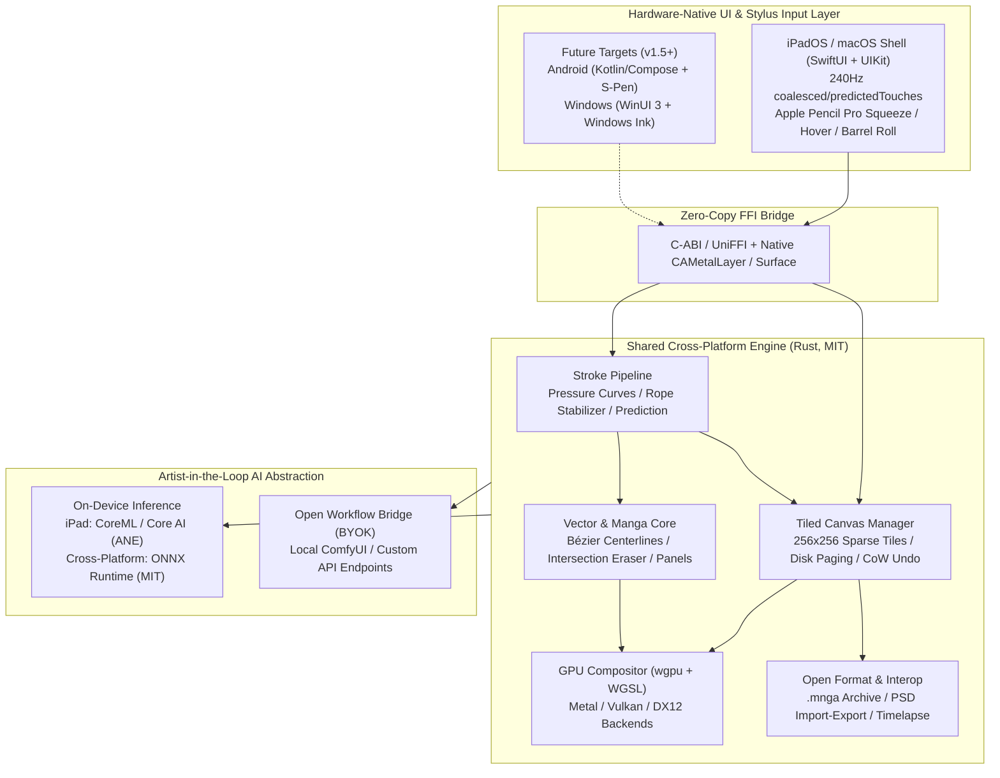

# About-Paint-Tools

> **An MIT-Licensed, Touch & Apple Pencil-First Open-Source Anime & Manga Creation Studio for iPad — Powered by Artist-in-the-Loop On-Device AI.**

**Languages / 文档语言**: **English** | [简体中文](./README.zh-CN.md)

[](./LICENSE)
[](#architecture-overview)
[](./docs/en/05-i18n-and-l10n-guide.md)

---

## Why This Project Exists

Today's iPad anime & manga creators face an awkward gap:

- **Procreate** delivers world-class touch ergonomics and low-latency Metal performance, but lacks native manga fundamentals (true vector lineart layers, vector intersection eraser, panel frame folders, non-destructive screentones, and multi-page management).
- **Clip Studio Paint (CSP)** is the manga industry standard, but its iPad version is subscription-only with a dense desktop-ported UI.
- **ibisPaint X / MediBang Paint** excel at accessibility and fast flatting, yet rely on ads/paywalls and closed ecosystems.
- **Krita** is the leading open-source painting suite, but its **GPLv3 license** conflicts with Apple App Store distribution terms, leaving a major open-source vacuum on iPadOS.

**About-Paint-Tools** is designed from day one under the permissive **MIT License** to unite:
1. **Procreate-grade iPad touch & Apple Pencil Pro ergonomics** (`≤ 9ms` latency target, 240Hz coalesced & predicted touches, Squeeze radial menu, Hover preview, Barrel Roll).
2. **CSP & ibisPaint-grade anime/manga production primitives** (vector lineart + intersection eraser, close-gap expand fill, panel folders, procedural GPU screentones, reference layers, PSD interoperability).
3. **Artist-in-the-Loop, Local-First AI Assistant Suite** (semantic flatting, offline photo-to-manga LT conversion, style-preserving sketch cleanup, 3D light-guided cel shading, character consistency checks — **zero forced cloud uploads, zero unauthorized model training**).

---

## Architecture Overview

To deliver **uncompromised hardware-native stylus feel** on iPad today while preserving a clean future path to macOS, Android tablets (S-Pen / M-Pencil), and Windows (Windows Ink), we adopt a **Thin Native Shell + Shared Rust Core Engine** architecture (rather than forcing a single cross-platform UI framework such as Flutter over the drawing canvas):



---

## Phased Roadmap Summary

- **Pre-1.0 Series (`v0.1` – `v0.9`) — Rock-Solid iPad Manga Toolset Foundation**
  - `v0.1`: Low-latency `256×256` sparse tile canvas, 240Hz Apple Pencil input, dual-source `en`/`zh-Hans` i18n base
  - `v0.2`: Brush stamping engine, pressure/tilt/barrel-roll curves, real-time rope stabilizer, 8 anime presets (G-Pen, Maru, Flatting, etc.)
  - `v0.3`: Layer tree, clipping masks, alpha lock, reference layers, blend modes, tile-level CoW undo/redo
  - `v0.4`: Lasso/wand selection, **close-gap + expand-edge flood fill (anti-white-halo)**, free transform & liquify
  - `v0.5`: **Vector lineart layers**, **vector intersection eraser**, symmetry & 1/2/3-point perspective rulers
  - `v0.6`: Panel frame folders, non-destructive GPU screentones, CJK vertical & EN/ES horizontal speech bubbles
  - `v0.7`: Open `.mnga` file format, layered PSD import/export, timelapse recording, Files/iCloud sync
  - `v0.8`: Apple Pencil Pro Squeeze radial menu, Hover cursor, reference window, **5-language live switching**
  - `v0.9`: B4 600DPI tile disk paging stress test, 5-language Split View UI layout QA, public TestFlight Beta
- **1.x Series (`v1.0` – `v1.5+`) — Pro UI Overhaul, Artist-Friendly AI Suite & Multi-Platform**
  - `v1.0`: Complete Design System & dual-mode workspace (*Focus Illustration* vs *Manga Studio*) + full 5-language polish
  - `v1.1`: On-device semantic smart flatting + offline photo-to-manga LT line/screentone extraction
  - `v1.2`: Style-preserving sketch-to-vector cleanup + 3D light-sphere cel-shading assist
  - `v1.3`: Lightweight 3D anime pose mannequin + multi-page chapter & Webtoon slice export
  - `v1.4`: Character color sheet manager + AI consistency critic + local ComfyUI/BYOK bridge
  - `v1.5+`: macOS, Android tablet, and Windows native shells + community Lua/WASM plugin API

---

## Documentation Index (Bilingual EN / 简体中文)

All project documents are maintained in 1:1 mirrored **English** and **Simplified Chinese**:

| Topic | English | 简体中文 |
| :--- | :--- | :--- |
| 01. Market Research & Competitor Analysis | [01-market-research.md](./docs/en/01-market-research.md) | [01-market-research.md](./docs/zh-CN/01-market-research.md) |
| 02. Technical Architecture & Platform RFC | [02-architecture-and-tech-stack.md](./docs/en/02-architecture-and-tech-stack.md) | [02-architecture-and-tech-stack.md](./docs/zh-CN/02-architecture-and-tech-stack.md) |
| 03. AI-Assisted Creator Toolset Spec | [03-ai-assistant-spec.md](./docs/en/03-ai-assistant-spec.md) | [03-ai-assistant-spec.md](./docs/zh-CN/03-ai-assistant-spec.md) |
| 04. Phased Development Roadmap (`0.1`–`1.x`) | [04-roadmap.md](./docs/en/04-roadmap.md) | [04-roadmap.md](./docs/zh-CN/04-roadmap.md) |
| 05. 5-Language i18n & Layout Guide | [05-i18n-and-l10n-guide.md](./docs/en/05-i18n-and-l10n-guide.md) | [05-i18n-and-l10n-guide.md](./docs/zh-CN/05-i18n-and-l10n-guide.md) |

---

## Repository Structure

```text
About-Paint-Tools/
├── LICENSE                      # MIT License
├── README.md                    # English project homepage
├── README.zh-CN.md              # Simplified Chinese project homepage
├── docs/
│   ├── en/                      # Canonical English documentation
│   └── zh-CN/                   # Canonical Simplified Chinese documentation
├── i18n/
│   ├── glossary.json            # 5-language art & manga terminology glossary
│   └── locales/                 # en, zh-Hans (sources) + zh-Hant, yue-Hant, es
├── scripts/
│   └── i18n_check.py            # CI parity, placeholder & UI length guardrails
├── core/                        # v0.1 Rust cross-platform canvas core (MIT)
│   └── manga-core/              # Sparse tiles, stroke stabilizer, CoW undo
└── apps/
    └── ipad/                    # v0.1 iPadOS native SwiftUI/UIKit shell scaffold
```

---

## Quick Verification (v0.1 Foundation)

```bash
# 1. Validate 5-language localization parity, placeholders, and Spanish/UI length budgets
python3 scripts/i18n_check.py

# 2. Run v0.1 Rust core unit tests (sparse tile store, rope stabilizer, CoW undo)
cargo test --manifest-path core/Cargo.toml
```

---

## License

Released under the [MIT License](./LICENSE). All third-party dependencies must remain strictly MIT / Apache-2.0 / BSD / Zlib compatible (no GPL/AGPL dependencies) to preserve iPadOS App Store compatibility and open community reuse.