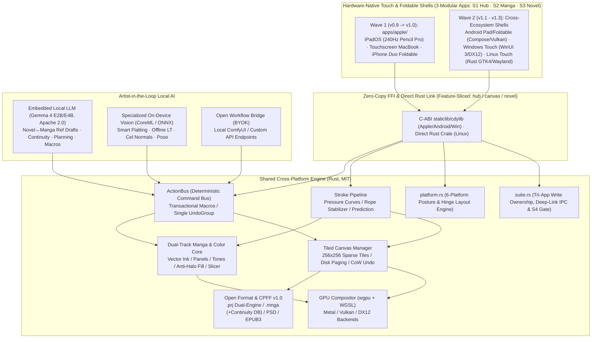

# About-Paint-Tools

> **An MIT-Licensed, Touch & Apple Pencil-First Open-Source Anime & Manga Creation Studio for iPad — Powered by Artist-in-the-Loop On-Device AI.**

**Languages / 文档语言**: **English** | [简体中文](./README.zh-CN.md)

[](./LICENSE)
[](#architecture-overview)
[](./docs/en/05-i18n-and-l10n-guide.md)

---

## Why This Project Exists

Today's touch-first anime & manga creators face an awkward gap:

- **Procreate** delivers world-class touch ergonomics and low-latency Metal performance, but lacks native manga fundamentals (true vector lineart layers, vector intersection eraser, panel frame folders, non-destructive screentones, and multi-page management).
- **Clip Studio Paint (CSP)** is the manga industry standard, but its tablet versions are subscription-only with a dense desktop-ported UI.
- **ibisPaint X / MediBang Paint** excel at accessibility and fast flatting, yet rely on ads/paywalls and closed ecosystems.
- **Krita** is the leading open-source painting suite, but its **GPLv3 license** conflicts with Apple App Store distribution terms, leaving a major open-source vacuum on iPadOS / iOS.

**About-Paint-Tools** is designed from day one under the permissive **MIT License** to serve **both B&W Page Manga (Japanese Manga / Doujinshi) and Full-Color Webtoon / Anime Illustration equally**, across **six touch & foldable platforms** (Wave 1 `v0.9`→`v1.0`: **iPad · Touchscreen MacBook · iPhone Duo**; Wave 2 `v1.1`–`v1.3`: **Android Pad/Foldable · Touchscreen Windows · Touchscreen Linux**).

To minimize RAM & GPU VRAM footprint on mobile/touch hardware, the suite provides **three independent tools over one CPFF v1.0 (`.prj`) file framework** that run **either standalone or concurrently side-by-side** *(all Chinese, English, and Spanish names below are **working codenames** pending final pre-release branding)*:
- **S1 — `NoemaDock` (`创想空间`, codename)**: Project overview, prose & artwork import, dual-engine (Manga × Light Novel) serialization, Git/LFS sync & multi-language edition publishing (`< 200 MB` standalone RAM).
- **S2 — `DracoNib` (`雕龙`, codename)**: Series manga & illustration drawing tool (`≤ 9ms` latency target, 240Hz Apple Pencil Pro / S-Pen / Windows Ink / Wayland `zwp_tablet_v2`, vector lineart + intersection eraser, panels, procedural screentones, anti-halo close-gap fill, Webtoon slicer).
- **S3 — `LitteraCore` (`文心`, codename)**: Light novel authoring & publishing workbench (5-language prose, shared Story Bible/dictionary autocomplete, curated or custom illustrations, EPUB3/Markdown export; `< 120 MB` standalone RAM, zero GPU canvas overhead).
- **Mandatory S4 Release Gate**: Every version (`v0.1`–`v1.5+`) decomposes into independent `S1`, `S2`, and `S3` subprojects followed by a dedicated **S4 Tri-App Integration & Compatibility Revision Stage** before unified PR publication.
- **Artist-in-the-Loop Embedded Local AI (Gemma 4 E2B/E4B + Vision)**: Offline **Gemma 4 (Apache 2.0)** powering **`v1.0` Bidirectional AI Reference Drafts** (`Manga → Novel` & `Novel → Manga`, strictly isolated in `ai_assist/` as `role="ai_reference_only"` — never overwriting human finals), Voice Continuity, Story Planning, and `ActionBus` Function-Calling batch macros — **zero forced cloud uploads, zero unauthorized model training**.

---

## Architecture Overview

To deliver **uncompromised hardware-native stylus & foldable feel** across every form factor while keeping 80%+ of the codebase single-source in Rust, we adopt a **Thin Native Shell + Shared Rust Core Engine** architecture:



---

## Phased Roadmap Summary

> Every milestone below splits into **`S1` (`NoemaDock`) + `S2` (`DracoNib`) + `S3` (`LitteraCore`) + `S4` (Tri-App Integration & Compatibility Gate) → Unified Release PR**. See [06. Detailed Engineering WBS](./docs/en/06-development-tasks.md).

- **Wave 1 — Pre-1.0 Series (`v0.1` – `v0.9`) — Dual-Track Core + Apple Trio (iPad · Touch MacBook · iPhone Duo)**
  - `v0.1`: Low-latency `256×256` sparse tile canvas, 240Hz Apple Pencil input, B4 600DPI & Webtoon canvas presets, dual-source `en`/`zh-Hans` i18n base
  - `v0.2`: Brush stamping engine, pressure/tilt/barrel-roll curves, real-time rope stabilizer, 8 dual-track anime presets (G-Pen, Maru, Flatting, etc.)
  - `v0.3`: Layer tree, clipping masks, alpha lock, reference layers, 12+ cel blend modes, tile-level CoW undo/redo
  - `v0.4`: Lasso/wand selection, **close-gap + expand-edge flood fill (anti-white-halo)**, free transform & liquify
  - `v0.5`: **Vector lineart layers**, **vector intersection eraser**, symmetry & 1/2/3-point perspective rulers
  - `v0.6`: Panel frame folders, non-destructive GPU screentones, CJK vertical & EN/ES horizontal bubbles, **Webtoon strip preview & slicer**
  - `v0.7`: CPFF v1.0 `.prj` projects (Git + Git LFS), open `.mnga` format (+ continuity tables), layered PSD, timelapse, **deterministic `ActionBus`**
  - `v0.8`: Apple Pencil Pro Squeeze/Hover, **Touchscreen MacBook** direct touch + shortcuts, **iPhone Duo** foldable posture, **5-language live switching**
  - `v0.9`: **Wave 1 Apple Trio Joint Beta (iPad · Touchscreen MacBook · iPhone Duo)**, B4 600DPI & `1600×25600` disk paging soak, 5-language layout QA
- **1.x Series (`v1.0` – `v1.5+`) — Dual-Engine Studio, Embedded Gemma 4 Local AI & Wave 2 Cross-Platform**
  - `v1.0`: **Apple Trio Official Launch** — Tri-App GA (`NoemaDock` · `DracoNib` · `LitteraCore`, codenames) + **Light Novel Authoring Engine** (shared `.prj`, decoupled finals, self-selected/custom illustrations, EPUB3) + **Embedded Gemma 4 Bidirectional AI Reference Drafts** (strictly isolated in `ai_assist/`)
  - `v1.1`: **Android Pad / Foldable Edition (`apps/android/`)** (Compose + WindowManager Tabletop/Dual-Pane + S-Pen/M-Pencil Vulkan) + Gemma 4 Voice Continuity + Smart Flatting & offline LT conversion
  - `v1.2`: **Touchscreen Windows Edition (`apps/windows/`)** (WinUI 3 + Windows Ink + 2-in-1 Tablet Mode + DX12) + Gemma 4 Function-Calling Workflow Driver + Sketch Cleanup & 3D Cel Shading
  - `v1.3`: **Touchscreen Linux Edition (`apps/linux/`)** (Native Rust + GTK4/Wayland `zwp_tablet_v2` + Vulkan) + 3D anime pose mannequin + multi-page/episode/volume studio
  - `v1.4`: **Gemma 4 Vision Continuity Critic** + LAN ComfyUI/BYOK workflow bridge
  - `v1.5+`: Six-platform `.prj` parity & open Lua/WASM community plugin API

---

## Documentation Index (Bilingual EN / 简体中文)

All project documents are maintained in 1:1 mirrored **English** and **Simplified Chinese**:

| Topic | English | 简体中文 |
| :--- | :--- | :--- |
| 01. Market Research & Competitor Analysis | [01-market-research.md](./docs/en/01-market-research.md) | [01-market-research.md](./docs/zh-CN/01-market-research.md) |
| 02. Technical Architecture & Platform RFC | [02-architecture-and-tech-stack.md](./docs/en/02-architecture-and-tech-stack.md) | [02-architecture-and-tech-stack.md](./docs/zh-CN/02-architecture-and-tech-stack.md) |
| 03. AI-Assisted Creator Toolset Spec (Gemma 4) | [03-ai-assistant-spec.md](./docs/en/03-ai-assistant-spec.md) | [03-ai-assistant-spec.md](./docs/zh-CN/03-ai-assistant-spec.md) |
| 04. Phased Development Roadmap (`0.1`–`1.x`) | [04-roadmap.md](./docs/en/04-roadmap.md) | [04-roadmap.md](./docs/zh-CN/04-roadmap.md) |
| 05. 5-Language i18n & Layout Guide | [05-i18n-and-l10n-guide.md](./docs/en/05-i18n-and-l10n-guide.md) | [05-i18n-and-l10n-guide.md](./docs/zh-CN/05-i18n-and-l10n-guide.md) |
| 06. Detailed Engineering Task Breakdown (WBS) | [06-development-tasks.md](./docs/en/06-development-tasks.md) | [06-development-tasks.md](./docs/zh-CN/06-development-tasks.md) |
| 07. Creative Project File Framework V1.0 (`.prj` / Git) | [07-creative-project-framework-v1.md](./docs/en/07-creative-project-framework-v1.md) | [07-creative-project-framework-v1.md](./docs/zh-CN/07-creative-project-framework-v1.md) |
| 08. Tri-App Original UI Design & `vX.Y.Z` Patch Roadmap | [08-tri-app-ui-design-and-patch-roadmap.md](./docs/en/08-tri-app-ui-design-and-patch-roadmap.md) | [08-tri-app-ui-design-and-patch-roadmap.md](./docs/zh-CN/08-tri-app-ui-design-and-patch-roadmap.md) |
| 09. Apple MacBook Pro Xcode & Xcode Cloud Guide | [09-apple-xcode-and-cloud-dev-guide.md](./docs/en/09-apple-xcode-and-cloud-dev-guide.md) | [09-apple-xcode-and-cloud-dev-guide.md](./docs/zh-CN/09-apple-xcode-and-cloud-dev-guide.md) |
| 10. Engineering Philosophy, Strategy, Skills & Living Retrospective | [10-engineering-retrospective-and-playbook.md](./docs/en/10-engineering-retrospective-and-playbook.md) | [10-engineering-retrospective-and-playbook.md](./docs/zh-CN/10-engineering-retrospective-and-playbook.md) |

- **Bilingual Side-by-Side Study Edition (中英对照综合学习版)**: [10-engineering-retrospective-and-playbook-bilingual.md](./docs/bilingual/10-engineering-retrospective-and-playbook-bilingual.md) *(with Core Bilingual Engineering Glossary; updated at every `S4` gate)*
- **Interactive HTML UI Demos**: [`S1 NoemaDock`](./docs/demos/s1_hub_ui_demo.html) · [`S2 DracoNib`](./docs/demos/s2_manga_ui_demo.html) · [`S3 LitteraCore`](./docs/demos/s3_novel_ui_demo.html)
- **Apple Keynote-Compatible Bilingual Decks (14 Slides)**: [English `.pptx`](./docs/presentations/About-Paint-Tools_Overview_and_Plan_en.pptx) ([PDF](./docs/presentations/About-Paint-Tools_Overview_and_Plan_en.pdf)) · [简体中文 `.pptx`](./docs/presentations/About-Paint-Tools_Overview_and_Plan_zh-CN.pptx) ([PDF](./docs/presentations/About-Paint-Tools_Overview_and_Plan_zh-CN.pdf))

---

## Repository Structure

```text
About-Paint-Tools/
├── LICENSE                      # MIT License
├── README.md                    # English project homepage
├── README.zh-CN.md              # Simplified Chinese project homepage
├── docs/
│   ├── en/                      # Canonical English documentation (01–09)
│   ├── zh-CN/                   # Canonical Simplified Chinese documentation (01–09)
│   ├── assets/ui-mockups/       # S1/S2/S3 original high-res UI mockups (7 images)
│   ├── demos/                   # S1/S2/S3 self-contained interactive HTML UI demos (3 files)
│   └── presentations/           # Bilingual Apple Keynote-compatible decks (.pptx + .pdf)
├── templates/
│   └── SampleManga/             # Reference CPFF v1.0 dual-engine project (SampleManga.prj + Git LFS)
├── i18n/
│   ├── glossary.json            # 5-language art, manga, novel & tri-app codename glossary
│   └── locales/                 # en, zh-Hans (sources) + zh-Hant, yue-Hant, es
├── scripts/
│   ├── i18n_check.py            # CI parity, placeholder & UI length guardrails
│   ├── i18n_sync.py             # Sync & export Apple .xcstrings + Android strings.xml
│   └── prj_validate.py          # CPFF v1.0 .prj XML, AI red-line & Git LFS validator
├── core/                        # Rust cross-platform canvas, suite, posture & project core (MIT)
│   └── manga-core/              # Feature-sliced (hub / canvas / novel) engine + suite.rs + platform.rs
└── apps/
    ├── apple/                   # Wave 1 (v0.9→v1.0): Unified iPadOS, macOS Touch & iPhone Duo shell
    ├── android/                 # Wave 2 (v1.1): Android Pad & Foldable (Compose + WindowManager + Vulkan)
    ├── windows/                 # Wave 2 (v1.2): Touchscreen Windows Notebook/Pad (WinUI 3 + DX12)
    └── linux/                   # Wave 2 (v1.3): Touchscreen Linux Notebook/Pad (Native Rust GTK4/Wayland)
```

---

## Quick Verification

```bash
# 1. Validate 5-language localization, Apple .xcstrings & Android strings.xml sync, and bilingual docs
python3 scripts/i18n_check.py && python3 scripts/i18n_sync.py --check-xcstrings --check-android

# 2. Validate reference CPFF v1.0 dual-engine project (SampleManga.prj + AI isolation + Git LFS)
python3 scripts/prj_validate.py templates/SampleManga

# 3. Verify C-ABI header, Rust workspace tests, modular feature slices, and S4 Tri-App Integration Gate
gcc -std=c11 -Wall -Wextra -Werror -fsyntax-only core/manga-core/include/manga_core.h
cargo test --manifest-path core/Cargo.toml --workspace --all-targets
cargo check --manifest-path core/Cargo.toml -p manga-core --no-default-features --features hub
cargo check --manifest-path core/Cargo.toml -p manga-core --no-default-features --features canvas
cargo check --manifest-path core/Cargo.toml -p manga-core --no-default-features --features novel
cargo run --manifest-path core/Cargo.toml -p manga-linux-shell -- --integration-check
```

---

## License

Released under the [MIT License](./LICENSE). All third-party dependencies must remain strictly MIT / Apache-2.0 / BSD / Zlib compatible (no GPL/AGPL dependencies) to preserve iPadOS App Store compatibility and open community reuse.