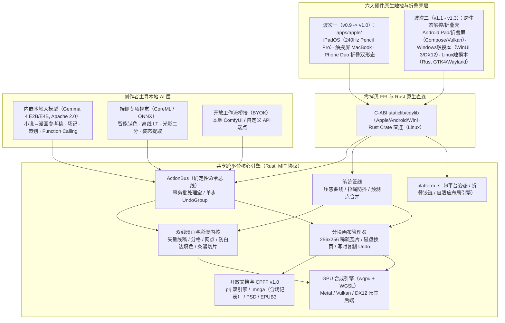

# About-Paint-Tools

> **基于 MIT 开源协议、面向 iPad 触控与 Apple Pencil 的二次元漫画创作工具——融合专业漫画工作流与「创作者主导（Artist-in-the-Loop）」端侧 AI 辅助工具集。**

**文档语言 / Languages**: [English](./README.md) | **简体中文**

[](./LICENSE)
[](#技术架构概览)
[](./docs/zh-CN/05-i18n-and-l10n-guide.md)

---

## 项目愿景与定位

当前触控设备上的二次元漫画/插画创作者长期面临工具断层：

- **Procreate** 触控手感与低延迟 Metal 性能堪称标杆，但严重缺乏专业漫画能力（无真正矢量线稿层、无矢量交点橡皮、无分格文件夹、无非破坏性网点纸与多页连载管理）。
- **Clip Studio Paint (CSP)** 是漫画行业标准，但移动端强制订阅制且桌面移植 UI 繁杂拥挤。
- **ibisPaint X / MediBang Paint** 轻快易用、填色顺手，但免费版广告与会员墙割裂体验且全闭源。
- **Krita** 是最强的开源绘画软件，但因采用 **GPLv3 协议** 与 Apple App Store 条款冲突，至今无法登陆 iPadOS / iOS。

**About-Paint-Tools** 从第一行代码起即采用宽松的 **MIT 开源协议**，确立首阶段 **黑白页漫（日漫/同人本）× 全彩条漫/二次元插画 双线并重**，并分阶段覆盖 **六大触控与折叠屏硬件平台**（第一波次 `v0.9`→`v1.0`：**iPad · 触摸屏 MacBook · iPhone Duo**；第二波次 `v1.1`–`v1.3`：**Android Pad/折叠屏手机 · 触摸屏 Windows · 触摸屏 Linux**），融合三大核心价值：
1. **硬件原生的触控、折叠屏与手写笔手感**（目标延迟 `≤ 9ms`，覆盖 iPadOS 240Hz Apple Pencil Pro、触摸屏 MacBook 直触+快捷键、iPhone Duo 与 Android 折叠屏铰链感知双联、Windows Ink 与 Wayland `zwp_tablet_v2`）。
2. **双线并重的专业漫画与赛璐璐工作流 + 小说 × 漫画双引擎并进**（黑白页漫：B4 600DPI 模板、矢量线稿 + 交点橡皮、分格文件夹、GPU 程序化网点；全彩条漫/插画：12+ 混合模式、闭口识别防白边填色、超长条漫预览与一键切片、多层 PSD 互通；**小说 × 漫画双引擎**：共用同一套 `.prj` 故事圣经、大纲与 5 语专有名词字典，人工小说终稿与漫画原稿 100% 独立解耦，轻小说插图支持自选漫画页或单独定制设计）。
3. **「创作者主导」的内嵌本地 AI 驱动中心（Gemma 4 E2B/E4B + 端侧视觉）**——基于 **Apache 2.0 协议的 Gemma 4 轻量版**在设备本地离线驱动 **`v1.0` 小说 ↔ 漫画双向 AI 参考稿**（严格隔离在 `ai_assist/` 内并标记 `role="ai_reference_only"`，绝不覆盖人工终稿）、**智能场记（支持手不离笔语音速记）**、**分镜/剧情策划与 5 语言润色**以及**复杂重复批处理工作流（Function Calling → `ActionBus`）**，配合端侧语义铺底色、离线 LT 转线与赛璐璐二分阴影——**坚持本地优先、画作零上传、绝不用于训练**。

---

## 技术架构概览

为确保**「不同硬件上的用户体验为先」**（守住各平台原生触控与手写笔延迟，同时保持 80%+ 核心代码在 Rust 端单一维护），本项目采用**「六端薄原生壳 + 共享 Rust 核心引擎」**架构：



---

## 分阶段版本路线图

- **波次一 — Pre-1.0 系列（`v0.1` – `v0.9`）——双线内核 + Apple 三端（iPad · 触摸屏 MacBook · iPhone Duo）**
  - `v0.1`：`256×256` 稀疏分块画布内核、240Hz Apple Pencil 输入、B4 600DPI & 条漫画布预设、双基准（`en`/`zh-Hans`）i18n 基座
  - `v0.2`：笔刷盖章引擎、压感/倾斜/笔杆旋转曲线、实时拉绳防抖、8 支双线核心笔刷预设（G 笔/圆笔/平涂笔等）
  - `v0.3`：图层树、剪切蒙版、Alpha 锁定、参考图层、12+ 赛璐璐混合模式、Tile 级写时复制撤销/重做
  - `v0.4`：套索/魔棒选区、**闭口识别 + 边缘扩张防白边油漆桶**、自由变换与基础液化
  - `v0.5`：**矢量线稿图层**、**矢量交点橡皮擦**、对称尺与 1/2/3 点透视尺
  - `v0.6`：分格框文件夹、非破坏性 GPU 网点纸、中/日文竖排与英/西横排气泡、**条漫手机预览与一键切片导出**
  - `v0.7`：CPFF v1.0 `.prj` 创作工程（Git + Git LFS）、开源 `.mnga`（含场记扩展表）、多层 PSD 互通、延时回放、**确定性 `ActionBus`**
  - `v0.8`：Apple Pencil Pro 轻捏/悬停、**触摸屏 MacBook** 屏幕直触与快捷键融合、**iPhone Duo** 折叠双形态、**5 语言应用内即时切换**
  - `v0.9`：**Wave 1 Apple 三端联合 Beta（iPad · 触摸屏 MacBook · iPhone Duo）**、B4 600DPI & `1600×25600` 磁盘换页压测、5 语言防截断 QA
- **1.x 正式版系列（`v1.0` – `v1.5+`）——双引擎工作台 + 本地 Gemma 4 + Wave 2 全平台兼容**
  - `v1.0`：**Apple 三端同步正式版**——全新设计系统与**三模式工作区** + **轻小说创作引擎**（共用 `.prj`、终稿解耦、自选/定制插图、EPUB3）+ **内嵌本地 Gemma 4 双向 AI 参考稿**（严格隔离于 `ai_assist/`）
  - `v1.1`：**Android Pad / 折叠屏兼容版（`apps/android/`）**（Compose + WindowManager 折叠/Tabletop + S-Pen/星闪笔 Vulkan）+ Gemma 4 语音场记 + 端侧铺底色 & 离线 LT 转线
  - `v1.2`：**触摸屏 Windows 兼容版（`apps/windows/`）**（WinUI 3 + Windows Ink + 2-in-1 平板模式 + DX12）+ Gemma 4 Function-Calling 批处理驱动 + 清稿矢量化 & 赛璐璐二分
  - `v1.3`：**触摸屏 Linux 兼容版（`apps/linux/`）**（Rust 原生直连 + GTK4/Wayland `zwp_tablet_v2` + Vulkan）+ 3D 二次元人偶 + 多页/条漫分集/轻小说多卷管理
  - `v1.4`：**Gemma 4 视觉场记穿帮巡检** + 局域网 ComfyUI / BYOK 桥接插件
  - `v1.5+`：六端 `.prj` 全能力对齐 + Lua/WASM 社区插件生态

---

## 项目文档索引（中英双语 1:1 镜像）

项目文档以**英文版**与**中文简体版**作为双基准源同步维护：

| 文档主题 | 简体中文 | English |
| :--- | :--- | :--- |
| 01. 市场竞品调研与二次元痛点分析 | [01-market-research.md](./docs/zh-CN/01-market-research.md) | [01-market-research.md](./docs/en/01-market-research.md) |
| 02. 技术架构选型与平台对比（RFC） | [02-architecture-and-tech-stack.md](./docs/zh-CN/02-architecture-and-tech-stack.md) | [02-architecture-and-tech-stack.md](./docs/en/02-architecture-and-tech-stack.md) |
| 03. AI 辅助创作者工具集规格（含 Gemma 4） | [03-ai-assistant-spec.md](./docs/zh-CN/03-ai-assistant-spec.md) | [03-ai-assistant-spec.md](./docs/en/03-ai-assistant-spec.md) |
| 04. 分阶段开发规划（`v0.1`–`v1.x`） | [04-roadmap.md](./docs/zh-CN/04-roadmap.md) | [04-roadmap.md](./docs/en/04-roadmap.md) |
| 05. 5 语言国际化与界面适配规范 | [05-i18n-and-l10n-guide.md](./docs/zh-CN/05-i18n-and-l10n-guide.md) | [05-i18n-and-l10n-guide.md](./docs/en/05-i18n-and-l10n-guide.md) |
| 06. 开发任务细化清单（WBS） | [06-development-tasks.md](./docs/zh-CN/06-development-tasks.md) | [06-development-tasks.md](./docs/en/06-development-tasks.md) |
| 07. 创作工程文件框架 V1.0（`.prj` / Git） | [07-creative-project-framework-v1.md](./docs/zh-CN/07-creative-project-framework-v1.md) | [07-creative-project-framework-v1.md](./docs/en/07-creative-project-framework-v1.md) |

---

## 仓库目录结构

```text
About-Paint-Tools/
├── LICENSE                      # MIT 开源许可证
├── README.md                    # 英文主页（GitHub 默认入口）
├── README.zh-CN.md              # 简体中文主页
├── docs/
│   ├── zh-CN/                   # 简体中文基准文档（01–07）
│   └── en/                      # 英文基准文档（1:1 镜像，01–07）
├── templates/
│   └── SampleManga/             # CPFF v1.0 双引擎标准示例创作工程（SampleManga.prj + Git LFS）
├── i18n/
│   ├── glossary.json            # 二次元绘画与小说专业术语 5 语词典
│   └── locales/                 # en, zh-Hans（双基准）+ zh-Hant, yue-Hant, es
├── scripts/
│   ├── i18n_check.py            # CI 词条完整性、占位符与西语长度预警校验
│   ├── i18n_sync.py             # 术语锁定同步 + Apple .xcstrings 与 Android strings.xml 导出
│   └── prj_validate.py          # CPFF v1.0 .prj XML、AI 红线隔离与 Git LFS 校验器
├── core/                        # Rust 跨平台画布、姿态与创作工程核心引擎（MIT）
│   └── manga-core/              # 瓦片、图层、填色、矢量、分格、ActionBus、platform、.prj
└── apps/
    ├── apple/                   # 波次一（v0.9→v1.0）：iPadOS / 触摸屏 MacBook / iPhone Duo 统一壳
    ├── android/                 # 波次二（v1.1）：Android Pad / 折叠屏手机（Compose + WindowManager + Vulkan）
    ├── windows/                 # 波次二（v1.2）：触摸屏 Windows Notebook / Pad（WinUI 3 + DX12）
    └── linux/                   # 波次二（v1.3）：触摸屏 Linux Notebook / Pad（Rust 原生 GTK4/Wayland）
```

---

## 快速本地校验

```bash
# 1. 校验 5 语言词条、Apple .xcstrings & Android strings.xml 同步与中英双语文档镜像
python3 scripts/i18n_check.py && python3 scripts/i18n_sync.py --check-xcstrings --check-android

# 2. 校验 CPFF v1.0 双引擎示例创作工程（SampleManga.prj + AI 隔离红线 + Git LFS）
python3 scripts/prj_validate.py templates/SampleManga

# 3. 校验 C-ABI 头文件、Rust 全工作区单测（manga-core + manga-linux-shell）及 Linux 壳自检
gcc -std=c11 -Wall -Wextra -Werror -fsyntax-only core/manga-core/include/manga_core.h
cargo test --manifest-path core/Cargo.toml --workspace --all-targets
cargo run --manifest-path core/Cargo.toml -p manga-linux-shell -- --self-check
```

---

## 开源协议

本项目基于 [MIT License](./LICENSE) 开源。为保证 iPadOS App Store 合规分发及社区自由商用/二次开发，所有第三方依赖均严格限定于 MIT / Apache-2.0 / BSD / Zlib 兼容协议，严禁引入 GPL/AGPL 依赖。
