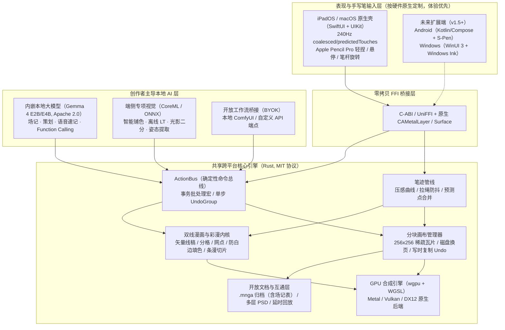

# About-Paint-Tools

> **基于 MIT 开源协议、面向 iPad 触控与 Apple Pencil 的二次元漫画创作工具——融合专业漫画工作流与「创作者主导（Artist-in-the-Loop）」端侧 AI 辅助工具集。**

**文档语言 / Languages**: [English](./README.md) | **简体中文**

[](./LICENSE)
[](#技术架构概览)
[](./docs/zh-CN/05-i18n-and-l10n-guide.md)

---

## 项目愿景与定位

当前 iPad 上的二次元漫画/插画创作者长期面临工具断层：

- **Procreate** 触控手感与低延迟 Metal 性能堪称标杆，但严重缺乏专业漫画能力（无真正矢量线稿层、无矢量交点橡皮、无分格文件夹、无非破坏性网点纸与多页连载管理）。
- **Clip Studio Paint (CSP)** 是漫画行业标准，但 iPad 版强制订阅制且桌面移植 UI 繁杂拥挤。
- **ibisPaint X / MediBang Paint** 轻快易用、填色顺手，但免费版广告与会员墙割裂体验且全闭源。
- **Krita** 是最强的开源绘画软件，但因采用 **GPLv3 协议** 与 Apple App Store 条款冲突，至今无法登陆 iPadOS。

**About-Paint-Tools** 从第一行代码起即采用宽松的 **MIT 开源协议**，确立首阶段 **黑白页漫（日漫/同人本）× 全彩条漫/二次元插画 双线并重**，融合三大核心价值：
1. **Procreate 级的 iPad 触控与 Apple Pencil Pro 手感**（目标延迟 `≤ 9ms`、240Hz 触摸合并与预测点、轻捏径向盘、悬停预览、笔杆旋转）。
2. **双线并重的专业漫画与赛璐璐工作流**（黑白页漫：B4 600DPI 模板、矢量线稿 + 交点橡皮、分格文件夹、GPU 程序化网点；全彩条漫/插画：12+ 混合模式、闭口识别防白边填色、超长条漫预览与一键切片、多层 PSD 互通）。
3. **「创作者主导」的内嵌本地 AI 驱动中心（Gemma 4 E2B/E4B + 端侧视觉）**——基于 **Apache 2.0 协议的 Gemma 4 轻量版**在 iPad 本地离线驱动**智能场记（支持手不离笔语音速记）**、**分镜/剧情策划与 5 语言台词润色**以及**复杂重复批处理工作流（Function Calling → `ActionBus`）**，配合端侧语义铺底色、离线 LT 转线与赛璐璐二分阴影——**坚持本地优先、画作零上传、绝不用于训练**。

---

## 技术架构概览

为确保**「不同硬件上的用户体验为先」**（守住 iPad 9ms 笔尖延迟与 Apple Pencil Pro 特性，同时为未来扩展 macOS / Android 平板 / Windows 预留前瞻能力），本项目摒弃「用单一跨平台 UI 框架（如 Flutter）强行包裹绘图画布」的路线，采用**「薄原生壳 + 共享 Rust 核心引擎」**架构：



---

## 分阶段版本路线图

- **Pre-1.0 系列（`v0.1` – `v0.9`）——黑白页漫 × 全彩条漫/插画 双线基础框架**
  - `v0.1`：`256×256` 稀疏分块画布内核、240Hz Apple Pencil 输入、B4 600DPI & 条漫画布预设、双基准（`en`/`zh-Hans`）i18n 基座
  - `v0.2`：笔刷盖章引擎、压感/倾斜/笔杆旋转曲线、实时拉绳防抖、8 支双线核心笔刷预设（G 笔/圆笔/平涂笔等）
  - `v0.3`：图层树、剪切蒙版、Alpha 锁定、参考图层、12+ 赛璐璐混合模式、Tile 级写时复制撤销/重做
  - `v0.4`：套索/魔棒选区、**闭口识别 + 边缘扩张防白边油漆桶**、自由变换与基础液化
  - `v0.5`：**矢量线稿图层**、**矢量交点橡皮擦**、对称尺与 1/2/3 点透视尺
  - `v0.6`：分格框文件夹、非破坏性 GPU 网点纸、中/日文竖排与英/西横排气泡、**条漫手机预览与一键切片导出**
  - `v0.7`：开源 `.mnga` 文档格式（含场记扩展表）、多层 PSD 互通、延时回放、**确定性 `ActionBus` 命令总线**
  - `v0.8`：Apple Pencil Pro 轻捏径向盘、悬停预览、参考图小窗、**5 语言应用内即时切换**
  - `v0.9`：B4 600DPI & `1600×25600` 条漫磁盘换页压测、5 语言分屏 UI 防截断巡检、TestFlight 公开 Beta
- **1.x 正式版系列（`v1.0` – `v1.5+`）——整体 UI 升级 + 内嵌 Gemma 4 本地 AI 驱动 + 跨端生态**
  - `v1.0`：全新设计系统与双工作区一键切换（*专注插画/条漫模式* vs *专业漫画工作台模式*）+ 5 语言排版精调定稿
  - `v1.1`：**内嵌本地 Gemma 4 E2B/E4B**（离线智能场记含语音速记 + 分镜/剧情策划 + 5 语言台词润色）+ 端侧智能铺底色 & 离线 LT 转线
  - `v1.2`：**Gemma 4 Function-Calling 批处理驱动**（通过 `ActionBus` 执行复杂重复工作流）+ 风格保留草稿清稿矢量化 + 3D 光源球赛璐璐二分
  - `v1.3`：轻量 3D 二次元比例人偶 + 多页章节对页视图与条漫分集工程管理
  - `v1.4`：**Gemma 4 视觉场记穿帮巡检** + 本地 ComfyUI / BYOK 桥接插件
  - `v1.5+`：macOS、Android 平板、Windows 原生壳扩展 + Lua/WASM 社区插件生态

---

## 项目文档索引（中英双语 1:1 镜像）

项目文档以**英文版**与**中文简体版**作为双基准源同步维护：

| 文档主题 | 简体中文 | English |
| :--- | :--- | :--- |
| 01. 市场竞品调研与二次元痛点分析 | [01-market-research.md](./docs/zh-CN/01-market-research.md) | [01-market-research.md](./docs/en/01-market-research.md) |
| 02. 技术架构选型与平台对比（RFC） | [02-architecture-and-tech-stack.md](./docs/zh-CN/02-architecture-and-tech-stack.md) | [02-architecture-and-tech-stack.md](./docs/en/02-architecture-and-tech-stack.md) |
| 03. AI 辅助创作者工具集规格（含 Gemma 4） | [03-ai-assistant-spec.md](./docs/zh-CN/03-ai-assistant-spec.md) | [03-ai-assistant-spec.md](./docs/en/03-ai-assistant-spec.md) |
| 04. 分阶段开发规划（`v0.1`–`v1.x`） | [04-roadmap.md](./docs/zh-CN/04-roadmap.md) | [04-roadmap.md](./docs/en/04-roadmap.md) |
| 05. 5 语言国际化与界面适配规范 | [05-i18n-and-l10n-guide.md](./docs/zh-CN/05-i18n-and-l10n-guide.md) | [05-i18n-and-l10n-guide.md](./docs/en/05-i18n-and-l10n-guide.md) |
| 06. 开发任务细化清单（WBS） | [06-development-tasks.md](./docs/zh-CN/06-development-tasks.md) | [06-development-tasks.md](./docs/en/06-development-tasks.md) |

---

## 仓库目录结构

```text
About-Paint-Tools/
├── LICENSE                      # MIT 开源许可证
├── README.md                    # 英文主页（GitHub 默认入口）
├── README.zh-CN.md              # 简体中文主页
├── docs/
│   ├── zh-CN/                   # 简体中文基准文档
│   └── en/                      # 英文基准文档（1:1 镜像）
├── i18n/
│   ├── glossary.json            # 二次元绘画专业术语 5 语词典
│   └── locales/                 # en, zh-Hans（双基准）+ zh-Hant, yue-Hant, es
├── scripts/
│   └── i18n_check.py            # CI 词条完整性、占位符与西语长度预警校验
├── core/                        # v0.1 Rust 跨平台画布核心引擎（MIT）
│   └── manga-core/              # 稀疏分块画布、拉绳防抖、写时复制撤销栈
└── apps/
    └── ipad/                    # v0.1 iPadOS 原生 SwiftUI/UIKit 壳骨架
```

---

## 快速本地校验（v0.1 基座）

```bash
# 1. 校验 5 语言词条对齐、占位符一致性与西语短文案长度预算
python3 scripts/i18n_check.py

# 2. 运行 v0.1 Rust 核心引擎单元测试（稀疏瓦片、拉绳防抖、写时复制撤销）
cargo test --manifest-path core/Cargo.toml
```

---

## 开源协议

本项目基于 [MIT License](./LICENSE) 开源。为保证 iPadOS App Store 合规分发及社区自由商用/二次开发，所有第三方依赖均严格限定于 MIT / Apache-2.0 / BSD / Zlib 兼容协议，严禁引入 GPL/AGPL 依赖。
