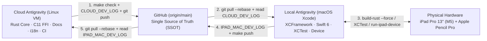

# 11. 云端 Agent × 端侧 Xcode Agent 双代理协同机制规范（中英对照版）
# 11. Cloud Agent × Local Xcode Agent Dual-Agent Collaboration Spec (Bilingual Side-by-Side Edition)

**版本导航 / Editions**: [简体中文版](../zh-CN/11-cloud-local-dual-agent-collaboration.md) | [English Edition](../en/11-cloud-local-dual-agent-collaboration.md) | **中英并排对照版 / Bilingual Side-by-Side Edition**

> **可复用技能 / Reusable Skill**: [`skills/cloud-local-dual-agent-collab/SKILL.md`](../../skills/cloud-local-dual-agent-collab/SKILL.md)（已同步注册为全局 Antigravity Skill：`cloud-local-dual-agent-collab` / Registered globally as Antigravity Skill `cloud-local-dual-agent-collab`）

---

## 1. 架构拓扑与角色分工 / Architecture Topology & Role Division

| 中文规范说明 (Simplified Chinese) | English Technical Specification |
| :--- | :--- |
| **1.1 为什么采用“云-端双 Agent 对等协同”** 跨平台原生创作软件（Rust 核心引擎 + Apple iPadOS/macOS 原生壳）天然跨越 Linux 与 macOS/iPadOS 两种物理环境。单靠云端无法编译 Xcode、调试 Metal 与验证 Apple Pencil Pro 240Hz 真机手感；单靠本地 IDE 又容易在跨语言架构、多语文档与全量 CI 上分散精力。通过 GitHub 作为唯一事实源，让**云端 Agent 专攻内核与全局治理、端侧 Agent 专攻原生编译与真机打磨**，实现 1+1 > 2 的零摩擦协同。 | **1.1 Why Peer-to-Peer Cloud × Local Dual-Agent Collaboration** Cross-platform native creative apps (Rust core + Apple iPadOS/macOS native shells) inherently span Linux and macOS/iPadOS hardware boundaries. Cloud alone cannot invoke Xcode, debug Metal, or verify 240Hz Apple Pencil Pro feel on a physical iPad Pro; Local IDE alone loses focus on cross-language architecture, bilingual docs, and full CI. Using GitHub as Single Source of Truth lets the **Cloud Agent own core engines & governance** while the **Local Agent owns native SDK compilation & real-device ergonomics**. |
| **1.2 黄金职责边界** - **云端 Antigravity（Linux VM）**：系统架构、`core/manga-core`（Rust）、C11 FFI 头文件、Rust 单测与 Feature 裁剪、Swift 跨平台骨架、5 语言 i18n、中英双语文档与 CI 校验。 - **端侧 Antigravity（macOS Xcode）**：3 切片 `MangaCore.xcframework` 重建、Swift 6 严格并发与 iOS/macOS SDK 细节修复、XCTest 实机运行、`LocalSigning.xcconfig` 真机签名部署、iPad Pro 触控/手势/UI 现场打磨。 | **1.2 Clear Responsibility Boundaries** - **Cloud Antigravity (Linux VM)**: Architecture, `core/manga-core` (Rust), C11 FFI headers, Rust unit tests & feature slicing, cross-platform Swift scaffolding, 5-locale i18n, bilingual docs, and CI checks. - **Local Antigravity (macOS Xcode)**: 3-slice `MangaCore.xcframework` builds, Swift 6 strict-concurrency & iOS/macOS SDK fixes, live XCTests, `LocalSigning.xcconfig` physical device signing/deployment, and live iPad Pro touch/gesture/UI polish. |

---

## 2. 两种互补协同模式 / Two Complementary Collaboration Modes

| 维度 / Dimension | 中文说明 (Simplified Chinese) | English Technical Specification |
| :--- | :--- | :--- |
| **模式 A：交互式双 Agent 接力** *Mode A: Interactive Dual-Agent Handoff* | **主力模式**，适用于活跃 UI 与真机手感迭代（如 `v1.0.0-rc4+` → `v1.0.0-rc5`）。云端与端侧交替开发，通过**双向单写日志**（`CLOUD_DEV_LOG.md` ↔ `IPAD_MAC_DEV_LOG.md`）+ 人类转发结构化交接指令完成闭环；端侧改动一律用 **`make push MSG="..."`** 提交。 | **Primary mode** for active feature work and device ergonomics polish (`v1.0.0-rc4+` → `v1.0.0-rc5`). Both agents alternate turns via **Dual One-Way Dev Logs** (`CLOUD_DEV_LOG.md` ↔ `IPAD_MAC_DEV_LOG.md`) and structured user-relayed handoff prompts; Local always commits & pushes via **`make push MSG="..."`**. |
| **模式 B：无人值守 `GoNext` 接力** *Mode B: Autonomous `GoNext` Relay* | **批量验证模式**，适用于夜间自动跑 10–20 轮构建与 XCTest。云端只写 `ops/relay/orders/*.json`，Mac 只写 `ops/relay/results/*.result.md`，内置 `MAX_MIN` / `MAX_ORDERS` / `MAX_FAILS` / `DUPLICATE_ERROR_LOOP` 五层熔断护栏。 | **Batch verification mode** for 10–20 unattended overnight build/test cycles. Cloud writes only `ops/relay/orders/*.json`; Mac writes only `ops/relay/results/*.result.md`, guarded by 5-layer circuit breakers (`MAX_MIN`, `MAX_ORDERS`, `MAX_FAILS`, `DUPLICATE_ERROR_LOOP`). |
| **命令边界铁律** *Trigger Boundary Rule* | **严禁在端侧主动改过代码后执行 `make gonext`！** `make gonext` 仅拉取执行云端白名单任务单；端侧代码回传必须使用 `make push`（或 `git commit && git push`）。 | **NEVER run `make gonext` after local code edits!** `make gonext` strictly executes Cloud-dispatched allowlisted orders; active local edits must be pushed via `make push` (or `git commit && git push`). |

---

## 3. 五大核心工程护栏 / Five Core Engineering Guardrails

| 机制 / Mechanism | 中文深度规范 (Simplified Chinese) | English Technical Specification |
| :--- | :--- | :--- |
| **3.1 双向单写日志** *Dual One-Way Logs* | 云端**只写** [`ops/cloud-dev-log/CLOUD_DEV_LOG.md`](../../ops/cloud-dev-log/CLOUD_DEV_LOG.md)，端侧**只写** [`ops/local-dev-log/IPAD_MAC_DEV_LOG.md`](../../ops/local-dev-log/IPAD_MAC_DEV_LOG.md)，双方对对方日志严格只读。放在 `ops/` 下既实现**结构性零合并冲突**，又天然免受 `docs/` 双语镜像门禁阻塞。 | Cloud writes ONLY [`ops/cloud-dev-log/CLOUD_DEV_LOG.md`](../../ops/cloud-dev-log/CLOUD_DEV_LOG.md); Local writes ONLY [`ops/local-dev-log/IPAD_MAC_DEV_LOG.md`](../../ops/local-dev-log/IPAD_MAC_DEV_LOG.md); each treats the peer's log as read-only. Keeping logs under `ops/` guarantees **structural zero merge conflicts** and avoids blocking on `docs/` bilingual parity checks. |
| **3.2 FFI 重建强信号** *Explicit FFI Rebuild Signal* | 仅改 Swift 时 SHA-256 指纹让 Rust 构建 `< 50ms` 跳过；一旦云端改动了 `core/manga-core/` 或 `manga_core.h`，必须在 `CLOUD_DEV_LOG.md` 醒目标注 `build-rust --force`，通知端侧第一步先执行 `./scripts/dev.sh build-rust --force && ./scripts/dev.sh xcode-gen`，杜绝旧静态库符号缺失。 | Pure Swift edits skip Rust in `< 50ms` via SHA-256 fingerprinting; whenever Cloud changes `core/manga-core/` or `manga_core.h`, Cloud MUST prominently flag `build-rust --force` in `CLOUD_DEV_LOG.md` so Local runs `./scripts/dev.sh build-rust --force && ./scripts/dev.sh xcode-gen` first, preventing stale-library undefined-symbol errors. |
| **3.3 持久化签名隔离** *Persistent Local Signing* | 受追踪的 [`BaseSigning.xcconfig`](../../apps/apple/BaseSigning.xcconfig) 通过 `#include? "LocalSigning.xcconfig"` 加载被 `.gitignore` 忽略的个人签名配置（`make ipad-setup-signing TEAM_ID=...`）。个人 Team ID 绝不入库，且反复 `xcodegen` 永不掉签名。 | Tracked [`BaseSigning.xcconfig`](../../apps/apple/BaseSigning.xcconfig) conditionally includes gitignored `LocalSigning.xcconfig` (`#include? "LocalSigning.xcconfig"`, generated via `make ipad-setup-signing TEAM_ID=...`). Personal Team IDs never enter Git and survive every `xcodegen` regeneration. |
| **3.4 回合纪律与临时分支兜底** *Turn Discipline & Temp Branch Fallback* | 交棒方在对方完成验证回传前不向 `main` 抢推，保证 `fast-forward`。若偶发双方同时改了同一文件，端侧直接推临时分支 `local/<slug>`（不在本地硬 rebase），由云端拉取择优合并后删掉临时分支，零风险零丢改动。 | The handing-off agent pauses pushing to `main` until the peer completes its turn for clean fast-forwards. If both edit overlapping files simultaneously, Local pushes to `local/<slug>` without rebasing, Cloud reconciles and merges cleanly into `main`, then deletes the temporary branch. |
| **3.5 跨平台宏与产物卫生** *Platform Guards & Artifact Hygiene* | `Shared/Sources/` 严禁出现未包裹 `#if canImport(...)` / `#if os(...)` 的 `UIKit`/`AppKit` 符号；严禁 `git add -f` 提交 `.xcodeproj/`、`Frameworks/`、`DerivedData/` 或 `LocalSigning.xcconfig`。 | Never place unguarded `UIKit`/`AppKit` symbols in `Shared/Sources/` (always wrap with `#if canImport(...)` / `#if os(...)`); never `git add -f` `.xcodeproj/`, `Frameworks/`, `DerivedData/`, or `LocalSigning.xcconfig`. |

---

## 4. 真实实战闭环记录 / Battle-Tested Execution Casebook (`v1.0.0-rc4+` → `v1.0.0-rc5`)

| 回合 / Turn | 发起方 / Actor | 提交 / Commit | 中文实绩 (Chinese Summary) | English Summary |
| :--- | :--- | :--- | :--- | :--- |
| **Turn 1** | 端侧 → 云端 | `b7c4c70` | 端侧本地改了 `project.yml` 与 11 尺寸星月 AppIcon，通过临时分支 `local/ipad-pro-deploy` 零冲突合入 `main`。 | Local edits to `project.yml` and 11-size AppIcon assets reconciled losslessly via temp branch `local/ipad-pro-deploy`. |
| **Turn 2** | 端侧 → 云端 | `e3eeb98` | 端侧完成 5 项 iPad Pro 真机体验打磨（套索选区栏、聚焦属性栏、双指平移、`S2+S3` 同屏双创、吸色放大镜），写入 `IPAD_MAC_DEV_LOG.md` 并提出 Rust 局部变形需求。 | Local shipped 5 iPad Pro UX upgrades (Lasso bar, focused tuning bar, 2-finger pan, Dual Split, Eyedropper Loupe), logging a Rust Floating Transform request in `IPAD_MAC_DEV_LOG.md`. |
| **Turn 3** | 云端 → 端侧 | `01d93c2` | 云端新增 2 个 Rust C11 FFI（局部浮动变形 + 相册导入图层）、双指旋转与多画布画廊，73/73 Rust 单测通过并写 `CLOUD_DEV_LOG.md` 标注 `build-rust --force`。 | Cloud delivered 2 new Rust C11 FFI APIs (Floating Transform + RGBA Photo Import), 2-finger rotation, and Multi-Canvas Gallery (73/73 Rust tests passing), flagging `build-rust --force` in `CLOUD_DEV_LOG.md`. |
| **Turn 4** | 端侧 → 云端 | `74ca465` | 端侧重编 3 切片 `XCFramework`，秒修 1 处 Swift 枚举名（`.webtoonStrip800`），**48/48 Apple Silicon XCTest 全绿**并成功装机物理 iPad Pro 13" (M5)。 | Local force-rebuilt 3-slice `XCFramework`, fixed a 1-line enum typo (`.webtoonStrip800`), passed **48/48 Apple Silicon XCTests**, and deployed to physical iPad Pro 13" (M5). |

---

## 5. 标准交接提示词模板 / Ready-to-Copy Handoff Prompt Templates

| 交接方向 / Direction | 中文标准模板 (Chinese Prompt) | English Standard Prompt |
| :--- | :--- | :--- |
| **云端 → 端侧 Xcode Agent** *Cloud → Local IDE* | `云端已完成 <阶段>（提交 <SHA>）并记录在 ops/cloud-dev-log/CLOUD_DEV_LOG.md。请你：1. git pull --rebase 并阅读 CLOUD_DEV_LOG.md 最新一条；2. [若改过 core/FFI] 执行 ./scripts/dev.sh build-rust --force && ./scripts/dev.sh xcode-gen；3. 验证全 Target Swift 6 零报错与全量 XCTests，修正任何 SDK/真机细节，用本地 LocalSigning.xcconfig 部署到真机（make run-ipad-device）；4. 将实测结果与后续需求追加到 ops/local-dev-log/IPAD_MAC_DEV_LOG.md（勿改 CLOUD_DEV_LOG.md），核验无个人 Team ID 入库后执行 make push MSG="..."（勿执行 make gonext）。` | `Cloud pushed <milestone> (commit <SHA>) and logged details in ops/cloud-dev-log/CLOUD_DEV_LOG.md. Please: 1. Run git pull --rebase and read the top CLOUD_DEV_LOG.md entry; 2. [If core/FFI changed] Run ./scripts/dev.sh build-rust --force && ./scripts/dev.sh xcode-gen; 3. Build all native targets cleanly under Swift 6, pass all XCTests, fix any SDK/device nuances, and deploy via make run-ipad-device using gitignored LocalSigning.xcconfig; 4. Append results & Cloud follow-ups to ops/local-dev-log/IPAD_MAC_DEV_LOG.md (do NOT edit CLOUD_DEV_LOG.md), verify no personal TEAM_ID is tracked, and push with make push MSG="..." (do NOT run make gonext).` |
| **端侧 → 云端 Agent** *Local IDE → Cloud* | `端侧 Xcode Agent 已完成本轮真机优化/验证并推至 origin/main（提交 <SHA>），详情已记入 ops/local-dev-log/IPAD_MAC_DEV_LOG.md。请先 git pull --rebase 并读取端侧日志最新一条，核查跨平台宏隔离后，继续推进日志里列出的云端内核/架构配合项。` | `Local Xcode Agent finished device polish/verification and pushed commit <SHA> to origin/main, logged in ops/local-dev-log/IPAD_MAC_DEV_LOG.md. Please run git pull --rebase, read the latest local dev log entry, audit cross-platform guards, and proceed with the requested Cloud core/architecture follow-ups.` |

---

## 6. 核心工程术语双语词表 / Core Bilingual Engineering Glossary

| 中文术语 | English Term | 简明释义 / Concise Definition |
| :--- | :--- | :--- |
| 唯一事实源 | Single Source of Truth (SSOT) | GitHub `origin/main` 作为云端与端侧共享的权威状态基准。 |
| 双向单写日志 | Dual One-Way Append-Only Dev Logs | 云端只写 `CLOUD_DEV_LOG.md`、端侧只写 `IPAD_MAC_DEV_LOG.md`，结构性杜绝合并冲突。 |
| FFI 重建信号 | FFI Rebuild Signaling | 当原生静态库/C 头文件变更时，显式要求端侧执行 `build-rust --force` 的交接标记。 |
| 持久化本地签名覆盖 | Persistent Local Signing Override | 通过受追踪 `BaseSigning.xcconfig` 条件包含 `.gitignore` 的 `LocalSigning.xcconfig`。 |
| 回合纪律 | Turn Discipline | 交棒方在对方回传前暂停推送 `main`，保持无冲突 `fast-forward`。 |
| 临时分支兜底合流 | Temporary Branch Reconciliation | 并发编辑冲突时，端侧推送 `local/<slug>` 由云端择优合入 `main` 并清理临时分支。 |
| 跨平台宏隔离 | Platform-Guard Isolation | 用 `#if canImport(...)` / `#if os(...)` 防止 `UIKit`/`AppKit` 符号泄漏进共享源码。 |
| 双模式协同 | Dual-Mode Orchestration | 活跃打磨走模式 A（双 Agent 交互接力），批量无人回归走模式 B（`GoNext` GitOps）。 |
