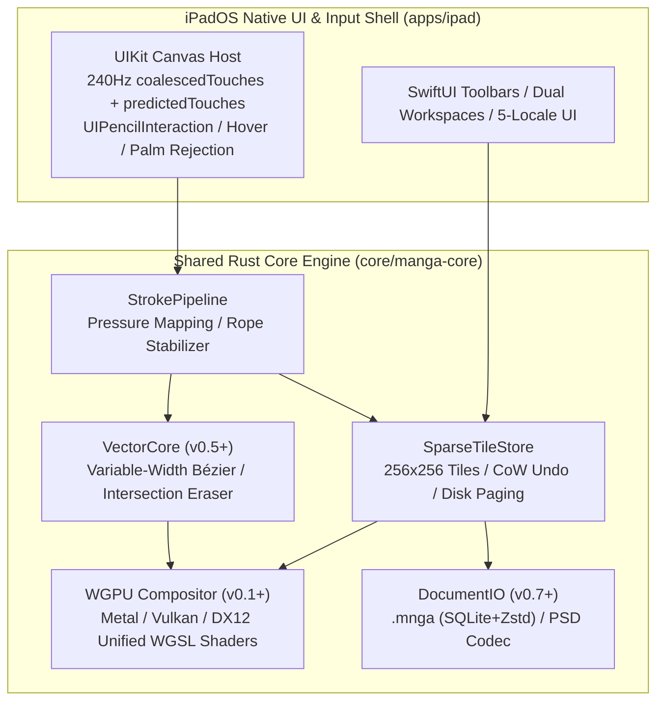

# 02. Technical Architecture & Cross-Platform RFC

**Language / 语言**: **English** | [简体中文](../zh-CN/02-architecture-and-tech-stack.md)

---

## 1. Why Drawing Apps Differ Fundamentally from Standard Apps

Evaluating technology stacks for an iPad manga studio (especially **Pure Native iPadOS** vs **Flutter**) requires judging against four non-negotiable graphics & hardware criteria rather than standard CRUD app benchmarks:

1. **Pencil-to-Photon Latency (`≤ 9ms` target on 120Hz ProMotion)**: Requires direct UIKit 240Hz `coalescedTouches`, live rendering of `predictedTouches`, and deferred pressure/altitude refinement via `estimatedPropertiesExpectingUpdates`.
2. **Apple Pencil Pro Hardware Primitives**: Hover preview (`UIHoverGestureRecognizer`), Squeeze (`UIPencilInteraction`), Barrel Roll (`rollAngle`), haptic confirmation, and OS-grade Palm Rejection.
3. **Tiled GPU Canvas & Virtual Memory Paging**: A B4 600DPI print manga page is `6071 × 8598` pixels (~400MB per RGBA16F layer; 30 layers exceed 12GB RAM). A sparse `256×256` tile pool, Copy-on-Write (CoW) undo snapshots, and disk paging are mandatory — generic 2D UI canvas APIs cannot sustain this workload.
4. **Hardware-Specific Ergonomics**: iPad (no stylus side button; relies on screen gestures + Pencil Squeeze), Android tablets (S-Pen / M-Pencil side button + Android `FrontBufferedRenderer`), and desktop pen displays (dense keyboard shortcuts + WinTab/Windows Ink) demand distinct UI paradigms.

---

## 2. Three-Way Architectural Comparison

| Dimension | Option A: Pure Native iPadOS (`Swift + UIKit/SwiftUI + Metal`) | Option B: Pure Flutter (`Dart + Impeller + Plugins`) | **Option C (Recommended): Thin Native Shell + Shared Rust Core** (`iPadOS Native Shell` + `Rust + wgpu Core Engine`) |
| :--- | :--- | :--- | :--- |
| **Apple Pencil Latency & Feel** | ⭐⭐⭐⭐⭐ **Best-in-Class (`≤ 9ms`)** Direct `UITouch` 240Hz coalesced & predicted touches to `CAMetalLayer` | ⭐⭐ **Structural Bottleneck** Flutter exhibits 3–4 frame input latency on 120Hz iPads (`flutter#175790`); `predictedTouches` is unexposed; heavy canvases still force native `PlatformView`/`Texture` escape hatches | ⭐⭐⭐⭐⭐ **Best-in-Class (`≤ 9ms`)** Native UIKit captures 240Hz raw & predicted samples directly into Rust and presents straight to `CAMetalLayer` via `wgpu` (zero-overhead Metal backend) |
| **Apple Pencil Pro Support** | ⭐⭐⭐⭐⭐ **Day-Zero Native** Squeeze, Hover, Barrel Roll, Haptics out of the box | ⭐⭐ **Lagging & Fragile** Relies on third-party plugins; edge bugs such as Hover misreporting as mouse (`flutter#195249`) | ⭐⭐⭐⭐⭐ **Day-Zero Native** UI shell is pure SwiftUI/UIKit with immediate access to new Apple hardware APIs |
| **High-DPI Canvas & Memory** | ⭐⭐⭐⭐⭐ **Top-Tier** Full control over Metal shaders and texture memory | ⭐⭐⭐ **Constrained** Dart `CustomPainter` cannot handle 600DPI multi-layer canvases; `Texture` bridging adds compositing overhead and splits native maintenance | ⭐⭐⭐⭐⭐ **Top-Tier** Deterministic Rust memory (no GC pauses); `wgpu` compiles unified WGSL shaders to Metal (iPad/Mac), Vulkan (Android), and DX12 (Windows) |
| **Future Cross-Platform Reach** *(macOS / Android / Windows)* | ⭐⭐ **Apple-Only** Fast macOS expansion, but porting to Android/Windows requires rewriting the core engine | ⭐⭐⭐⭐⭐ **Maximum UI Sharing** Single Dart UI codebase, but forcing one UI across touch tablets and mouse/keyboard desktops hurts ergonomics on both | ⭐⭐⭐⭐ **80% Shared Core + 100% Native UX** Document model, tile paging, brush stabilizer, vector lineart, screentones, and PSD I/O live once in Rust; each platform keeps a thin native UI shell |
| **On-Device AI Integration** | ⭐⭐⭐⭐⭐ **Excellent** Zero-copy CoreML / Core AI on Apple Neural Engine (~10× lower power) | ⭐⭐ **High Friction** Copying large textures across MethodChannel/FFI risks OOM | ⭐⭐⭐⭐⭐ **Excellent** Unified `AIProvider` trait: CoreML/Core AI on Apple, NNAPI on Android, ONNX Runtime / ComfyUI on Desktop |
| **Initial 0.x Velocity** | ⭐⭐⭐⭐⭐ **Fastest iPad MVP** Single language (Swift + MSL) with world-class Xcode/Metal debugging | ⭐⭐⭐ **Fast UI, Deep Canvas Pitfalls** Fast toolbar prototyping, followed by complex native canvas bridging | ⭐⭐⭐ **Moderate Initial Setup, Huge Long-Term Leverage** Requires `Swift ↔ Rust (C-ABI / UniFFI)` glue up front, paying off massively from `v0.5` onward |

### 2.1 Why Option C Wins Under "Hardware UX First"

> **Core Principle**: **Unify the engine core across platforms** (identical brush math, vector curves, and `.mnga` file fidelity), **but specialize the UI & stylus shell natively for every hardware class**.

- **Why Not Flutter**: Even with Impeller, Flutter cannot bypass iPadOS stylus latency requirements or high-DPI GPU tile management without pushing the canvas back into native code — negating Flutter's primary benefit while adding cross-layer latency and maintenance complexity.
- **Pragmatic Option A Fallback**: A solo Swift engineer targeting a rapid 3-month `v0.1–v0.3` iPad prototype may start in pure Swift + Metal as long as document state, stroke math, and file formats remain strictly decoupled from UIKit/SwiftUI views for future extraction.

---

## 3. Layered System Architecture

### 3.1 Target Performance & Memory Budgets

| Metric | Target (iPad Pro M2/M4, 8GB–16GB RAM) | Engineering Strategy |
| :--- | :--- | :--- |
| Stylus-to-Photon Latency | `≤ 9ms` (120Hz ProMotion) | 240Hz coalesced sampling + predicted overlay + lock-free render thread |
| Frame Budget | `< 8.33ms` | Dirty-tile-only compositing (`DirtyTileRect`), avoiding full-canvas redraws |
| Tile Geometry | `256 × 256` RGBA8 / RGBA16F | Sparse allocation (empty tiles consume 0 bytes); Zstd cold-tile disk paging |
| Undo/Redo Footprint | `< 150MB` across 100 steps | Reference-counted Copy-on-Write tile snapshots storing only modified tiles per stroke |

---

## 4. MIT Dependency Compliance Policy

CI enforces strict license auditing so the project stays legally distributable on the Apple App Store and freely reusable:

| Policy | Licenses | Approved Examples |
| :--- | :--- | :--- |
| **✅ Permitted** | MIT, Apache-2.0, BSD-2/3, Zlib, ISC, MPL-2.0 (file-level) | Rust `wgpu`, `kurbo`, `tiny-skia`, `zstd`, `rusqlite`, `uniffi`; `ONNX Runtime` (MIT); Apple system frameworks (Metal, UIKit, SwiftUI, CoreML, Core AI) |
| **❌ Prohibited** | GPLv2, GPLv3, AGPL, static-linked LGPL on iOS, proprietary SDKs | Krita source, GPL MyPaint modules, GPL FFmpeg builds, closed brush engines |

---

## 5. Recommended Development Toolchain

- **Hardware**: Apple Silicon Mac (M2/M3/M4) + physical 120Hz ProMotion iPad with Apple Pencil Pro/2 (**brush feel and pressure curves must always be tuned on real hardware**).
- **Software**:
  - `Xcode` + `Instruments` (Metal System Trace & Allocations profiling)
  - `Rust (cargo, rust-analyzer, clippy)` + `UniFFI` / `cbindgen`
  - `Python 3.12` (powers `scripts/i18n_check.py` localization verification and build automation)
