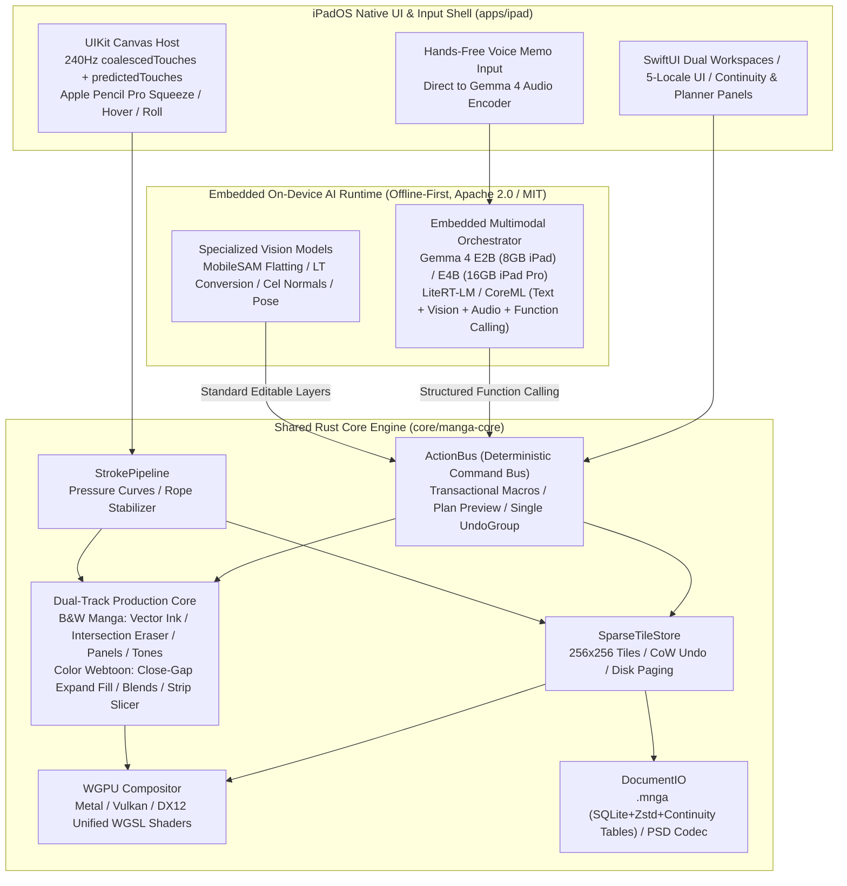

# 02. Technical Architecture & Cross-Platform RFC

**Language / 语言**: **English** | [简体中文](../zh-CN/02-architecture-and-tech-stack.md)

---

## 1. Why Drawing Apps Differ Fundamentally from Standard Apps

Evaluating technology stacks for an iPad manga studio (especially **Pure Native iPadOS** vs **Flutter**) requires judging against four non-negotiable graphics & hardware criteria rather than standard CRUD app benchmarks:

1. **Pencil-to-Photon Latency (`≤ 9ms` target on 120Hz ProMotion)**: Requires direct UIKit 240Hz `coalescedTouches`, live rendering of `predictedTouches`, and deferred pressure/altitude refinement via `estimatedPropertiesExpectingUpdates`.
2. **Apple Pencil Pro Hardware Primitives**: Hover preview (`UIHoverGestureRecognizer`), Squeeze (`UIPencilInteraction`), Barrel Roll (`rollAngle`), haptic confirmation, and OS-grade Palm Rejection.
3. **Tiled GPU Canvas & Virtual Memory Paging**: Phase `0.x` serves **both B&W Page Manga and Full-Color Webtoon/Illustration equally**:
   - **B&W Page Manga**: B4 600DPI print sheets reach `6071 × 8598` pixels with dense vector lineart and procedural screentones.
   - **Full-Color Webtoon & Illustration**: Vertical strips frequently reach `1600 × 25600+` pixels with 30–60 cel-shaded blend/shadow layers.
   A sparse `256×256` tile pool, Copy-on-Write (CoW) undo snapshots, and disk paging are mandatory — generic 2D UI canvas APIs cannot sustain this workload.
4. **Hardware-Specific Ergonomics**: iPad (screen gestures + Pencil Squeeze), Android tablets (S-Pen/M-Pencil side button + Android `FrontBufferedRenderer`), and desktop pen displays (dense keyboard shortcuts + WinTab/Windows Ink) demand distinct native UI shells.

---

## 2. Three-Way Architectural Comparison

| Dimension | Option A: Pure Native iPadOS (`Swift + UIKit/SwiftUI + Metal`) | Option B: Pure Flutter (`Dart + Impeller + Plugins`) | **Option C (Recommended): Thin Native Shell + Shared Rust Core** (`iPadOS Native Shell` + `Rust + wgpu Core Engine`) |
| :--- | :--- | :--- | :--- |
| **Apple Pencil Latency & Feel** | ⭐⭐⭐⭐⭐ **Best-in-Class (`≤ 9ms`)** Direct `UITouch` 240Hz coalesced & predicted touches to `CAMetalLayer` | ⭐⭐ **Structural Bottleneck** Flutter exhibits 3–4 frame input latency on 120Hz iPads (`flutter#175790`); `predictedTouches` is unexposed; heavy canvases still force native `PlatformView`/`Texture` escape hatches | ⭐⭐⭐⭐⭐ **Best-in-Class (`≤ 9ms`)** Native UIKit captures 240Hz raw & predicted samples directly into Rust and presents straight to `CAMetalLayer` via `wgpu` (zero-overhead Metal backend) |
| **Apple Pencil Pro Support** | ⭐⭐⭐⭐⭐ **Day-Zero Native** Squeeze, Hover, Barrel Roll, Haptics out of the box | ⭐⭐ **Lagging & Fragile** Relies on third-party plugins; edge bugs such as Hover misreporting as mouse (`flutter#195249`) | ⭐⭐⭐⭐⭐ **Day-Zero Native** UI shell is pure SwiftUI/UIKit with immediate access to new Apple hardware APIs |
| **High-DPI Canvas & Memory** | ⭐⭐⭐⭐⭐ **Top-Tier** Full control over Metal shaders and texture memory | ⭐⭐⭐ **Constrained** Dart `CustomPainter` cannot handle 600DPI/Webtoon multi-layer canvases; `Texture` bridging adds compositing overhead and splits native maintenance | ⭐⭐⭐⭐⭐ **Top-Tier** Deterministic Rust memory (no GC pauses); `wgpu` compiles unified WGSL shaders to Metal (iPad/Mac), Vulkan (Android), and DX12 (Windows) |
| **Future Cross-Platform Reach** *(macOS / Android / Windows)* | ⭐⭐ **Apple-Only** Fast macOS expansion, but porting to Android/Windows requires rewriting the core engine | ⭐⭐⭐⭐⭐ **Maximum UI Sharing** Single Dart UI codebase, but forcing one UI across touch tablets and mouse/keyboard desktops hurts ergonomics on both | ⭐⭐⭐⭐ **80% Shared Core + 100% Native UX** Document model, tile paging, brush stabilizer, vector lineart, screentones, PSD I/O, and `ActionBus` live once in Rust; each platform keeps a thin native UI shell |
| **On-Device AI & Embedded LLM** | ⭐⭐⭐⭐⭐ **Excellent** Zero-copy CoreML / Core AI / LiteRT-LM integration | ⭐⭐ **High Friction** Copying large textures across MethodChannel/FFI risks OOM | ⭐⭐⭐⭐⭐ **Excellent** Unified `AIProvider` + `ActionBus`: LiteRT-LM/CoreML runs Gemma 4 E2B/E4B on iPad/Mac, AICore/LiteRT-LM on future Android, local/ComfyUI on Desktop |
| **Initial 0.x Velocity** | ⭐⭐⭐⭐⭐ **Fastest iPad MVP** Single language (Swift + MSL) with world-class Xcode/Metal debugging | ⭐⭐⭐ **Fast UI, Deep Canvas Pitfalls** Fast toolbar prototyping, followed by complex native canvas bridging | ⭐⭐⭐ **Moderate Initial Setup, Huge Long-Term Leverage** Requires `Swift ↔ Rust (C-ABI / UniFFI)` glue up front, paying off massively from `v0.5` onward |

### 2.1 Why Option C Wins Under "Hardware UX First"

> **Core Principle**: **Unify the engine core and deterministic `ActionBus` across platforms** (identical brush math, vector curves, `.mnga` fidelity, and AI-driven macros), **but specialize the UI & stylus shell natively for every hardware class**.

---

## 3. Layered System Architecture (with Deterministic `ActionBus` & Embedded Gemma 4)

### 3.1 Strategic Role of the Deterministic `ActionBus`

To allow the embedded **Gemma 4** model to drive complex repetitive workflows safely in `v1.1+` without ever risking canvas corruption, all document & batch mutations route through a typed Rust `ActionBus` starting in **`v0.7–v0.8`**:
- Every command (`CreatePage`, `BatchSetLayerTint`, `RunCloseGapFill`, `ExportWebtoonSlices`) carries a strict JSON Schema, validator, and reversible `UndoGroup`.
- **Gemma 4 never mutates pixel buffers directly**. It emits a structured `ActionPlan` via native Function Calling → the UI displays a human-readable preview bar → the artist taps **Run** → `ActionBus` executes atomically inside one undo step.

### 3.2 Embedded Gemma 4 & High-DPI Canvas Memory Coexistence Budget

| iPad RAM Tier | Recommended Embedded Gemma 4 | Quantized Peak RAM (4-bit) | Memory Coexistence & Jetsam Guard |
| :--- | :--- | :--- | :--- |
| **8 GB RAM** (iPad Air / Base iPad Pro) | **Gemma 4 E2B** (`2.3B` effective params, multimodal + audio + function calling) | ~`1.45 GB` (~`1.5–2.58 GB` disk) | • **Lazy-load + 120s Idle Auto-Unload** (`0 MB` RAM when idle) • Proactively Zstd-pages cold canvas tiles to disk before launching inference • Feeds panel thumbnails rather than raw 600DPI bitmaps to vision context |
| **16 GB RAM** (High-tier M2/M4+ iPad Pro) | **Gemma 4 E4B** (`4.5B` effective params, stronger multi-step planning & tool calling) | ~`3.38 GB` (~`3.65 GB` disk) | • Supports warm residency for instant voice continuity logging • Immediately drops KV cache on iOS `didReceiveMemoryWarning` to protect active artwork |

### 3.3 Canvas Performance & Memory Budgets

| Metric | Target (iPad Pro M2/M4) | Engineering Strategy |
| :--- | :--- | :--- |
| Stylus-to-Photon Latency | `≤ 9ms` (120Hz ProMotion) | 240Hz coalesced sampling + predicted overlay + lock-free render thread |
| Frame Budget | `< 8.33ms` | Dirty-tile-only compositing (`DirtyTileRect`), avoiding full-canvas redraws |
| Tile Geometry | `256 × 256` RGBA8 / RGBA16F | Sparse allocation (empty tiles = 0 bytes); Zstd cold-tile disk paging |
| Undo/Redo Footprint | `< 150MB` across 100 steps | Reference-counted Copy-on-Write tile snapshots storing only modified tiles |

---

## 4. MIT Dependency & Model-Weight Compliance Policy

| Policy | Licenses | Approved Components & Weights |
| :--- | :--- | :--- |
| **✅ Permitted** | MIT, Apache-2.0, BSD-2/3, Zlib, ISC, MPL-2.0 (file-level) | Rust `wgpu`, `kurbo`, `tiny-skia`, `zstd`, `rusqlite`, `uniffi`; `ONNX Runtime` (MIT); **`LiteRT-LM` & `Gemma 4 E2B / E4B` weights (Apache 2.0)**; Apple frameworks (Metal, UIKit, SwiftUI, CoreML, Core AI) |
| **❌ Prohibited** | GPLv2, GPLv3, AGPL, static-linked LGPL on iOS, restrictive commercial model terms | Krita source, GPL MyPaint modules, GPL FFmpeg builds, closed brush SDKs, revenue-capped proprietary weights |

> **Distribution Model**: Gemma 4 weights ship as **opt-in downloadable Model Packs**, keeping the App Store binary lean, preserving full Apache 2.0 attribution, and allowing one-tap deletion at any time.

---

## 5. Recommended Development Toolchain

- **Hardware**: Apple Silicon Mac (M2/M3/M4) + physical 120Hz ProMotion iPad with Apple Pencil Pro/2 (test both 8GB and 16GB tiers for memory coexistence).
- **Software**:
  - `Xcode` + `Instruments` (Metal System Trace, Allocations, Jetsam monitoring)
  - `Rust (cargo, rust-analyzer, clippy)` + `UniFFI` / `cbindgen`
  - `LiteRT-LM` / `CoreML Tools` (Gemma 4 E2B/E4B & vision model conversion/profiling)
  - `Python 3.12` (`scripts/i18n_check.py` and localization/build automation)
