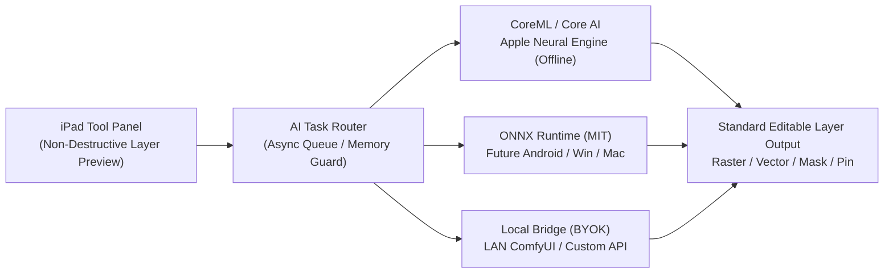

# 03. AI-Assisted Creator Toolset Specification (Artist-in-the-Loop)

**Language / 语言**: **English** | [简体中文](../zh-CN/03-ai-assistant-spec.md)

---

## 1. The Artist-Friendly AI Pledge (Non-Negotiable Guardrails)

Anime and manga creators are understandably skeptical of "one-click prompt generators" that erase personal art style or harvest artwork for cloud training. Every AI capability in this project adheres strictly to four guardrails:

1. **Assist, Never Replace (Artist-in-the-Loop)**: AI targets mechanical, repetitive production chores (flatting, stray-line cleanup, background line extraction, first-pass shadow blocking, continuity QA) while keeping 100% of composition and artistic voice in the artist's hands.
2. **100% Non-Destructive Editable Outputs**: Every AI tool writes into standard, editable **layers, vector paths, masks, or review annotations** — never overwriting the artist's original lineart.
3. **Local-First & Offline by Default**: Core assistant models run directly on Apple Silicon via **CoreML / Core AI (Apple Neural Engine)** — **offline-capable, zero forced cloud uploads, zero subscription fees, zero artwork harvesting**.
4. **Opt-In Modular Downloads + Open Bridge (BYOK)**: The base app stays lean; model packs are downloaded or deleted on demand. Power users may optionally bridge to their own LAN **ComfyUI** server or custom HTTP API.

---

## 2. Six Core AI Assistant Tools (`v1.1` – `v1.4`)

### Tool 1: Semantic One-Tap Multi-Layer Flatting (`v1.1`)
- **Pain Point**: Cel-shading flatting — clicking bucket fill dozens of times, sealing tiny gaps, removing white halos, and manually separating skin/hair/eyes/clothing layers.
- **Workflow**:
  1. Select a marked Reference Lineart layer and trigger **Smart Flatting**.
  2. An on-device segmentation model identifies enclosed/near-enclosed regions and outputs cleanly named flat layers beneath the lineart (Skin, Hair, Eyes, Outfit, Accessories).
  3. Applies 1–2px anti-aliased expansion to eliminate white halos and optionally samples colors from a bound Character Color Sheet.
- **Tech Stack**: Quantized on-device `MobileSAM` / `SAM2-Tiny` (CoreML) combined with morphological gap-closing and color diffusion.

### Tool 2: Offline Photo/3D-to-Manga Background (Open-Source LT Conversion, `v1.1`)
- **Pain Point**: Hand-drawing classrooms, cityscapes, and interiors is exhausting, while CSP's LT conversion sits behind the costly EX subscription.
- **Workflow**:
  1. Import a reference photo or built-in lightweight 3D room angle.
  2. Split automatically into three editable layers: `Background Lineart` (adjustable threshold) + `Procedural Screentone` (non-destructive LPI/angle) + `Solid Black Shadow`.
  3. Artists erase or ink over any area to harmonize seamlessly with their personal style.
- **Tech Stack**: On-device depth/edge estimation (CoreML) + GPU procedural halftone WGSL shader.

### Tool 3: Style-Preserving Sketch Cleanup & Vectorization (`v1.2`)
- **Pain Point**: Rough sketches feel lively, but clean inking strains wrists and naïve auto-tracing destroys line weight rhythm.
- **Workflow**:
  1. Lasso a region or full sketch with the **Cleanup Assist** tool and tune the fidelity slider (*Keep Sketch Texture ↔ Crisp Clean Line*).
  2. Generates a new **editable vector lineart layer** with variable-width Bézier centerlines ready for the vector intersection eraser.
  3. Optional **Gap Radar** softly highlights unclosed `< 4px` line breaks before coloring.

### Tool 4: 3D Light-Sphere Guided Cel Shading (`v1.2`)
- **Pain Point**: Placing consistent shadows and rim lights across 50–80 serialized panels causes severe creative fatigue.
- **Workflow**:
  1. Drag an interactive **3D Light Sphere** directly on canvas with Apple Pencil (azimuth, elevation, softness, shadow tint).
  2. Preview and bake crisp cel-shaded shadows onto a separate `Multiply` layer plus an optional `Screen/Glow` rim-light layer.
- **Tech Stack**: On-device lineart normal-map estimation + real-time Metal/`wgpu` cel-threshold shader.

### Tool 5: Photo/Stick-Figure Pose-to-3D Anime Mannequin (`v1.3`)
- **Pain Point**: Dynamic foreshortening and hands break easily, while realistic 3D pose tools disrupt workflow and clash with anime proportions.
- **Workflow**:
  1. Snap a reference photo or doodle a stick figure; on-device pose estimation aligns a lightweight built-in anime-proportioned 3D mannequin (configurable 5–8 head ratios + hand preset library).
  2. Automatically locks camera focal length and horizon with the canvas 1/2/3-point perspective ruler.

### Tool 6: Continuity Critic & Open Workflow Bridge (`v1.4`)
- **Pain Point**: Missing hairpins, mismatched heterochromia, or missing buttons across chapters; advanced technical artists want to integrate local ComfyUI pipelines.
- **Workflow**:
  1. **AI Editorial Continuity Critic**: Compares the current page against the artist's Character Reference Sheet and drops **dismissible review pins** (e.g., *"Panel 3: left earring missing"*) without ever mutating pixels.
  2. **Open Local Bridge (BYOK / ComfyUI)**: Connects to a user's LAN ComfyUI instance or OpenAI-compatible local endpoint, dispatching the active selection/lineart and importing results onto a fresh layer.

---

## 3. Unified Inference Abstraction (`AIProvider`)

- **Memory Guard (Jetsam Protection)**: On high-DPI canvases (e.g., B4 600DPI), the router automatically crops to the active Panel Frame or selection ROI before dispatching inference so iPadOS never terminates the app for peak memory spikes.
