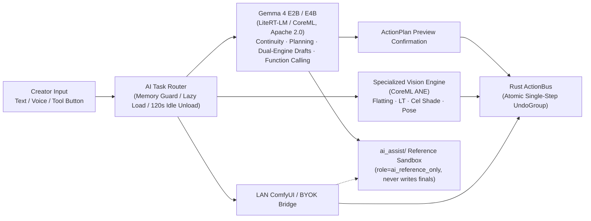

# 03. AI-Assisted Creator Toolset Spec (with Embedded Local Gemma 4 Orchestrator)

**Language / 语言**: **English** | [简体中文](../zh-CN/03-ai-assistant-spec.md)

---

## 1. The Artist-Friendly AI Pledge (Non-Negotiable Guardrails)

Anime and manga creators rightly distrust "one-click prompt generators" that erase artistic identity or harvest artwork for cloud training. Every AI capability in this project obeys four strict rules:

1. **Assist, Never Replace (Artist-in-the-Loop)**: AI handles continuity logging, story planning, repetitive batch execution, and mechanical flatting/line-extraction — never replacing personal composition or brushwork.
2. **100% Non-Destructive & Single-Step Reversible**: Visual tools output standard editable layers, vector curves, or masks; embedded LLM workflows must always present a **reviewable `ActionPlan` preview** and execute inside one atomic `UndoGroup`.
3. **Local-First & Offline by Default**: Both the embedded multimodal model (**Gemma 4 E2B / E4B, Apache 2.0**) and specialized vision models run locally on iPad — **offline-capable, zero cloud uploads, zero subscription fees, zero artwork training**.
4. **Opt-In Model Packs + Open Bridge (BYOK)**: Models download/delete on demand so the base app stays lean; power users may optionally bridge to LAN **ComfyUI** or custom HTTP endpoints.

---

## 2. Pillar One: Embedded Local Multimodal Brain (Gemma 4 E2B / E4B)

Powered by **Gemma 4's Apache 2.0 edge models** (`E2B` for 8GB iPads; `E4B` for 16GB iPad Pros) featuring native **Text + Vision + Audio input, 140+ languages, and native Function Calling**, the app embeds a private, offline **"Assistant Director · Script Supervisor · Workflow Driver"**:

### Capability A: Intelligent Script Supervisor & Continuity Log
Eliminates continuity mistakes and tedious back-referencing across serialized chapters:
- **Structured Continuity Database (persisted inside `.mnga`)**: Tracks per Chapter → Page/Strip → Panel:
  - Cast present, outfit/accessory states (e.g., *"Page 3 onward: right sleeve torn, silver left earring"*);
  - Location, time of day (sunset / night indoor), and primary lighting direction;
  - Prop states and narrative foreshadowing notes.
- **Hands-Free Voice Continuity Dictation**: Leveraging Gemma 4's native audio encoder, artists keep drawing with Apple Pencil while speaking (Mandarin / Cantonese / English / Spanish): *"Continuity note: Panel 5 hero's glasses crack — keep them cracked for the rest of this chapter."* Gemma 4 extracts structured entries directly into the continuity database.
- **Multimodal Visual Continuity Critic**: After inking or flatting, feeds panel thumbnails alongside Character Reference Sheets and prior continuity logs into Gemma 4 Vision, dropping **dismissible review pins** (e.g., *"Panel 4: heroine's hairpin not detected"*) without ever touching canvas pixels.

### Capability B: Story & Storyboard Planner
Bridges the gap from rough plot idea to structured panels and multilingual release:
- **Plot-to-Storyboard Breakdown**: Given a text outline or voice memo, Gemma 4 breaks scenes into structured panel scripts tailored to either **B&W Page Manga pacing (4–6 panels/page with page-turn hooks)** or **Full-Color Webtoon vertical scroll pacing** (shot scale, camera angle, action beats, dialogue, SFX ideas).
- **One-Tap Panel & Bubble Scaffolding**: Upon approval, dispatches `ActionBus` commands to create pages, panel frame folders, and placeholder speech bubble layers ready for immediate sketching.
- **5-Language Dialogue Localization**: Uses Gemma 4's native multilingual fluency to adapt Simplified Chinese/English scripts into natural **Traditional Chinese, authentic Cantonese (including Hong Kong comic cadence), and Spanish**, flagging dialogue length before bubbles overflow.

### Capability C: Repetitive Workflow Driver (Function-Calling Action Engine)
Turns tedious multi-menu manga chores into a single text or voice command → deterministic preview → one-tap execution:

| Natural Language / Voice Command | Deterministic `ActionPlan` Emitted by Gemma 4 Function Calling | Target Track |
| :--- | :--- | :--- |
| *"Create 4 B4 600DPI manga pages with Sketch, VectorInk, Screentone, and Bubble layers."* | `create_pages(count=4, preset="B4_600DPI")` → `batch_create_layers(["Sketch", "VectorInk", "Screentone", "Bubble"])` | B&W Page Manga |
| *"Tint all Sketch layers light blue, set opacity to 30%, and lock them."* | `find_layers(pattern="Sketch*")` → `set_layer_tint("#4DA6FF")` → `set_layer_opacity(0.30)` → `set_layer_lock(true)` | Both Tracks |
| *"For panels 2–5, flat using VectorInk as reference with Sakura's color sheet, then add a clipped Multiply shadow layer."* | `select_panels(2..5)` → `run_smart_flatting(ref="VectorInk", sheet="Sakura", expand_px=2)` → `create_layer("Shadow", blend="Multiply", clipping=true)` | Color Webtoon / Art |
| *"Change all Screentone layers across these 8 pages from 60LPI to 55LPI and export 600DPI PSDs."* | `find_layers(type="Screentone")` → `update_screentone(lpi=55)` → `export_psd(dpi=600)` | B&W Page Manga |
| *"Slice this Webtoon at 800×1280 and export Simplified Chinese, Cantonese, and Spanish editions."* | `for locale in ["zh-Hans","yue-Hant","es"]: toggle_bubble_locale(locale) -> export_webtoon_slices(800, 1280)` | Webtoon + 5-i18n |

> **Safety Guardrail**: Gemma 4 may only invoke whitelisted `ActionBus` schemas; every batch plan displays a **preview confirmation banner** and wraps mutations in one `UndoGroup` so a single two-finger tap reverts everything cleanly.

### Capability D: Dual-Engine Novel × Manga Bidirectional AI Reference Drafts (`v1.0` Core Pillar)
Designed for cross-media creators developing a light novel and manga adaptation in parallel (or drafting one medium first while cross-referencing the other), embedded **Gemma 4 E2B / E4B** drives offline bidirectional reference pipelines:
- **Manga → Novel AI Prose Reference (`Manga → Novel`)**: Opens panel thumbnails, [`script/script.xml`](../../templates/SampleManga/chapters/ch001/script/script.xml) speech bubbles, `scenes/` beat sheets, and `i18n/dictionary.xml` proper nouns **read-only**, generating a side-by-side prose reference draft isolated inside `chapters/chXXX/ai_assist/manga_to_novel/` (accompanied by `meta.xml` recording source revision, timestamp, and model ID).
- **Novel → Manga AI Storyboard/Rough Intermediate (`Novel → Manga`)**: Reads authoritative human prose in `novel/prose/*.md`, `scenes/`, and character sheets **read-only**, breaking prose beats into a structured storyboard & panel placeholder layout (`ai_storyboard_ref.xml`) isolated inside `chapters/chXXX/ai_assist/novel_to_manga/`. Optional visual rough references can later be generated into the same sandbox via built-in 3D mannequin auto-posing or an opt-in local ComfyUI BYOK bridge.
- **Intentional Divergence Friendly**: Supports `decoupledFromManga="true"` and `<DivergenceNote>` inside `chapter.xml` (e.g., *"Novel retains an 800-word rooftop monologue; manga converts it into a silent action sequence"*), so Continuity AI only flags **unintended canon errors** without falsely rejecting intentional cross-medium adaptation.

> **Hard Architectural Red Line (Non-Negotiable Isolation)**:
> 1. Every bidirectional AI intermediate artifact MUST carry `role="ai_reference_only"` and is retained strictly as an authoring reference and creative process artifact.
> 2. Data flows strictly one way — AI pipelines are **hard-blocked from writing into** `novel/prose/` (authoritative human novel finals) or `manuscript/` (authoritative human manga finals), enforced in both the Rust core and CI validator.
> 3. Human-confirmed novel finals and human-confirmed manga finals remain **100% decoupled** and are never required to match each other or any AI intermediate draft.

---

## 3. Pillar Two: Specialized On-Device Vision & Graphics Tools (`v1.1` – `v1.4`)

| Specialized Tool | Primary Track | Capability Summary | On-Device Tech Stack |
| :--- | :--- | :--- | :--- |
| **1. Semantic Multi-Layer Smart Flatting** | Color Webtoon / Art | Splits enclosed regions into Skin/Hair/Eyes/Outfit layers with 1–2px anti-halo expansion and optional Character Color Sheet sampling | Quantized CoreML `MobileSAM` / `SAM2-Tiny` + morphological close-gap fill |
| **2. Offline Photo/3D-to-Manga LT Conversion** | B&W Page Manga | Splits imported photos or 3D interiors into editable `Background Lineart` + `Procedural Screentone (LPI/angle)` + `Solid Black Shadow` | CoreML edge/depth estimation + WGSL procedural halftone shader |
| **3. Style-Preserving Sketch Cleanup & Vectorization** | Both Tracks | Converts rough pencil sketches into editable variable-width **Vector Lineart** while preserving stroke rhythm, plus `< 4px` Gap Radar | Lightweight line extraction + MIT Bézier centerline fitting |
| **4. 3D Light-Sphere Cel Shading Assist** | Color Webtoon / Art | Drag a 3D light sphere directly on canvas to preview & bake crisp `Multiply` cel shadows and `Screen/Glow` rim lights | On-device lineart normal estimation + Metal/`wgpu` cel shader |
| **5. Photo/Stick-Figure Pose-to-3D Anime Mannequin** | Both Tracks | Aligns a built-in 5–8 head anime 3D figure + hand preset library from photos/doodles and syncs focal length with perspective rulers | CoreML lightweight pose estimation + Metal skeletal renderer |
| **6. Open Local Workflow Bridge (BYOK / ComfyUI)** | Power Users | Sends active selections/lineart to a user's LAN ComfyUI or custom HTTP endpoint and imports outputs onto a new layer or `ai_assist/` reference slot | Standard JSON/WebSocket plugin bridge |

---

## 4. Unified On-Device AI Scheduling Architecture

