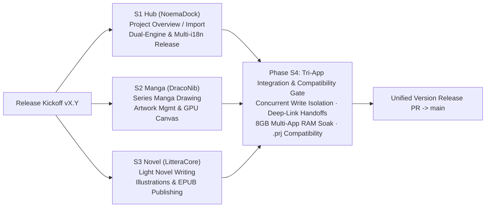

# 04. Phased Development Roadmap (`v0.1–v0.9` → `v1.x`)

**Language / 语言**: **English** | [简体中文](../zh-CN/04-roadmap.md)

---

## 1. Release Strategy Overview (Dual-Track Equal Priority: B&W Page Manga × Full-Color Webtoon/Illustration)

Phase `0.x` formally treats **both anime comic workflows as equal first-class citizens**:

- **Track A — B&W Page Manga (Japanese Manga / Doujinshi)**: B4/A4 600DPI print templates (bleed/crop guides), G-Pen taper & rope stabilizer, vector lineart + vector intersection eraser, panel frame folders, non-destructive GPU screentones, and CJK vertical speech bubbles.
- **Track B — Full-Color Webtoon & Anime Illustration**: Vertical long-strip & 4K illustration presets, full cel-shading blend modes, clipping mask / alpha lock / reference layer workflow, close-gap + edge-expand anti-halo bucket fill, and seamless platform strip slicing.
- **Pre-1.0 Series (`v0.1` – `v0.9`)**: Delivers a complete, ultra-responsive dual-track engine and completes **Wave 1 Apple Trio parity in `v0.8–v0.9` (iPad · Touchscreen MacBook · iPhone Duo foldable)**, alongside deterministic `ActionBus`, CPFF v1.0 `.prj`, and the shared `platform.rs` posture engine.
- **1.x Series (`v1.0` – `v1.5+`)**: Launches `v1.0` simultaneously across all three Wave 1 Apple targets (**Pro UI + Novel × Manga Dual-Engine Studio + Embedded Gemma 4 Bidirectional AI Reference Drafts**), then rolls out **Wave 2 cross-ecosystem touch & foldable builds**: **`v1.1` Android Pad / Foldable Phone** → **`v1.2` Touchscreen Windows Notebook / 2-in-1 Pad** → **`v1.3` Touchscreen Linux Notebook / Pad**, paired with specialized vision AI and plugin ecosystems.

> For granular engineering work packages, task IDs, module ownership, and DoD checklists, see [06. Detailed Engineering Task Breakdown](./06-development-tasks.md).

```mermaid
flowchart LR
    subgraph Pre1["Pre-1.0 (v0.1 - v0.9): Dual Core + Apple Trio (iPad / Touch MacBook / iPhone Duo)"]
        V01["v0.1 Dual Canvas Core"] --> V02["v0.2 Brush & Stabilizer"]
        V02 --> V03["v0.3 Cel Layer Stack"]
        V03 --> V04["v0.4 Selection & Anti-Halo Fill"]
        V04 --> V05["v0.5 Vector Ink & Rulers"]
        V05 --> V06["v0.6 Panels / Tones / Slicer"]
        V06 --> V07["v0.7 .prj / .mnga / ActionBus"]
        V07 --> V08["v0.8 Apple Trio Input & 5-i18n"]
        V08 --> V09["v0.9 Apple Trio Joint Beta"]
    end

    subgraph V1X["1.x Series: Dual-Engine + Gemma 4 + Android / Windows / Linux Expansion"]
        V10["v1.0 Dual-Engine + Apple Trio Launch"] --> V11["v1.1 Android Pad/Fold + Flat/LT"]
        V11 --> V12["v1.2 Windows Touch + Gemma4 Macros"]
        V12 --> V13["v1.3 Linux Touch + 3D Pose"]
        V13 --> V14["v1.4 Vision Critic + ComfyUI"]
        V14 --> V15["v1.5+ 6-Platform Parity & Plugins"]
    end

    V09 --> V10
```

### 1.1 Modular Tri-App Suite & Mandatory "3+1" Per-Version PR Release Discipline

> **Codename Notice**: All Chinese, English, and Spanish names for the three tools below are **working codenames** reserved until final pre-release branding sign-off.

To minimize RAM/VRAM footprint on touch and foldable devices while maximizing creator focus, the suite ships as **three independent tools that run either standalone or concurrently over one CPFF v1.0 (`.prj`) folder**. **Every release `vX.Y` is decomposed into 4 mandatory subprojects — unified PR publication happens only after all 4 pass:**

| Milestone Range | `S1` Hub (`创想空间` / `NoemaDock`, codename) | `S2` Manga (`雕龙` / `DracoNib`, codename) | `S3` Novel (`文心` / `LitteraCore`, codename) | `S4` Integration & Compatibility Gate → Release PR |
| :--- | :--- | :--- | :--- | :--- |
| **`v0.1`–`v0.3`** | `.prj` XML codec, new project wizard, project overview, 5-locale base | Low-latency `256×256` sparse canvas, 240Hz brush/stabilizer, 13-blend cel layers | Lightweight Markdown/prose editor, chapter mount, read-only Outline/Bible sidebar | Verify `manga-core` Cargo feature slicing, `.prj` write isolation, and CI gate |
| **`v0.4`–`v0.6`** | Batch prose & artwork import, episode/chapter organizer, 5-locale dictionary & bubble audit | Anti-halo close-gap fill, vector ink + intersection eraser, rulers, panels, tones, strip slicer | Multilingual novel chapters, glossary autocomplete, `<DivergenceNote>` divergence markers | Verify Manga script ↔ Hub dictionary sync and zero Novel/Manga cross-overwrite |
| **`v0.7`–`v0.9`** | Multi-edition publisher, Git+LFS sync, Wave 1 Apple Trio project handoff | `.mnga`/PSD, `ActionBus`, Pencil Pro, Touch MacBook & iPhone Duo canvas | Novel illustration manager (`manga-pick` or `novel-custom`), EPUB3/MD export, iPhone Duo cover writer | **Wave 1 Apple Trio S4 Gate**: live hot-reload, Deep-Link handoff, 8GB multi-app soak → Joint Beta PR |
| **`v1.0`** | Official UI, Dual-Engine dashboard, local Gemma 4 model-pack manager | Official drawing UI, translucent Novel → Manga AI rough reference overlay | Official novel atelier, side-by-side Manga → Novel AI prose reference (`ai_assist/` isolated) | **`v1.0` GA Release Gate**: AI red-line audit, decoupled finals QA, Apple Trio GA PR |
| **`v1.1`–`v1.4`** | Wave 2 (`v1.1` Android / `v1.2` Win / `v1.3` Linux) release hub, multi-volume manager & continuity dashboard | Smart Flatting, offline LT, Gemma 4 batch macros, cleanup vectorization, 3D pose, Vision Critic, ComfyUI | Voice continuity dictation, 5-locale novel polish, multi-volume typography & Hi-Res illustration link | Per-release S4 cross-platform tri-app integration (Android Fold / Win 2-in-1 / Linux Wayland) → Unified PR |

---

## 2. Pre-1.0 Milestones (`v0.1` – `v0.9`)

| Version | Milestone Theme | Key Deliverables (Dual-Track + Wave 1 Apple Trio) | Definition of Done |
| :--- | :--- | :--- | :--- |
| **`v0.1`** | **Hello Stroke: Dual Canvas Core & i18n Base** | • Sparse `256×256` tile core (`core/manga-core`) + `wgpu` (Metal) compositor • UIKit 240Hz `coalescedTouches` + `predictedTouches` + Palm Rejection • **Dual Canvas Presets**: B4/A4 600DPI print page (bleed/crop guides) + `800×12800` Webtoon strip / 4K illustration • Dual-source (`en`/`zh-Hans`) i18n catalog & CI check | Sustained 120fps (`< 8.33ms`) on physical ProMotion iPad Pro; zero palm misfires |
| **`v0.2`** | **Anime Brush Engine & Rope Stabilizer** | • GPU brush stamping + pressure/tilt/velocity/Barrel Roll curves • Dual smoothing (weighted average + Rope Stabilizer) • 8 dual-track presets: G-Pen, Maru Pen (B&W ink), Pencil, Solid Flatting Brush, Soft Airbrush, Wet Blend (Color/Art), Hard/Soft Eraser | Smooth jitter-free slow arcs; crisp G-Pen tapers and clean solid flatting strokes |
| **`v0.3`** | **Cel Layer Stack, Masks & CoW Undo** | • Full layer tree (folders, visibility, locks, label colors, blue sketch tint) • **Color Core**: Clipping Mask, Alpha Lock, Reference Layer, 12+ blend modes (Multiply, Screen, Glow Dodge, Linear Burn, etc.) • Tile-level CoW Undo/Redo (100+ steps) | 50 consecutive undo/redo steps on a 30-layer 4K canvas complete in `< 16ms` each |
| **`v0.4`** | **Selection, Transform & Anti-Halo Fill** | • Lasso, marquee, magic wand (reference-layer aware, feather/expand/invert) • **Color Essential**: Close-Gap bucket fill (`1–8px`) + Edge Expand (`1–3px` zero white halo) + enclose-and-fill lasso • Free Transform (scale/rotate/perspective) & basic Liquify | One-tap fill inside lineart with 3px gaps yields zero leaks and zero white halos |
| **`v0.5`** | **Vector Lineart Layer & Manga Rulers** | • **B&W Core**: Variable-width Bézier vector lineart (lossless zoom, localized width edit) • **Vector Intersection Eraser** (single-swipe removal of hair/cloth overshoots) • Symmetry, parallel, 1/2/3-point perspective (with snapping), and speed/focus line rulers | 400% zoomed vector ink remains razor-sharp; intersecting overshoots trim cleanly |
| **`v0.6`** | **Panels, GPU Screentones, Bubbles & Strip Slicer** | • **B&W Loop**: Panel Frame Folders (diagonal/grid auto-masking) + non-destructive GPU procedural screentones (live LPI/angle) • **Multilingual Bubbles**: CJK vertical (punctuation squeeze) + EN/ES horizontal (full diacritics) with locale-switchable bubble groups • **Webtoon Tools**: Mobile viewport preview frame + one-tap height-based strip slicer | End-to-end creation of both a 4-panel B&W manga page and a sliced 5-panel color Webtoon |
| **`v0.7`** | **CPFF v1.0 `.prj` Projects, `.mnga`, PSD & `ActionBus`** | • **Creative Project File Framework V1.0**: same-name `.prj` XML manifest, outline/scenes/multilingual dictionary/editions & Git/Git LFS compatibility (see [07. CPFF v1.0](./07-creative-project-framework-v1.md)) • `.mnga` open canvas archive + layered PSD import/export + Timelapse MP4 • **Deterministic `ActionBus`**: unified transactional command bus for batch macros (foundation for `1.x` Gemma 4) | Projects push cleanly to GitHub/GitLab; exported PSDs render faithfully in CSP/PS; `ActionBus` macros revert in one undo step |
| **`v0.8`** | **Apple Trio Touch/Foldable Ergonomics & 5-Language Pipeline** | • **iPad**: 2/3-finger undo/redo, Apple Pencil Pro Squeeze radial menu & Hover outline, Reference Window • **Touchscreen MacBook**: direct screen multi-touch palm rejection + trackpad gestures + full desktop keyboard shortcut fusion • **iPhone Duo**: folded one-handed Light Novel/voice continuity/quick sketch ↔ unfolded hinge-aware dual-pane canvas • **Live 5-Language Switcher** (`en`/`zh-Hans`/`zh-Hant`/`yue-Hant`/`es`) | 80% of frequent tool switches without touching top chrome; zero missing keys across all 3 Apple targets |
| **`v0.9`** | **Pre-1.0 Apple Trio Joint Beta (iPad · Touch MacBook · iPhone Duo)** | • **Simultaneous Wave 1 Builds**: release Beta PR artifacts for **iPad**, **Touchscreen MacBook**, and **iPhone Duo** • **Dual-Track Stress**: B4 600DPI 50+ layers & `1600×25600` Webtoon disk tile paging soak • 5-language zero-truncation QA across iPad Split View, Mac touch display, and iPhone Duo folded/unfolded postures | 2+ hours zero-crash soak across all 3 Apple form factors; zero UI overflow; public TestFlight / Beta |

---

## 3. 1.x Release Series (`v1.0` – `v1.5+`)

| Version | Milestone Theme | Headline Innovations, Local AI & Wave 2 Cross-Platform Delivery |
| :--- | :--- | :--- |
| **`v1.0`** | **Apple Trio Official Launch + Dual-Engine Novel × Manga Studio** | • **Simultaneous GA Release across iPad, Touchscreen MacBook, and iPhone Duo** • **Ground-up Design System & Three-Mode Workspace**: *Focus Illustration/Webtoon* ↔ *Manga Studio* ↔ **Novel × Manga Dual-Engine Studio** (naturally split across iPhone Duo's unfolded hinge), finalized 5-language polish • **Built-in Light Novel Engine + Embedded Gemma 4 (E2B/E4B) Bidirectional AI Reference Drafts**: strictly isolated inside `ai_assist/` (`role="ai_reference_only"`), **keeping human Novel and Manga finals 100% decoupled**, with self-selected or custom-designed novel illustrations for EPUB/Markdown |
| **`v1.1`** | **Android Pad / Foldable Edition + Gemma 4 Continuity & Flat/LT** | • **First Wave 2 Cross-Ecosystem Target**: ship **`apps/android/` (Android Pad & Foldable Phones)** — Jetpack Compose + `WindowManager` (`FoldingFeature` dual-pane & half-open Tabletop mode) + S-Pen/NearLink M-Pencil/USI 2.0 low-latency FrontBuffer + Vulkan `wgpu` + 5-locale `strings.xml` • **Offline Intelligent Script Supervisor (voice dictation + `<DivergenceNote>` awareness)** + **Smart Flatting** + **Offline Photo-to-Manga LT Conversion** |
| **`v1.2`** | **Touchscreen Windows Edition + Gemma 4 Workflow Driver & Cleanup** | • **Second Wave 2 Target**: ship **`apps/windows/` (Touchscreen Windows Notebook / 2-in-1 Pad)** — WinUI 3 + `WM_POINTER`/Windows Ink palm rejection + automatic 2-in-1 tablet-mode hit targets + DirectX 12 `wgpu` + MSIX/Portable builds • **Gemma 4 Function-Calling Action Driver (`ActionBus` preview + single undo)** + **Sketch-to-Vector Cleanup** + **3D Light-Sphere Cel Shading** |
| **`v1.3`** | **Touchscreen Linux Edition + 3D Mannequin & Serialized Studio** | • **Third Wave 2 Target**: ship **`apps/linux/` (Touchscreen Linux Notebook / Pad)** — native Rust linking directly to `manga-core` + GTK4/Wayland `zwp_tablet_v2` + `libinput` multi-touch + Vulkan `wgpu` + Flatpak/AppImage • Lightweight anime 3D pose mannequin (staging Novel → Manga roughs) + Multi-Page spreads, multi-episode Webtoon & multi-volume novel management |
| **`v1.4`** | **Multimodal Continuity Critic & ComfyUI Bridge** | • **Gemma 4 Vision Continuity Critic** (respects `<DivergenceNote>`, emits non-destructive review pins) • **LAN ComfyUI / BYOK Open Workflow Bridge** (available across all 6 platforms; optional Novel → Manga visual roughs isolated in `ai_assist/`) |
| **`v1.5+`** | **Six-Platform Parity & Open Plugin Ecosystem** | Seamless `.prj` Git handoff across iPad, Touchscreen MacBook, iPhone Duo, Android Pad/Foldable, Touchscreen Windows, and Touchscreen Linux; open Lua/WASM community plugin API |
