# 04. Phased Development Roadmap (`v0.1–v0.9` → `v1.x`)

**Language / 语言**: **English** | [简体中文](../zh-CN/04-roadmap.md)

---

## 1. Release Strategy Overview (Dual-Track Equal Priority: B&W Page Manga × Full-Color Webtoon/Illustration)

Phase `0.x` formally treats **both anime comic workflows as equal first-class citizens**:

- **Track A — B&W Page Manga (Japanese Manga / Doujinshi)**: B4/A4 600DPI print templates (bleed/crop guides), G-Pen taper & rope stabilizer, vector lineart + vector intersection eraser, panel frame folders, non-destructive GPU screentones, and CJK vertical speech bubbles.
- **Track B — Full-Color Webtoon & Anime Illustration**: Vertical long-strip & 4K illustration presets, full cel-shading blend modes, clipping mask / alpha lock / reference layer workflow, close-gap + edge-expand anti-halo bucket fill, and seamless platform strip slicing.
- **Pre-1.0 Series (`v0.1` – `v0.9`)**: Delivers a complete, ultra-responsive iPad framework covering both tracks, while introducing the deterministic `ActionBus` and continuity metadata schema in `v0.7–v0.8` to prepare cleanly for `1.x` local AI orchestration.
- **1.x Series (`v1.0` – `v1.5+`)**: Ships a ground-up **UI/UX design upgrade** in `v1.0`, integrates the **embedded local Gemma 4 (E2B/E4B) Continuity, Story Planning & Workflow Driver** alongside specialized vision tools in `v1.1–v1.4`, and expands to macOS, Android tablets, and Windows in `v1.5+`.

> For granular engineering work packages, task IDs, module ownership, and DoD checklists, see [06. Detailed Engineering Task Breakdown](./06-development-tasks.md).

```mermaid
flowchart LR
    subgraph Pre1["Pre-1.0 Series (v0.1 - v0.9): Dual-Track B&W Manga & Color Webtoon Core"]
        V01["v0.1 Dual Canvas Core"] --> V02["v0.2 Brush & Stabilizer"]
        V02 --> V03["v0.3 Cel Layer Stack"]
        V03 --> V04["v0.4 Selection & Anti-Halo Fill"]
        V04 --> V05["v0.5 Vector Ink & Rulers"]
        V05 --> V06["v0.6 Panels / Tones / Slicer"]
        V06 --> V07["v0.7 .mnga / PSD / ActionBus"]
        V07 --> V08["v0.8 Pencil Pro & 5-i18n"]
        V08 --> V09["v0.9 Dual Stress Beta"]
    end

    subgraph V1X["1.x Series: Pro UI Overhaul + Embedded Gemma 4 AI + Cross-Platform"]
        V10["v1.0 Pro UI Overhaul"] --> V11["v1.1 Gemma4 Log/Plan + Flat/LT"]
        V11 --> V12["v1.2 Gemma4 Macros + Clean/Shade"]
        V12 --> V13["v1.3 3D Pose & Multi-Page"]
        V13 --> V14["v1.4 Vision Critic + ComfyUI"]
        V14 --> V15["v1.5+ Multi-Platform"]
    end

    V09 --> V10
```

---

## 2. Pre-1.0 Milestones (`v0.1` – `v0.9`)

| Version | Milestone Theme | Key Deliverables (Dual-Track) | Definition of Done |
| :--- | :--- | :--- | :--- |
| **`v0.1`** | **Hello Stroke: Dual Canvas Core & i18n Base** | • Sparse `256×256` tile core (`core/manga-core`) + `wgpu` (Metal) compositor • UIKit 240Hz `coalescedTouches` + `predictedTouches` + Palm Rejection • **Dual Canvas Presets**: B4/A4 600DPI print page (bleed/crop guides) + `800×12800` Webtoon strip / 4K illustration • Dual-source (`en`/`zh-Hans`) i18n catalog & CI check | Sustained 120fps (`< 8.33ms`) on physical ProMotion iPad Pro; zero palm misfires |
| **`v0.2`** | **Anime Brush Engine & Rope Stabilizer** | • GPU brush stamping + pressure/tilt/velocity/Barrel Roll curves • Dual smoothing (weighted average + Rope Stabilizer) • 8 dual-track presets: G-Pen, Maru Pen (B&W ink), Pencil, Solid Flatting Brush, Soft Airbrush, Wet Blend (Color/Art), Hard/Soft Eraser | Smooth jitter-free slow arcs; crisp G-Pen tapers and clean solid flatting strokes |
| **`v0.3`** | **Cel Layer Stack, Masks & CoW Undo** | • Full layer tree (folders, visibility, locks, label colors, blue sketch tint) • **Color Core**: Clipping Mask, Alpha Lock, Reference Layer, 12+ blend modes (Multiply, Screen, Glow Dodge, Linear Burn, etc.) • Tile-level CoW Undo/Redo (100+ steps) | 50 consecutive undo/redo steps on a 30-layer 4K canvas complete in `< 16ms` each |
| **`v0.4`** | **Selection, Transform & Anti-Halo Fill** | • Lasso, marquee, magic wand (reference-layer aware, feather/expand/invert) • **Color Essential**: Close-Gap bucket fill (`1–8px`) + Edge Expand (`1–3px` zero white halo) + enclose-and-fill lasso • Free Transform (scale/rotate/perspective) & basic Liquify | One-tap fill inside lineart with 3px gaps yields zero leaks and zero white halos |
| **`v0.5`** | **Vector Lineart Layer & Manga Rulers** | • **B&W Core**: Variable-width Bézier vector lineart (lossless zoom, localized width edit) • **Vector Intersection Eraser** (single-swipe removal of hair/cloth overshoots) • Symmetry, parallel, 1/2/3-point perspective (with snapping), and speed/focus line rulers | 400% zoomed vector ink remains razor-sharp; intersecting overshoots trim cleanly |
| **`v0.6`** | **Panels, GPU Screentones, Bubbles & Strip Slicer** | • **B&W Loop**: Panel Frame Folders (diagonal/grid auto-masking) + non-destructive GPU procedural screentones (live LPI/angle) • **Multilingual Bubbles**: CJK vertical (punctuation squeeze) + EN/ES horizontal (full diacritics) with locale-switchable bubble groups • **Webtoon Tools**: Mobile viewport preview frame + one-tap height-based strip slicer | End-to-end creation of both a 4-panel B&W manga page and a sliced 5-panel color Webtoon |
| **`v0.7`** | **CPFF v1.0 `.prj` Projects, `.mnga`, PSD & `ActionBus`** | • **Creative Project File Framework V1.0**: same-name `.prj` XML manifest, outline/scenes/multilingual dictionary/editions & Git/Git LFS compatibility (see [07. CPFF v1.0](./07-creative-project-framework-v1.md)) • `.mnga` open canvas archive + layered PSD import/export + Timelapse MP4 • **Deterministic `ActionBus`**: unified transactional command bus for batch macros (foundation for `1.x` Gemma 4) | Projects push cleanly to GitHub/GitLab; exported PSDs render faithfully in CSP/PS; `ActionBus` macros revert in one undo step |
| **`v0.8`** | **Touch Ergonomics, Pencil Pro & 5-Language Pipeline** | • 2-finger undo, 3-finger redo, long-press eyedropper, floating Reference Window • Apple Pencil Pro Squeeze radial menu + Hover cursor outline preview • Bluetooth keyboard & one-handed controller shortcut mapping • **Live 5-Language Switcher** (`en`/`zh-Hans`/`zh-Hant`/`yue-Hant`/`es`) + glossary-locked sync script | 80% of frequent tool switches without touching top chrome; zero missing keys across 5 locales |
| **`v0.9`** | **Pre-1.0 Dual Stress Testing, L10n QA & Public Beta** | • **B&W Stress**: B4 600DPI 50+ layers with disk tile paging • **Webtoon Stress**: `1600×25600` multi-layer scroll & slice memory soak • 5-language (focus: ES/Cantonese/Traditional) 11-inch portrait + Split View zero-truncation QA • Bilingual `CONTRIBUTING` & public TestFlight Beta | 2+ hours zero-crash soak on 8GB iPad across both heavy B&W and Webtoon projects; zero UI overflow |

---

## 3. 1.x Release Series (`v1.0` – `v1.5+`)

| Version | Milestone Theme | Headline Innovations |
| :--- | :--- | :--- |
| **`v1.0`** | **Pro UI Overhaul & Official Release** | Ground-up Design System (OLED Dark / Studio Gray / Light, left/right-handed ergonomics); **One-Tap Dual Workspace** (*Focus Illustration/Webtoon* vs *Manga Studio*); finalized 5-language polish; open MIT brush & screentone specification |
| **`v1.1`** | **Embedded Gemma 4 (Phase 1) + Flatting / LT** | • **Embedded Local Gemma 4 E2B/E4B (Apache 2.0, LiteRT-LM/CoreML)**: offline **Intelligent Script Supervisor (with hands-free voice dictation)** & **Story/Storyboard Planner (with 5-language dialogue localization)** • Specialized Vision: **On-device Semantic Multi-Layer Smart Flatting (Color track)** + **Offline Photo-to-Manga LT Conversion (B&W track)** • Opt-in Model Pack manager + 120s idle memory auto-unload |
| **`v1.2`** | **Gemma 4 Workflow Driver + Cleanup / Cel Shade** | • **Gemma 4 Function-Calling Action Driver**: natural text/voice commands drive `ActionBus` batch macros (multi-page scaffolding, batch sketch tinting, LPI updates, 5-language Webtoon slice exports) with preview confirmation + single undo • Specialized Vision: **Style-Preserving Sketch-to-Vector Cleanup** + **3D Light-Sphere Cel Shading Assist** |
| **`v1.3`** | **3D Anime Mannequin & Multi-Page/Episode Studio** | • Lightweight anime-proportioned 3D pose figure (photo/stick-figure capture + hand presets + perspective ruler lock) • Full Multi-Page spread/binding view and multi-episode Webtoon project manager |
| **`v1.4`** | **Multimodal Continuity Critic & ComfyUI Bridge** | • **Gemma 4 Vision Continuity Critic**: compares panel thumbnails against Character Reference Sheets & continuity logs, dropping non-destructive review pins • **LAN ComfyUI / BYOK Open Workflow Bridge** |
| **`v1.5+`** | **Cross-Platform Shells & Open Plugin Ecosystem** | Reuse Rust/`wgpu` core and LiteRT-LM AI abstraction to ship native shells for **macOS**, **Android Tablets (S-Pen/M-Pencil low latency)**, and **Windows (Windows Ink)**; open Lua/WASM plugin API |
