# 04. Phased Development Roadmap (`v0.1–v0.9` → `v1.x`)

**Language / 语言**: **English** | [简体中文](../zh-CN/04-roadmap.md)

---

## 1. Release Strategy Overview

Development follows a disciplined two-act roadmap:

- **Pre-1.0 Series (`v0.1` – `v0.9`)**: Build a **rock-solid, low-latency iPad manga creation foundation** covering every essential everyday drawing and comic primitive. UI remains clean and utilitarian so 90% of engineering focus stays on pencil latency, memory stability, vector inking, anti-halo flatting, panels, screentones, and PSD interoperability.
- **1.x Series (`v1.0` – `v1.5+`)**: Launch `v1.0` with a **ground-up visual & UX overhaul**; roll out the **Artist-in-the-Loop AI Toolset** and chapter management across `v1.1–v1.4`; extend the decoupled Rust/`wgpu` core to macOS, Android tablets, and Windows in `v1.5+`.

```mermaid
flowchart LR
    subgraph Pre1["Pre-1.0 Series (v0.1 - v0.9): Core iPad Toolset Framework"]
        V01["v0.1 Canvas Core"] --> V02["v0.2 Brush & Stabilizer"]
        V02 --> V03["v0.3 Layers & Blending"]
        V03 --> V04["v0.4 Selection & Fill"]
        V04 --> V05["v0.5 Vector & Rulers"]
        V05 --> V06["v0.6 Panels & Tones"]
        V06 --> V07["v0.7 .mnga & PSD"]
        V07 --> V08["v0.8 Pencil Pro & 5-i18n"]
        V08 --> V09["v0.9 600DPI Beta"]
    end

    subgraph V1X["1.x Series: Full UI Upgrade + AI Suite + Cross-Platform"]
        V10["v1.0 Pro UI Overhaul"] --> V11["v1.1 AI Flatting / LT"]
        V11 --> V12["v1.2 AI Cleanup / Shade"]
        V12 --> V13["v1.3 3D Pose / Pages"]
        V13 --> V14["v1.4 Critic / ComfyUI"]
        V14 --> V15["v1.5+ Multi-Platform"]
    end

    V09 --> V10
```

---

## 2. Pre-1.0 Milestones (`v0.1` – `v0.9`)

### `v0.1` — Hello Stroke: Low-Latency Canvas & i18n Foundation
- **Goal**: Prove end-to-end Apple Pencil-to-GPU rendering at 120Hz and establish zero-hardcoded-string localization.
- **Deliverables**:
  - Sparse `256×256` tile store (`core/manga-core`) + `wgpu` (Metal backend) tile compositor.
  - UIKit canvas host integrating 240Hz `coalescedTouches` and `predictedTouches`.
  - Basic hard round brush + eraser; smooth pinch/zoom/rotate; OS-grade Palm Rejection.
  - Dual-source (`en` + `zh-Hans`) i18n catalog & automated CI check script.
- **Exit Criteria**: Sustained 120fps (`< 8.33ms`/frame) on physical ProMotion iPad Pro with zero palm misfires.

### `v0.2` — Anime Brush Engine & Rope Stabilizer
- **Goal**: Achieve authentic anime G-Pen feel that real manga artists enjoy inking with.
- **Deliverables**:
  - GPU brush stamping engine (tip texture, spacing, rotation, hardness, scatter).
  - Pressure, tilt, velocity, and Apple Pencil Pro Barrel Roll (`rollAngle`) response curves.
  - **Dual Stabilizer**: weighted moving average + real-time Rope Stabilizer.
  - 8 curated presets: G-Pen, Maru Pen, Mechanical Pencil, Solid Flatting Brush, Soft Airbrush, Blur, Hard/Soft Eraser.
- **Exit Criteria**: Smooth long slow arcs free of jitter; crisp tapered G-Pen entry/exit strokes.

### `v0.3` — Layer Tree, Masks & CoW Tile Undo
- **Goal**: Support multi-layer cel-shaded anime illustrations without memory spikes.
- **Deliverables**:
  - Layer stack with folders, visibility, opacity, and lock toggles.
  - **Anime Essentials**: Clipping Mask, Alpha Lock, and Reference Layer flags.
  - 12+ blend modes (Normal, Multiply, Screen, Overlay, Glow Dodge, Linear Burn, Hard Light, Hue/Sat).
  - Copy-on-Write tile-level Undo/Redo stack (100+ steps at minimal RAM cost).
- **Exit Criteria**: 50 consecutive undo/redo steps on a 30-layer 4K canvas complete in `< 16ms` each with zero leaks.

### `v0.4` — Selection, Transform & Anti-Halo Bucket Fill
- **Goal**: Rival ibisPaint X and CSP for rapid cel flatting.
- **Deliverables**:
  - Freehand lasso, rect/ellipse marquee, magic wand (reference-layer aware, expand/contract, invert).
  - **Close-Gap & Expand-Edge Bucket Fill**: configurable gap closing (`1–8px`), edge expansion (`1–3px`), and enclose-and-fill lasso.
  - Free Transform (scale, rotate, perspective distort, flip) and basic Liquify push.
- **Exit Criteria**: One-tap fill inside lineart containing 3px gaps yields zero leaks and zero white halos.

### `v0.5` — Vector Lineart Layer & Manga Rulers
- **Goal**: Close Procreate's biggest gap for sequential comic artists.
- **Deliverables**:
  - **Vector Lineart Layer**: variable-width Bézier centerlines supporting lossless zoom and post-stroke thickness adjustment.
  - **Vector Intersection Eraser**: cleanly trims intersecting overshoots in hair and drapery with a single swipe.
  - Symmetry, parallel, 1/2/3-point perspective (with stroke snapping), and speed/focus line rulers.
- **Exit Criteria**: 400% zoomed vector ink stays razor sharp; overlapping line tails erase cleanly to the exact intersection.

### `v0.6` — Panel Frame Folders, GPU Screentones & Multilingual Lettering
- **Goal**: Complete a full publishable comic page inside the app.
- **Deliverables**:
  - **Panel Frame Folders**: diagonal/grid slicing with automatic per-panel mask clipping.
  - **Procedural GPU Screentones**: non-destructive dots/lines/noise with live LPI, angle, and density controls.
  - Speech bubble presets + **CJK vertical lettering (punctuation compression) and EN/ES horizontal lettering (full accented glyphs)**.
- **Exit Criteria**: End-to-end 4-panel comic page created and exported cleanly in both vertical CJK and horizontal EN/ES layouts.

### `v0.7` — Open `.mnga` Format, Layered PSD Interop & Timelapse
- **Goal**: Guarantee rock-solid data safety and studio interoperability.
- **Deliverables**:
  - Open `.mnga` archive format (SQLite/ZIP + Zstd-compressed tiles + JSON manifest + incremental autosave & crash recovery).
  - PNG / JPG / PDF export plus **layered PSD import & export** (preserving blend modes and opacity for CSP/Photoshop).
  - Lightweight **Timelapse** action recording and MP4 export.
  - Local gallery, folders, and Apple Files / iCloud Drive integration.
- **Exit Criteria**: Exported PSD opens faithfully in CSP/Photoshop; forced app termination loses zero recent strokes.

### `v0.8` — Touch Ergonomics, Apple Pencil Pro & 5-Language Live Pipeline
- **Goal**: Turn core operations into muscle memory and activate full 5-language support.
- **Deliverables**:
  - Procreate-grade gestures: 2-finger undo, 3-finger redo, long-press eyedropper, quick-pinch canvas reset.
  - **Apple Pencil Pro Integration**: Squeeze radial quick menu + Hover brush outline & rotation preview.
  - Floating Reference Window (eyedropper-enabled), Bluetooth keyboard & one-handed gamepad shortcut mapping.
  - **In-App 5-Language Switcher**: glossary-locked auto-translation pipeline hydrating `zh-Hant`, `yue-Hant`, and `es`.
- **Exit Criteria**: Experienced artists complete 80% of inking/flatting without touching top menus; all 5 locales switch live with zero missing keys.

### `v0.9` — Pre-1.0 Stress Testing, Multilingual Layout QA & Public Beta
- **Goal**: Achieve daily-driver production stability before 1.0.
- **Deliverables**:
  - B4 600DPI (`6071×8598`) tile disk virtual memory paging stress test and cold-tile eviction.
  - Automated golden-image visual regression tests across blend modes and PSD codecs.
  - **5-Language Fullscreen & Split View Layout QA**: dedicated audit and micro-tuning for Spanish long strings, Traditional Chinese, and Cantonese.
  - Bilingual `CONTRIBUTING.md` / `CONTRIBUTING.zh-CN.md` and public TestFlight Beta launch.
- **Exit Criteria**: 2+ hours of heavy B4 600DPI (50+ layers) drawing on an 8GB iPad with zero crashes and zero UI truncation across all 5 locales.

---

## 3. 1.x Release Series (`v1.0` – `v1.5+`)

| Version | Theme | Headline Innovations |
| :--- | :--- | :--- |
| **`v1.0`** | **Pro UI Overhaul & Official Launch** | Ground-up Design System (OLED Dark / Studio Gray / Light themes, left/right-handed ergonomics); **One-Tap Dual Workspace** (*Focus Illustration Mode* vs *Manga Studio Mode*); finalized 5-language layout polish; open MIT brush & screentone specification |
| **`v1.1`** | **AI Assistant Suite Phase 1** | On-device **Semantic Smart Flatting**; **Offline Photo/3D-to-Manga Background (Open LT Conversion)**; opt-in on-device model pack manager |
| **`v1.2`** | **AI Assistant Suite Phase 2** | **Style-Preserving Sketch Cleanup → Vector Layer**; real-time Gap Radar; **3D Light-Sphere Cel Shading Assist** (editable Multiply + Rim Light layers) |
| **`v1.3`** | **3D Anime Mannequin & Multi-Page Serialization** | Built-in anime-proportioned 3D pose figure (photo/stick-figure pose capture + hand presets); **Multi-Page Chapter View** (spreads, bleed/crop marks); **Webtoon Long-Strip Preview & Platform Slicer** |
| **`v1.4`** | **Continuity Critic & Open Workflow Bridge** | Character Color Sheets; **AI Continuity Critic** (non-destructive review pins for missing accessories/colors); **LAN ComfyUI / Custom API Bridge (BYOK)** |
| **`v1.5+`** | **Cross-Platform Expansion & Plugin Ecosystem** | Reuse the Rust/`wgpu` core to ship native shells for **macOS**, **Android Tablets (S-Pen/M-Pencil low latency)**, and **Windows (Windows Ink)**; open Lua/WASM community plugin API |
