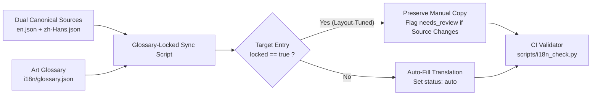

# 05. 5-Language Internationalization (i18n / L10n) & Bilingual Docs Guide

**Language / 语言**: **English** | [简体中文](../zh-CN/05-i18n-and-l10n-guide.md)

---

## 1. Scope & Dual-Source of Truth Strategy

This project enforces a **Dual Canonical Source (`en` + `zh-Hans`)** localization strategy:
- **Project Documentation**: Root README and every specification in `docs/` are maintained 1:1 in **English (`docs/en/`)** and **Simplified Chinese (`docs/zh-CN/`)**.
- **Application UI**: Ships with at least **5 languages**. `en` and `zh-Hans` are human-authored canonical baselines; the remaining 3 locales are generated through a glossary-locked automated translation pipeline followed by layout-aware manual tuning.

| Language | Standard Locale (BCP-47 / iPadOS) | Role | Preferred Translation Source | Localization & UI Layout Considerations |
| :--- | :--- | :--- | :--- | :--- |
| **English** | `en` | **Canonical Source #1** | Human-maintained | Global MIT open-source standard; primary source for Spanish |
| **Simplified Chinese** | `zh-Hans` | **Canonical Source #2** | Human-maintained | Mainland anime/manga creator terminology; primary source for Traditional Chinese & Cantonese |
| **Traditional Chinese** | `zh-Hant` (`zh-Hant-TW` conventions) | Auto-filled + Glossary/Tuned | `zh-Hans` + `en` | Never rely on naive character conversion; enforce Taiwan/HK art terminology (`矢量→向量`, `选区→選取範圍`, `剪切蒙版→剪裁遮色片`) |
| **Traditional Cantonese** | `yue-Hant` (`zh-HK` fallback) | Auto-filled + Cantonese Tuning | `zh-Hans` + `zh-Hant` | **iPadOS Critical Note**: Ship an in-app locale switcher and `zh-HK → yue-Hant` fallback; balance authentic Cantonese UI actions (`揀選`, `撤銷/還原`, `貼齊`) with precise professional art nouns (`圖層`, `網點紙`, `筆刷`) |
| **Spanish** | `es` (Neutral Spanish) | Auto-filled + **Layout-Critical Tuning** | `en` | **String Expansion Guardrail**: Spanish runs **25%–40% longer** than English and **2–3× longer** than Chinese (e.g., `Clipping Mask` → `Máscara de recorte`). Requires compact `.short` keys and adaptive SwiftUI layouts |

---

## 2. Core Art & Manga Terminology Glossary (Excerpt)

The machine-readable glossary lives in [`i18n/glossary.json`](../../i18n/glossary.json) and locks domain terminology across automated runs:

| English (`en`) | Simplified (`zh-Hans`) | Traditional (`zh-Hant`) | Cantonese (`yue-Hant`) | Spanish (`es`) | Layout Note |
| :--- | :--- | :--- | :--- | :--- | :--- |
| Layer | 图层 | 圖層 | 圖層 | Capa | Short & compact |
| Clipping Mask | 剪切蒙版 | 剪裁遮色片 | 剪裁遮罩 | Máscara de recorte | Use `.short` key or icon in narrow toolbars |
| Reference Layer | 参考图层 | 參考圖層 | 參考圖層 | Capa de referencia | Use `.short` key or icon in narrow toolbars |
| Vector Layer | 矢量图层 | 向量圖層 | 向量圖層 | Capa vectorial | Respect `矢量` vs `向量` regional term |
| Stabilizer | 防抖 | 防手震 | 防震修正 | Estabilizador | Core lineart parameter |
| Screentone | 网点纸 | 網點紙 | 網點紙 | Trama | `Trama` fits compact buttons cleanly |
| Close Gap | 间隙闭合 | 封閉間隙 | 填補空隙 | Cerrar huecos | High-frequency anime bucket setting |
| Selection | 选区 | 選取範圍 | 揀選範圍 | Selección | Natural Cantonese verb `揀選` |
| Undo / Redo | 撤销 / 重做 | 復原 / 重做 | 撤銷 / 重做 | Deshacer / Rehacer | Keep single-button labels concise |

---

## 3. Automated Translation & Manual Override Protection

To ensure automated sync runs **never overwrite careful manual layout tweaks** (such as shortened Spanish toolbar buttons or natural Cantonese phrasing), every locale entry in [`i18n/locales/*.json`](../../i18n/locales/) carries explicit lock metadata:

```json
{
  "tool.clipping_mask.short": {
    "value": "Máscara",
    "status": "tuned",
    "locked": true,
    "max_chars": 12
  }
}
```



---

## 4. Layout Anti-Truncation Engineering Rules

1. **Icon-First Canvas Chrome**: High-frequency tools around the canvas use crisp iconography with localized hover/long-press tooltips rather than cramming wide labels into narrow sidebars.
2. **Dual-Granularity Keys (`.short` vs `.full`)**:
   - `*.short`: Used in compact toolbars, segmented controls, and badges with an enforced `max_chars` budget checked in CI.
   - `*.full`: Used in menus, inspector sheets, and alerts where full descriptive phrasing (`Máscara de recorte`) has room to breathe.
3. **Adaptive SwiftUI Containers**:
   - Popovers use flexible width bounds (`minWidth`–`maxWidth`), `ViewThatFits`, `lineLimit(2)`, and `minimumScaleFactor(0.85)`.
   - `v0.9` Beta and `v1.0` require screenshot QA in **11-inch portrait + 1/3 Split View** across `es`, `zh-Hant`, and `yue-Hant`.
4. **Font Fallback Stack**: Explicitly prioritize locale-accurate system fonts (`PingFang SC`, `PingFang TC`, `PingFang HK` covering HKSCS Cantonese glyphs, and `SF Pro` covering full Spanish diacritics `¡ ¿ ñ á é í ó ú ü`).

---

## 5. CI Validation Command

Run after any change under `i18n/`:

```bash
python3 scripts/i18n_check.py
```

The validator checks:
1. 100% key parity across all 5 locales against `en.json` and `zh-Hans.json`.
2. Non-empty strings and valid `status`/`locked` metadata.
3. Identical placeholder sets (e.g., `{count}`, `{percent}`) across all 5 locales.
4. Strict compliance with `max_chars` UI length budgets (protecting Spanish and narrow Split View controls).
