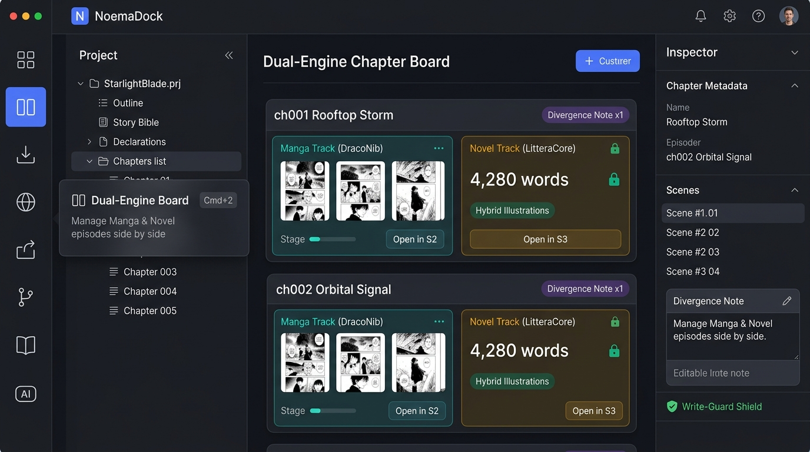
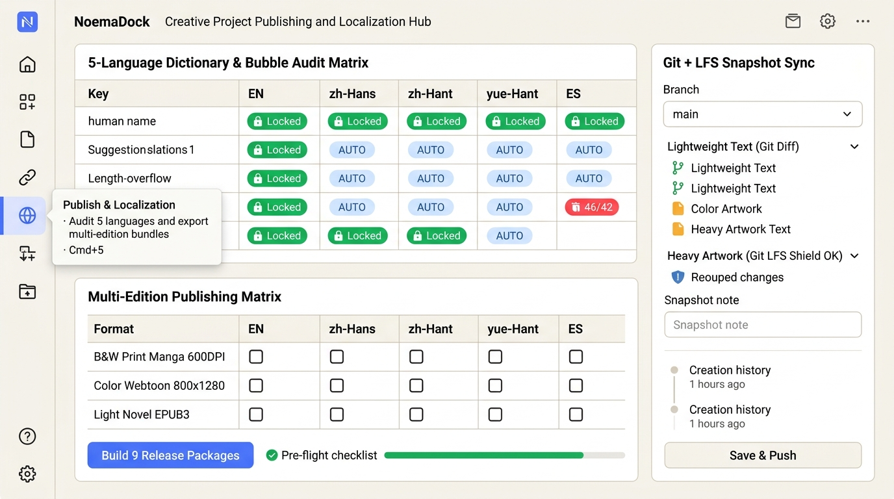
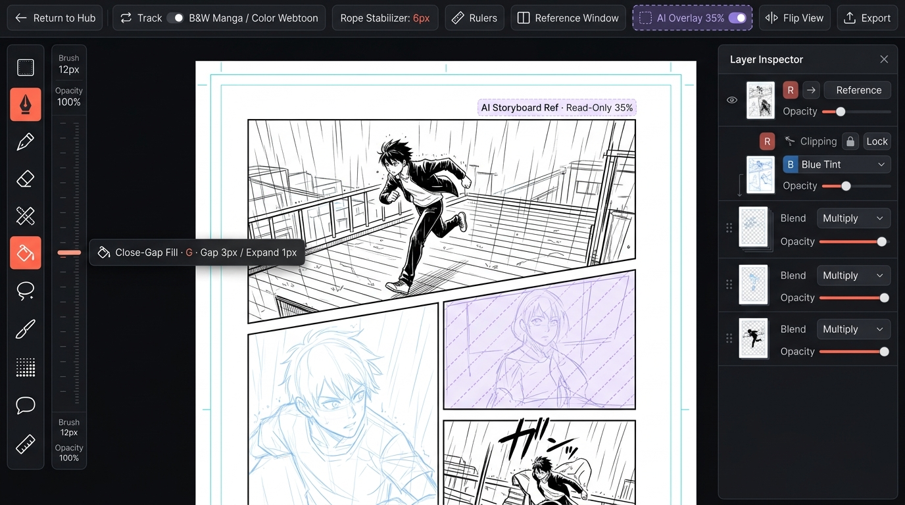
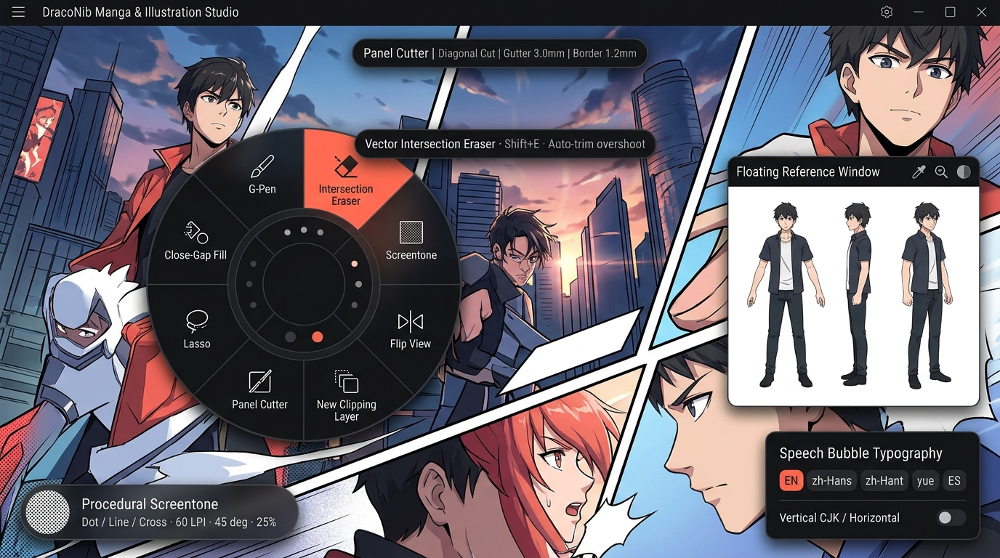
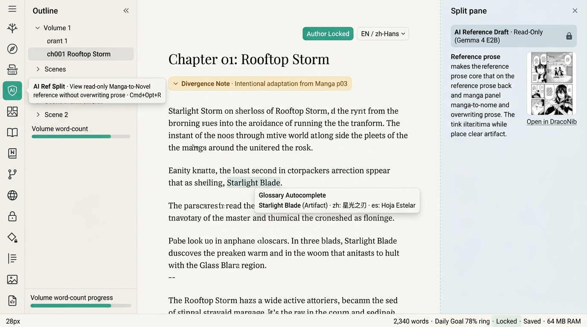
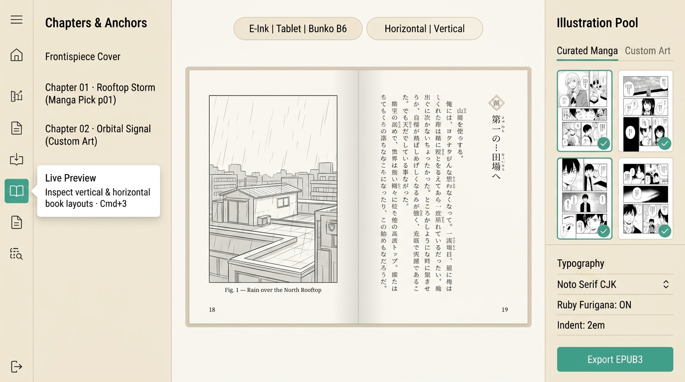
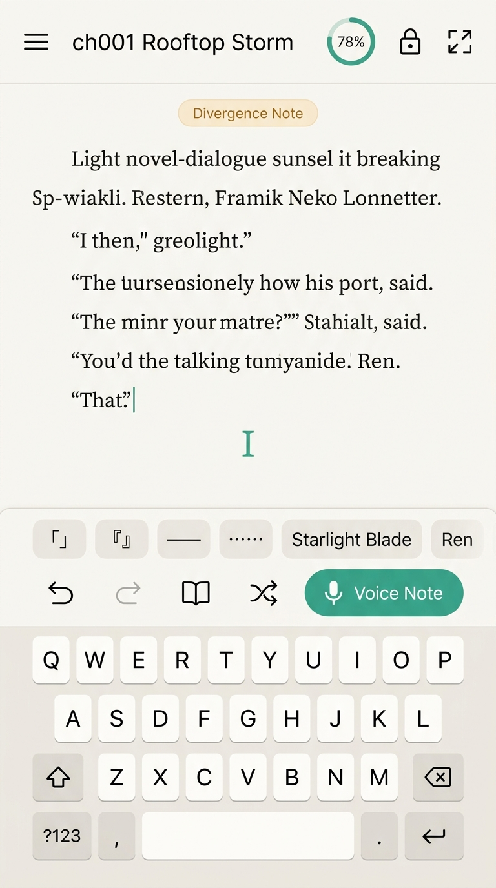
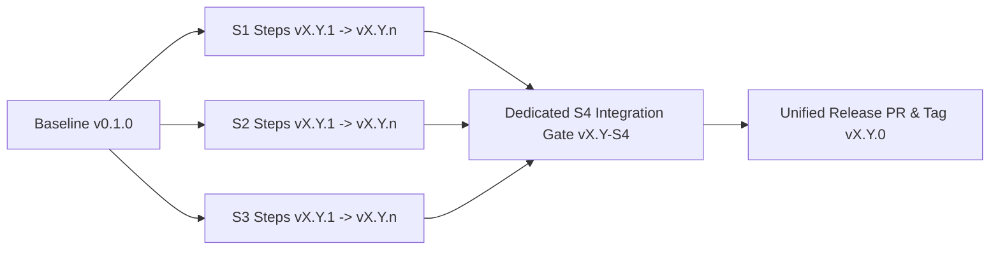

# 08. Tri-App Original UI Design Spec & SemVer (`vX.Y.Z`) Incremental Roadmap

**Language / 语言**: **English** | [简体中文](../zh-CN/08-tri-app-ui-design-and-patch-roadmap.md)

> **Working Codename Notice**: The Chinese, English, and Spanish names of the three standalone tools — **`S1` `NoemaDock` (`创想空间`)**, **`S2` `DracoNib` (`雕龙`)**, and **`S3` `LitteraCore` (`文心`)** — remain **working codenames (`is_final_brand = false`)** until finalized via a dedicated branding PR prior to official release.

---

## 1. Market & Open-Source Benchmarks + Clean-Room Trade Dress Guardrails

### 1.1 Cross-Suite Competitive Benchmark Matrix

| Tool Scope | Mainstream & Popular Open-Source Benchmarks | Adopted Universal Conventions (Safe) | Market Pain Points Solved |
| :--- | :--- | :--- | :--- |
| **`S1` `NoemaDock` (Hub)** Overview · Import · Dual-Engine · Publishing | **Clip Studio Paint EX** (Story Manager), **Scrivener** (Binder/Outliner/Compile), **Obsidian**, **Plottr / Campfire / NovelCrafter**, **Story Architect (STARC)**, **Manuskript**, **Calibre / Sigil**, **GitHub Desktop / Fork** | Slim left icon rail + collapsible tree + central board/matrix + right inspector; `Cmd/Ctrl+K` quick jump; card/outliner toggle; 3-step Git commit/push + Image Diff | CSP ties project management to a heavy GPU canvas; Scrivener Compile & Calibre are notoriously complex; no open-source suite unifies Dual-Engine Manga × Novel + 5-locale locked glossary + Git LFS |
| **`S2` `DracoNib` (Manga)** Dual-Track B&W Page & Color Webtoon Drawing | **Clip Studio Paint** (Studio & Simple Mode), **Procreate**, **Krita** (GPLv3), **MediBang / Jump Paint**, **ibisPaint X**, **Adobe Fresco**, **Blender Grease Pencil / Inkscape / MyPaint** | Slim left tool rail + top context bar + collapsible right drawer; standard hotkeys `B`/`E`/`G`/`L`/`I`/`T`/`Space`/`[`/`]`; 2/3-finger undo/redo, pinch-zoom/rotate, long-press eyedropper, Pencil Pro Squeeze/Hover/Roll | CSP desktop chrome is dense while Simple Mode drops reference layers & panels; Procreate lacks vector intersection eraser/panels/tones/multi-page management; Krita's GPLv3 blocks iPad App Store |
| **`S3` `LitteraCore` (Novel)** Light Novel Writing · Illustration Curation · EPUB3 | **Scrivener**, **Ulysses**, **iA Writer**, **novelWriter** (OSS), **Manuskript / Bibisco** (OSS), **Vellum / Atticus**, **Sigil** (OSS), **Nola / Japanese Tategaki & Ruby**, **PureWriter / Chenggua / Mozhe** | Collapsible 3-pane Outline → Paper Editor → Reference Split; Zen Focus Mode, Typewriter scroll, goal ring; Markdown shortcuts; mobile CJK thumb punctuation deck (`「」`/`——`/`……`) | Writing, story bible, artwork curation, and EPUB3 formatting are split across 4–5 tools; Vellum/Atticus lack CJK vertical Ruby & manga art integration; cloud writing apps lock data away from Git |

### 1.2 Clean-Room Trade Dress & IP Non-Infringement Rules

- **Zero proprietary UI trade-dress copying**: Never replicate Procreate's top-right 5-icon layout or left frosted pill sliders; never copy CSP's nested legacy sub-tool chrome; never copy Adobe Fresco's floating double-ring Touch Shortcut; never copy Scrivener's corkboard texture, Ulysses's blue gradient sheet list, or Vellum's proprietary ornament pack.
- **Zero GPL assets or code**: 100% clean-room MIT `24×24dp` grid, `1.75px` uniform rounded geometric SVG icons and visual tokens; brush dynamics mathematics reference only ISC-licensed (`libmypaint`) research formulas implemented cleanly in Rust.

---

## 2. Unified Original MIT Design System (Icon-First + 4-Element Hint)

All three apps share one **4-zone organizational grammar** (`48px` top context bar · `56px` left icon-only rail · collapsible left/right drawers · `28px` status footer) while establishing immediate visual identity through distinct accent hues:

| Dimension | `S1` `NoemaDock` (Hub) | `S2` `DracoNib` (Manga) | `S3` `LitteraCore` (Novel) |
| :--- | :--- | :--- | :--- |
| **Standalone RAM / GPU Budget** | `< 200 MB` · No GPU canvas | Dedicated GPU VRAM & sparse tile pool (`1536 MB`) | `< 120 MB` · No GPU canvas |
| **App Identity Accent** | **Indigo Slate-Blue `#4F7CFF`** | **Crimson-Coral `#FF6B4A`** (active state only, zero color cast) | **Calm Sage Emerald-Teal `#2FA88B`** |
| **Default Studio Surfaces** | Dark Studio `#14161B` / Warm Daylight `#F7F6F2` | Zero-Tint OLED Charcoal `#0B0C0F` / `#111216` (+ Gray/Light) | Warm Paper `#FAF8F4` / Soft Sepia `#F3EDE0` / OLED Dark `#15171A` |
| **Shared Semantic Tokens** | Manga Cyan `#2DD4BF` · Novel Amber `#F59E0B` · Divergence Violet `#A855F7` · Lock Emerald `#22C55E` · Warning Rose `#F43F5E` | Read-only AI overlay strictly **Violet Dashed `#A78BFA`** + Lock badge | Read-only AI split pane **Cool Slate `#EEF3F6` + Left Dashed Border**; `<DivergenceNote>` Amber `#B87A1E` |
| **Icon-First + Hint Protocol** | `24×24dp` / `1.75px` geometric icons; **Mouse hover (`180–350ms`) / Apple Pencil Pro Hover / Touch long-press (`350–400ms`) / `?` Hint Mode tap** pops a 4-element Hint Card (`Icon + Short Label + 1-line Help + Keycap/Gesture`) | Same + live parameter readout inside Hint Pill (e.g. `Gap 3px / Expand 1px`, `60 LPI / 45°`) | Same + mobile thumb CJK punctuation & glossary chips |

---

## 3. Daily Core UI Mockups & Interactive HTML Demos

> Open the three self-contained interactive HTML demos in any browser to test live layouts, themes, 5-language switching, and iPhone Duo postures:
> - **`S1` Interactive Demo**: [`docs/demos/s1_hub_ui_demo.html`](../demos/s1_hub_ui_demo.html)
> - **`S2` Interactive Demo (Drawable Canvas + `Q` Radial Dial)**: [`docs/demos/s2_manga_ui_demo.html`](../demos/s2_manga_ui_demo.html)
> - **`S3` Interactive Demo (Live Editor + Vertical EPUB3)**: [`docs/demos/s3_novel_ui_demo.html`](../demos/s3_novel_ui_demo.html)

### 3.1 `S1` `NoemaDock` (Working Codename)

### 3.2 `S2` `DracoNib` (Working Codename)

### 3.3 `S3` `LitteraCore` (Working Codename)

---

## 4. Independent SemVer 3rd-Segment (`vX.Y.Z`) Incremental Development Plan

Starting from **`v0.1.0-architecture-baseline`**, each subproject advances through small, independently compilable and testable patch steps (`vX.Y.Z`), converging at a dedicated **`S4` Integration & Compatibility Revision Stage** prior to unified version Release PRs.

### 4.1 `S1` (`NoemaDock`) Patch Steps
| Step Tag | Independent Scope | Modules | S4 Integration Checkpoint |
| :--- | :--- | :--- | :--- |
| `v0.2.1` | `.prj` bootstrap engine (Dual-Track / Dual-Engine presets + declarations/LFS) | `core/manga-core` (`hub`) | Opens cleanly read-only in S2 & S3 |
| `v0.2.2` | 56px icon rail + 18 original MIT icons + unified Hint Popover component | `apps/apple` + `i18n/` | `--features hub` zero GPU canvas init |
| `v0.2.3` | Project overview, `RenamedFolderFallback` banner & lightweight thumbnail cache | `core/manga-core` + `apps/apple` | **`T0.2-S4`**: 100-cycle 3-app soak |
| `v0.3.1–.2` | Atomic Story Bible / TOC I/O + left project tree UI | `core/manga-core` + `apps/apple` | **`T0.3-S4`**: `< 300ms` S2/S3 live refresh |
| `v0.4.1–.2` | Unified Importer router (Handoff manifest) + drag-drop UI | `core/manga-core` + `apps/apple` | **`T0.4-S4`**: Hub → Manga/Novel parity |
| `v0.5.1–.2` | Dual-Engine aggregator + atomic chapter reorder + Deep-Link launch to S2/S3 | `core/manga-core` + `apps/apple` | **`T0.5-S4`**: 0 broken links on reorder |
| `v0.6.1–.2` | 5-locale audit engine + native Rust CPFF validator + Matrix UI | `core/manga-core` + `apps/apple` | **`T0.6-S4`**: 0 locale drift across 3 apps |
| `v0.7.1–.3` | Multi-edition packager + Creator Git+LFS sync engine + S1-C UI | `core` + `apps/apple` | **`T0.7-S4`**: Orchestrated S2 + S3 release |
| `v0.8.1–v1.0.2` | Apple Trio posture adaptation + 5-locale QA + Gemma 4 Runtime Hub & branding | `core` + `apps/apple` + `ai/` | **`T0.9-S4` / `T1.0-S4`** |
| `v1.1.x–v1.3.x` | Wave 2 Hub shells (Android / Windows / Linux) | `apps/{android,windows,linux}` | Per-wave S4 platform gate |

### 4.2 `S2` (`DracoNib`) Patch Steps
| Step Tag | Independent Scope | Modules | S4 Integration Checkpoint |
| :--- | :--- | :--- | :--- |
| `v0.1.1–.2` | Metal `wgpu` dirty-tile compositor + 240Hz input + base canvas shell (`≥82%`) | `core/manga-gpu` + `apps/apple` | `--features canvas` zero FFI leaks |
| `v0.2.1–.4` | GPU brush stamp → pressure/roll curves → Rope + caliper → 8 starter brushes | `core/manga-gpu` + `apps/apple` | **`T0.2-S4`**: 100-cycle concurrent I/O |
| `v0.3.1–.2` | WGSL 13 cel blend modes + right Layer drawer (`R`/`✂`/`🔒`/`B`) | `core/manga-gpu` + `apps/apple` | **`T0.3-S4`**: `< 300ms` live refresh |
| `v0.4.1–.3` | Selections + marching ants → Close-Gap fill HUD → GPU Free Transform/Liquify | `core` + `apps/apple` | **`T0.4-S4`**: Imported art flatting parity |
| `v0.5.1–.3` | `vello` vector ink → `rstar` intersection eraser/local width → ruler overlays | `core/manga-vector` + `apps/apple` | **`T0.5-S4`**: 0 broken vector links |
| `v0.6.1–.4` | Diagonal panels (`i_overlay`) → WGSL screentones → 5-lang bubbles → PNG slicer | `core` + `apps/apple` | **`T0.6-S4`**: `script.xml` 5-lang parity |
| `v0.7.1–.4` | `.mnga` (SQLite+Zstd) → MIT PSD → `ActionBus` preview card → Timelapse | `core/manga-io` + `apps/apple` | **`T0.7-S4`**: Multi-edition bundle export |
| `v0.8.1–v1.0.3` | 8-sector Compass Dial + Floating Ref + Trio hinge/paging + AI storyboard overlay | `apps/apple` + `ai/dual-bridge` | **`T0.9-S4` / `T1.0-S4`** |
| `v1.1.x–v1.3.x` | Wave 2 shells + on-device Vision AI (flatting/LT/macros/cleanup/3D/ComfyUI) | `apps/{android,windows,linux}` + `ai/` | Per-wave S4 platform gate |

### 4.3 `S3` (`LitteraCore`) Patch Steps
| Step Tag | Independent Scope | Modules | S4 Integration Checkpoint |
| :--- | :--- | :--- | :--- |
| `v0.2.1–.3` | Novel MD core (atomic save/word count) → Paper themes/Zen → Outline & Hints | `core/manga-core` (`novel`) + `apps/apple` | **`T0.2-S4`**: `< 120 MB` RAM, zero locks |
| `v0.3.1–.2` | Read-only Scenes/Bible sidebar + cross-app file Watcher live refresh | `core/manga-core` + `apps/apple` | **`T0.3-S4`**: `< 300ms` refresh, cursor safe |
| `v0.4.1–.2` | Shared `dictionary.xml` inline autocomplete + split multi-locale prose view | `core/manga-core` + `apps/apple` | **`T0.4-S4`**: Imported prose encoding parity |
| `v0.5.1–.2` | Whitelist `novel/novel_meta.xml` in `suite.rs` + `<DivergenceNote>` pill UI | `core/manga-core` + `apps/apple` | **`T0.5-S4`**: 0 broken notes on reorder |
| `v0.6.1–.2` | Full 5-locale prose + `locked="true"` guard + Vertical Tategaki & Ruby engine | `core/manga-core` + `apps/apple` | **`T0.6-S4`**: 0 locale drift across 3 apps |
| `v0.7.1–.3` | Dual-source illustration model → Live preview workbench → MIT EPUB3 exporter | `core/manga-io` + `apps/apple` | **`T0.7-S4`**: `epubcheck` 0 errors |
| `v0.8.1–v1.0.3` | iPhone Duo folded drafting deck + Trio hinge spread + Read-Only AI ref split | `apps/apple` + `ai/dual-bridge` | **`T0.9-S4` / `T1.0-S4`** |
| `v1.1.x–v1.3.x` | Wave 2 shells + voice continuity structuring / lore checker / foreshadowing | `apps/{android,windows,linux}` + `ai/` | Per-wave S4 platform gate |

---

## 5. Bilingual Executive Presentation Decks

- English Keynote-Compatible Deck (14 Slides): [`About-Paint-Tools_Overview_and_Plan_en.pptx`](../presentations/About-Paint-Tools_Overview_and_Plan_en.pptx) ([PDF Preview](../presentations/About-Paint-Tools_Overview_and_Plan_en.pdf))
- 简体中文 Keynote 兼容演示文稿（14 页）：[`About-Paint-Tools_Overview_and_Plan_zh-CN.pptx`](../presentations/About-Paint-Tools_Overview_and_Plan_zh-CN.pptx)（[PDF 预览](../presentations/About-Paint-Tools_Overview_and_Plan_zh-CN.pdf)）
