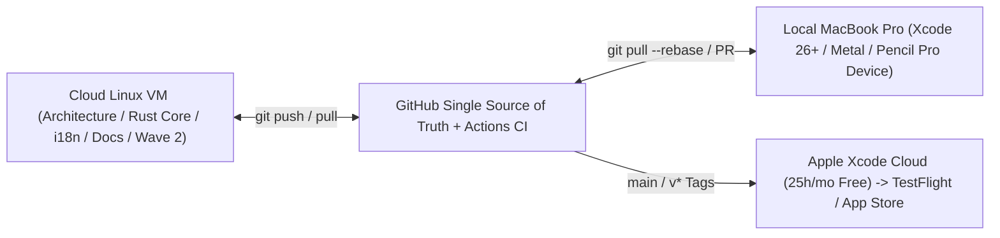

# 09. Apple Platform MacBook Pro Xcode & Xcode Cloud Engineering Guide

**Language / 语言**: **English** | [简体中文](../zh-CN/09-apple-xcode-and-cloud-dev-guide.md)

> **Scope**: Wave 1 Apple Trio (**iPad · Touchscreen MacBook · iPhone Duo**) across all three modular tools (working codenames: **`S1` `NoemaDock`**, **`S2` `DracoNib`**, **`S3` `LitteraCore`**).

---

## 1. Building Wave 1 Apple Apps on MacBook Pro with Xcode + AI Coding

### 1.1 Existing Repository Baseline
The `v0.1.0-architecture-baseline` already provides a verified cross-language foundation:
- Feature-sliced Rust core (`hub`/`canvas`/`novel`): [`core/manga-core/Cargo.toml`](../../core/manga-core/Cargo.toml)
- Zero-warning C11 ABI header: [`core/manga-core/include/manga_core.h`](../../core/manga-core/include/manga_core.h)
- Swift RAII bridge & `SuiteAppKind`: [`apps/apple/Shared/Sources/MangaCoreBridge.swift`](../../apps/apple/Shared/Sources/MangaCoreBridge.swift)
- 3-target XcodeGen manifest: [`apps/apple/project.yml`](../../apps/apple/project.yml) & 5-locale [`Localizable.xcstrings`](../../apps/apple/Shared/Resources/Localizable.xcstrings)

### 1.2 Upgrading to a 3-Slice `MangaCore.xcframework`
Bundle physical iOS/iPadOS (`aarch64-apple-ios`), Apple Silicon iOS Simulator (`aarch64-apple-ios-sim`), and macOS (`aarch64-apple-darwin`) into one `XCFramework` so Simulator, device, Mac, and Xcode Cloud link seamlessly:

```bash
cargo build --manifest-path core/Cargo.toml -p manga-core --release --target aarch64-apple-ios
cargo build --manifest-path core/Cargo.toml -p manga-core --release --target aarch64-apple-ios-sim
cargo build --manifest-path core/Cargo.toml -p manga-core --release --target aarch64-apple-darwin

xcodebuild -create-xcframework \
  -library core/target/aarch64-apple-ios/release/libmanga_core.a     -headers core/manga-core/include \
  -library core/target/aarch64-apple-ios-sim/release/libmanga_core.a -headers core/manga-core/include \
  -library core/target/aarch64-apple-darwin/release/libmanga_core.a  -headers core/manga-core/include \
  -output apps/apple/Frameworks/MangaCore.xcframework
```

### 1.3 Dual-Layer Xcode + AI Coding Workflow
1. **Layer A (Xcode 26+ Coding Intelligence / 26.3+ Agentic Coding + MCP)**: Ideal for SwiftUI views, Metal shader authoring, Swift 6 strict concurrency fixes, and live 5-language SwiftUI Previews.
2. **Layer B (Cross-Language Agent: Antigravity / Claude Code / Cursor + Xcode MCP)**: Atomically updates Rust (`core/manga-core`) → C header (`manga_core.h`) → Swift bridge (`MangaCoreBridge.swift`) → 5-locale JSON & `.xcstrings`, then rebuilds `XCFramework` and runs tests.
3. **Real-Device & Profiling Gates**: Verify 240Hz Apple Pencil Pro latency (`≤ 9ms`) over USB-C/Wi-Fi on iPad Pro using **Metal Frame Capture** and **Instruments (Allocations/Jetsam)** (`S1 < 200 MB`, `S3 < 120 MB`, `S2` 2h zero-crash soak on 8GB iPad).

---

## 2. MacBook Pro Hardware Sizing, Toolchain Setup & Cloud VM Handoff

### 2.1 Recommended Hardware Tiers (Xcode + Rust + Local Gemma 4)

| Tier | Apple Silicon | Unified RAM | SSD | Suitability |
| :--- | :--- | :--- | :--- | :--- |
| **Minimum** | M2 Pro / M3 | **24 GB** | **512 GB** | Single target + Simulator + Gemma 4 E2B testing (avoid `< 16 GB`) |
| **Recommended** | **M4 Pro** (12–14 core) | **36 GB / 48 GB** | **1 TB** | Smooth concurrent Xcode + Rust + AI agents + 3-app soak + **Gemma 4 E4B** |
| **Flagship** | M4 Max | **64 GB+** | **2 TB** | Heavy Wave 2 virtualization + `v1.1`–`v1.4` vision AI (MobileSAM/LT/3D) |

### 2.2 One-Shot macOS Toolchain Setup
```bash
xcode-select --install && sudo xcodebuild -license accept
xcodebuild -downloadPlatform iOS
brew install git git-lfs gh xcodegen python3 jq
curl --proto '=https' --tlsv1.2 -sSf https://sh.rustup.rs | sh
rustup target add aarch64-apple-ios aarch64-apple-ios-sim aarch64-apple-darwin
git lfs install
git clone https://github.com/70sDushuren/About-Paint-Tools.git
```

### 2.3 Seamless Handoff with the Cloud Linux VM



- **Clear Division of Labor**: Cloud VM handles platform-agnostic Rust core, CPFF/i18n/docs, and cross-platform validation; local MacBook Pro handles Metal rendering, SwiftUI/UIKit/AppKit ergonomics, and real-device profiling.
- **Zero-Drift Rule**: Always edit localization keys in `i18n/locales/*.json` and sync via `python3 scripts/i18n_sync.py --export-xcstrings --export-android` rather than editing `.xcstrings` manually.

---

## 3. Apple Cloud Environment (`Xcode Cloud`) Evaluation & Setup Guide

### 3.1 Feasibility Conclusion
- **Key Clarification**: Apple does **not** offer an interactive browser-based cloud Mac IDE; Apple's official cloud service is **Xcode Cloud** (Apple-native CI/CD for automated builds, parallel simulator XCTest, automatic signing, notarization, TestFlight, and App Store Connect delivery).
- **Cost & Recommended Hybrid Architecture**: Every **Apple Developer Program membership (\$99/year)** includes **25 free compute hours/month** (paid tiers start at \$49.99/100h). Combine **Local MacBook Pro** + **GitHub Actions** (cross-platform Rust/i18n/Android/Win/Linux CI) + **Xcode Cloud** (free 25h/month dedicated to Apple signing, TestFlight & Store release).

### 3.2 Configuring Xcode Cloud for Rust + XcodeGen in 4 Steps
1. **Keep `project.yml` as the Daily Single Source of Truth**: During active `v0.2`–`v0.8` development, keep `/apps/apple/*.xcodeproj/` and `/apps/apple/Frameworks/` in `.gitignore` to eliminate `.pbxproj` merge noise; when activating Xcode Cloud workflows (`v0.9+`), either let `ci_post_clone.sh` generate the project via `xcodegen` or run `git add -f` on the thin `MangaStudioApple.xcodeproj` if App Store Connect scheme discovery requires it.
2. **Add `apps/apple/ci_scripts/ci_post_clone.sh` (`chmod +x`)**: Installs minimal `rustup` + the 3 Apple targets, runs `cargo test -p manga-core`, builds `MangaCore.xcframework` via `scripts/dev.sh build-rust --force`, and generates `.xcodeproj` if absent.
3. **Create Workflows** (`Xcode → Integrate → Xcode Cloud → Create Workflow`):
   - `Wave1-Beta-TestFlight`: Triggered on `main` / `v0.9*-beta*` → auto-signed TestFlight distribution;
   - `Wave1-Release-Store`: Triggered on S4-verified `v1.0.*` tags → full XCTest + App Store Connect & macOS notarization.
4. **Reserve Semantic Bundle IDs & Shared App Group**:
   - `org.aboutpainttools.suite.hub` (S1) / `org.aboutpainttools.suite.manga` (S2) / `org.aboutpainttools.suite.novel` (S3)
   - Shared App Group `group.org.aboutpainttools.shared` to share `.prj` security-scoped bookmarks and a single cached copy of offline Gemma 4 weights across all 3 tools.

---

## 4. Unified Workflow Driver (`Makefile` + `scripts/dev.sh`) & Daily Playbook

To keep local MacBook Pro Xcode iteration and cloud Linux VM development completely frictionless, the repository ships a unified root [`Makefile`](../../Makefile) + [`scripts/dev.sh`](../../scripts/dev.sh), paired with an incremental `preBuildScripts` hook in [`apps/apple/project.yml`](../../apps/apple/project.yml).

### 4.1 Single-Project Multi-Target Architecture (Three Apps from One Workspace)
- **One Xcode project during development**: `apps/apple/project.yml` → `MangaStudioApple.xcodeproj`. Switch Schemes in the Xcode toolbar to run each hardware target or standalone app (`S1`/`S2`/`S3` share `Shared/Sources/` bridges and common UI components).
- **Three independent apps at release**: Each tool ships with its own Bundle ID, independent memory budget, and URL Scheme (`noemadock://`, `draconib://`, `litteracore://`) for Split View concurrency on iPad and Mac.

### 4.2 Clear Division of Labor: Terminal vs. Xcode Window
- **Terminal (4 unified commands)**: Git sync, incremental Rust XCFramework builds, XcodeGen project regeneration, and CI-gated Git pushes.
- **Xcode Window**: Scheme/device selection, **`⌘R`** device/simulator launch, **`⌥⌘Enter`** live SwiftUI Previews, and **`⌘7` / `⌘I`** Memory & Metal GPU profiling.
- **Automatic Incremental Rust Sync in Xcode**: Every target runs `Sync Rust MangaCore XCFramework (Incremental)` before building, checking a SHA-256 fingerprint of `core/`: pure Swift edits skip in **< 50ms**, while Rust edits rebuild the 3-slice XCFramework automatically on `⌘R`.

### 4.3 Daily Command Cheatsheet (Run `make` from repo root or `./scripts/dev.sh` from anywhere)

| Command | Action |
| :--- | :--- |
| `make sync` | `git pull --rebase` (when clean) → incremental `MangaCore.xcframework` rebuild → `xcodegen generate` → open Xcode |
| `make run-mac` / `make run-ipad` / `make run-duo` | Headless `xcodebuild` compile (and launch `.app` on Mac) for rapid local or AI-agent verification |
| `make check` | Exact local mirror of GitHub Actions CI + `S4` Integration Gate (5-locale i18n, `.xcstrings`/Android sync, CPFF v1.0, C11 zero-warning header, Rust workspace tests, 3 feature slices, `S4` check) |
| `make push MSG="feat(...): ..."` | Runs `make check` first; only if green does it commit, `git pull --rebase`, and push to `origin` |
| `make status` | Displays current branch, git status, and `MangaCore.xcframework` freshness |

---

## 5. `GoNext` Cloud ↔ Local Mac Async Relay (GitOps Loop)

[`ops/relay/`](../../ops/relay/README.md) provides an **append-only, zero-conflict, allowlisted GitOps relay** between the Cloud VM and local MacBook Pro:
- **Cloud Dispatch**: After each cloud milestone, run `python3 scripts/relay_tool.py new ...` to append a timestamped declarative order (`ops/relay/orders/<YYYYMMDD-HHMMSS>_<slug>.json`) containing only pre-audited allowlisted actions (`env-info`, `build-rust`, `xcode-gen`, `build-mac`, `build-ipad`, `build-duo`, `test-mac`, `test-ipad`, `launch-mac`, `open-xcode`, `check`) — never arbitrary shell scripts.
- **Local Mac Execution & Paired Receipt**: On Mac, either run the single fixed command **`make gonext`** or enable automated polling (`make relay-watch` / macOS `launchd` via `make relay-install-agent`). Pending orders execute chronologically and push a paired receipt `ops/relay/results/<YYYYMMDD-HHMMSS>_<slug>.result.md` containing status, durations, exit codes, and trimmed logs.
- **Chronological Audit Log & Closed Loop**: Paired `orders/` and `results/` remain in Git as a chronological development log; Cloud pulls receipts to advance on `PASS` or diagnose/fix and issue the next `GoNext` order on `FAIL`.


