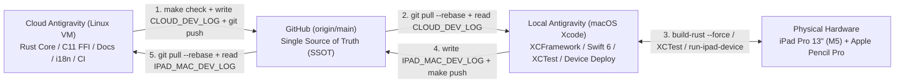

# 11. Cloud Agent × Local Xcode Agent Dual-Agent Collaboration Mechanism

**Language / 语言**: **English** | [简体中文](../zh-CN/11-cloud-local-dual-agent-collaboration.md) | [Bilingual Side-by-Side Edition](../bilingual/11-cloud-local-dual-agent-collaboration-bilingual.md)

> **Reusable Skill**: [`skills/cloud-local-dual-agent-collab/SKILL.md`](../../skills/cloud-local-dual-agent-collab/SKILL.md) (also registered globally as Antigravity Skill `cloud-local-dual-agent-collab` for direct reuse in this project and any future hybrid Cloud-Linux + Local-IDE/Device project).

---

## 1. Motivation & Design Goals

High-performance cross-platform native apps (such as our Rust `manga-core` engine paired with Apple iPadOS/macOS SwiftUI/UIKit/Metal shells) naturally span two complementary environments:
- **Cloud Agent (Antigravity on Linux VM)**: Excels at system architecture, cross-platform core algorithms (Rust/C11 FFI), deterministic unit tests, 5-locale i18n, bilingual technical documentation, and full CI gates — but lacks macOS Xcode, Metal GPUs, and physical iPad Pro hardware.
- **Local IDE Agent (Antigravity inside Xcode on macOS)**: Runs directly on an Apple Silicon MacBook Pro tethered to a physical iPad Pro 13" (M5), excelling at Swift 6 strict-concurrency verification, 3-slice `XCFramework` linking, physical device signing & deployment (`devicectl`), 240Hz Apple Pencil Pro ergonomics, and live XCTests — without needing to shoulder heavy cross-language refactors or bilingual docs.

This specification formalizes how both agents operate as **zero-conflict, auditable, security-hardened engineering peers** reusable across projects.

---

## 2. System Topology & Dual Collaboration Modes



The system supports **two complementary modes**, selected by development phase:

| Mode | When to Use | Transport & Trigger |
| :--- | :--- | :--- |
| **Mode A: Interactive Dual-Agent Handoff (Primary)** | Active feature engineering and real-device UX polish (e.g., `v1.0.0-rc4+` → `v1.0.0-rc5`) where both Cloud and Local agents edit code in alternating turns coordinated via structured handoff prompts. | `origin/main` + **Dual One-Way Append-Only Dev Logs** (`ops/cloud-dev-log/CLOUD_DEV_LOG.md` ↔ `ops/local-dev-log/IPAD_MAC_DEV_LOG.md`) + **`make push`**. |
| **Mode B: Unattended `GoNext` GitOps Relay** | Batch milestone CI sweeps (e.g., 10–20 overnight automated builds and XCTests) requiring zero interactive Xcode edits. | `ops/relay/orders/*.json` (Cloud-only) ↔ `ops/relay/results/*.result.md` (Local-only) + **`make gonext` / `make relay-watch` / `make relay-install-agent`** with 5-layer budget & loop-detection circuit breakers (see [Doc 09](./09-apple-xcode-and-cloud-dev-guide.md)). |

> **Golden Rule — Never Mix Triggers**:
> - After active code edits by the Local IDE Agent, always commit & push via **`make push MSG="..."`** (or `git commit && git push`).
> - **NEVER run `make gonext`** to push local edits — `make gonext` strictly pulls and executes Cloud-dispatched allowlisted orders.

---

## 3. Five Core Zero-Conflict & Security Mechanisms

### 3.1 Dual One-Way Append-Only Dev Logs
- **Cloud-Owned Log**: [`ops/cloud-dev-log/CLOUD_DEV_LOG.md`](../../ops/cloud-dev-log/CLOUD_DEV_LOG.md) — prepended exclusively by Cloud Agent (reverse chronological); **read-only** for Local Agent.
- **Local-Owned Log**: [`ops/local-dev-log/IPAD_MAC_DEV_LOG.md`](../../ops/local-dev-log/IPAD_MAC_DEV_LOG.md) — prepended exclusively by Local Agent (reverse chronological); **read-only** for Cloud Agent.
- **Why under `ops/` instead of `docs/`**: Avoids triggering `scripts/i18n_check.py`'s strict 1:1 `docs/zh-CN/` ↔ `docs/en/` mirroring gate during rapid local device iterations.

### 3.2 Explicit FFI Rebuild Signaling
- For Swift-only or docs-only updates, the SHA-256 `core/` fingerprint skips Rust compilation in `< 50ms`.
- **Whenever Cloud modifies `core/manga-core/` or `manga_core.h` (adding/changing C11 FFI symbols)**, Cloud MUST prominently flag the required native rebuild at the top of its `CLOUD_DEV_LOG.md` entry so Local runs:
  ```bash
  ./scripts/dev.sh build-rust --force && ./scripts/dev.sh xcode-gen
  ```
  before invoking Xcode, eliminating stale-library `Undefined symbol` failures.

### 3.3 Persistent Signing That Survives Project Regeneration
- Tracked [`apps/apple/BaseSigning.xcconfig`](../../apps/apple/BaseSigning.xcconfig) includes `#include? "LocalSigning.xcconfig"`.
- `apps/apple/LocalSigning.xcconfig` is listed in [`.gitignore`](../../.gitignore) and generated once via `make ipad-setup-signing TEAM_ID=<10-char-id>`.
- **Outcome**: Personal Team IDs never leak into public Git, and repeated `make sync` / `xcodegen generate` invocations never wipe local signing.

### 3.4 Turn Discipline & Conflict-Free Temporary Branch Recovery
- **Normal Turn-Taking**: Once one agent hands off, it pauses pushing to `main` until the peer agent completes its turn, ensuring clean fast-forward pushes.
- **Concurrent Edit Fallback**: If both sides edit overlapping files before pulling (e.g., `project.yml` and `Assets.xcassets/`):
  1. Local does **not** rebase locally on `main`; instead it pushes its working state to `local/<slug>`.
  2. Cloud fetches `local/<slug>`, reconciles the best of both (e.g., keeping verified 11-size device AppIcons while integrating Cloud updates), runs `make check`, pushes `main`, and deletes the remote temp branch.
  3. Local switches back to `main`, deletes the local temp branch, and runs `git pull --rebase`.

### 3.5 Platform Guard Hygiene & Artifact Exclusion
- Never leak unguarded `UIKit` / `AppKit` symbols into `apps/apple/Shared/Sources/` (always wrap with `#if canImport(...)` / `#if os(...)`).
- Never force-add (`git add -f`) `.xcodeproj/`, `Frameworks/`, `DerivedData/`, or `LocalSigning.xcconfig`.

---

## 4. Battle-Tested Case Study (`v1.0.0-rc4+` → `v1.0.0-rc5`)

This protocol was proven end-to-end on real iPad Pro 13" (M5) iterations:
1. **Zero-Loss Concurrent Icon Merge (`b7c4c70`)**: Local edits to `project.yml` and 11-size AppIcon assets were handed off via `local/ipad-pro-deploy`, cleanly merged by Cloud, and the temp branch deleted.
2. **5 Local iPad Pro UX Upgrades (`e3eeb98`)**: Local Xcode Agent refined Lasso workflows, focused per-tool tuning bars, 2-finger pan, `S2+S3` Dual Split, and Eyedropper Loupe, logging a Rust Floating Selection Transform follow-up in `IPAD_MAC_DEV_LOG.md`.
3. **Cloud Rust FFI + 3 Major Upgrades (`01d93c2`)**: Cloud read the local log, added 2 C11 FFI functions (`transform_selected_pixels_affine`, `import_rgba_to_layer`), 2-finger canvas rotation, Multi-Canvas Gallery & Photo Import (73/73 Rust tests passing), and recorded handoff instructions in `CLOUD_DEV_LOG.md`.
4. **Local Verification & Device Ship (`74ca465`)**: Local Xcode Agent read `CLOUD_DEV_LOG.md`, force-rebuilt `MangaCore.xcframework`, caught & fixed a 1-line Swift enum typo (`.webtoonStrip` → `.webtoonStrip800`), passed **48/48 live Apple Silicon XCTests**, and deployed cleanly to physical iPad Pro 13" (M5).

---

## 5. 5-Minute Adoption Guide for Future Projects

To adopt this dual-agent architecture in any new Apple / Android / Windows / Linux project:
1. Copy [`skills/cloud-local-dual-agent-collab/SKILL.md`](../../skills/cloud-local-dual-agent-collab/SKILL.md) into `<repo>/skills/` (and invoke the globally registered Antigravity Skill `cloud-local-dual-agent-collab`).
2. Create `ops/cloud-dev-log/CLOUD_DEV_LOG.md` and `ops/local-dev-log/LOCAL_DEV_LOG.md` with explicit single-writer headers.
3. Add `BaseSigning.xcconfig` (`#include? "LocalSigning.xcconfig"`) and ignore local signing + generated IDE project/build artifacts in `.gitignore`.
4. Expose unified `Makefile` shortcuts (`make check`, `make sync`, `make push MSG="..."`, `make run-<device>`), optionally pairing with `gitops-gonext-relay-setup` for unattended overnight batch runs.
