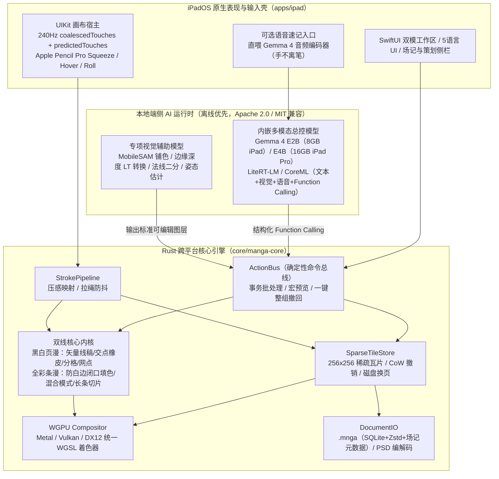

# 02. 技术架构选型与跨平台对比（RFC）

**语言 / Language**: [English](../en/02-architecture-and-tech-stack.md) | **简体中文**

---

## 1. 绘图软件与普通 App 的本质差异

评估 iPad 漫画创作软件的技术栈（特别是对比 **纯原生 iPadOS** 与 **Flutter 跨平台**），绝不能套用普通信息流/表单应用的标准。决定画师是否愿意每天连续创作 6 小时的核心是以下四项底层硬指标：

1. **笔尖到像素延迟（Pencil-to-Photon Latency）**：iPad Pro 120Hz ProMotion 下的行业标杆为 **≤ 9ms**。这要求直接捕获 UIKit 240Hz `coalescedTouches`（合并高采样点）、实时渲染 `predictedTouches`（系统级预测点）并在后续帧用 `estimatedPropertiesExpectingUpdates` 修正压感与倾角。
2. **Apple Pencil Pro 硬件专属能力**：悬停预览（`UIHoverGestureRecognizer`）、轻捏（`UIPencilInteraction` Squeeze）、笔杆旋转（`rollAngle`）、触觉反馈（Haptics）及系统级防误触（Palm Rejection）。
3. **超大画布分块显存与虚拟内存（Tiled GPU Canvas）**：首阶段需**同时支撑黑白页漫与全彩条漫/插画**：
   - **黑白页漫**：B4 600DPI 印刷页高达 `6071 × 8598` 像素，且含高频矢量线稿与程序化网点。
   - **全彩条漫（Webtoon）与插画**：长条画布常达 `1600 × 25600+` 像素、30–60 个赛璐璐颜色/混合/阴影层。
   必须构建 `256×256` 稀疏瓦片（Sparse Tile）显存池 + 写时复制（Copy-on-Write）撤销栈 + 磁盘换页（Disk Paging），无法依赖通用 2D UI 画布 API。
4. **不同硬件平台的差异化交互范式**：iPad（无笔身按键、依赖屏上双指手势与轻捏）、Android 平板（S-Pen/星闪笔实体侧键 + Android `FrontBufferedRenderer`）、桌面数位屏（高密度键盘快捷键 + WinTab/Windows Ink）在物理习惯上截然不同。

---

## 2. 三大技术路线硬核对比

| 评估维度 | 方案 A：纯原生 iPadOS (`Swift + UIKit/SwiftUI + Metal`) | 方案 B：纯 Flutter 跨平台 (`Dart + Impeller + 桥接插件`) | **方案 C（推荐）：薄原生壳 + 共享跨平台核心引擎** (`iPadOS 原生壳` + `Rust + wgpu 核心引擎`) |
| :--- | :--- | :--- | :--- |
| **Apple Pencil 延迟与手感** | ⭐⭐⭐⭐⭐ **极致（≤ 9ms）** 直连 `UITouch` 240Hz 采样、`predictedTouches` 与 `CAMetalLayer` | ⭐⭐ **存在底层硬伤** Flutter 在 120Hz iPad 上存在 3–4 帧管线延迟（如 `flutter#175790`）；框架不暴露 `predictedTouches`；重度画布仍需绕过 Impeller 写原生 `PlatformView`/`Texture` | ⭐⭐⭐⭐⭐ **极致（≤ 9ms）** UIKit 原生层零损耗采集 240Hz 与预测点，直接送入 Rust 核心，经 `wgpu` 直出 `CAMetalLayer`（底层直调 Metal） |
| **Apple Pencil Pro 支持** | ⭐⭐⭐⭐⭐ **首日原生支持** Squeeze、Hover、Barrel Roll、Haptics 开箱即用 | ⭐⭐ **滞后且脆弱** 依赖三方插件，且存在 Hover 误报为鼠标（`flutter#195249`）等边缘问题 | ⭐⭐⭐⭐⭐ **首日原生支持** UI 壳即原生 SwiftUI/UIKit，苹果新硬件 API 零延迟跟进 |
| **超大画布性能与内存** | ⭐⭐⭐⭐⭐ **顶级** 直接掌控 Metal Shaders 与显存池 | ⭐⭐⭐ **受限** Dart `CustomPainter` 扛不住 600DPI/超长条漫多图层；采用 `Texture` Widget 桥接会引入额外合成拷贝并退化为双端原生维护 | ⭐⭐⭐⭐⭐ **顶级** Rust 无 GC 停顿；`wgpu` 在 iPadOS 编译为 Metal，Android 编译为 Vulkan，Windows 编译为 DX12，WGSL 着色器全端共用 |
| **前瞻跨平台扩展** *(macOS / Android / Windows)* | ⭐⭐ **局限苹果生态** 扩展 macOS 极快；迁移 Android/Windows 时核心引擎需重写 | ⭐⭐⭐⭐⭐ **UI 代码复用最高** 但强行用一套 UI 覆盖平板触控与桌面键鼠，易陷入「两边都不顺手」的体验妥协 | ⭐⭐⭐⭐ **80% 核心零重写 + 100% 原生体验** 文档模型、Tile 换页、笔刷防抖、矢量线稿、网点、PSD 读写与命令总线全在 Rust 核复用；各平台仅维护薄原生 UI 壳 |
| **端侧 AI 与内嵌 LLM 集成** | ⭐⭐⭐⭐⭐ **极佳** 零拷贝直连 CoreML / Core AI / LiteRT-LM | ⭐⭐ **繁琐** 需通过 MethodChannel/FFI 反复拷贝大图纹理，易触发 OOM | ⭐⭐⭐⭐⭐ **极佳** 通过 `AIProvider` + `ActionBus` 抽象：iPad/Mac 走 CoreML/LiteRT-LM 跑 Gemma 4 E2B/E4B，未来 Android 走 AICore/LiteRT-LM，桌面走本地推理或 ComfyUI |
| **前期开发门槛（0.x）** | ⭐⭐⭐⭐⭐ **最快上线** 单语言 Swift + MSL，Xcode Instruments 调试最顺滑 | ⭐⭐⭐ **UI 快、画布坑深** 早期按钮快，一旦进入笔刷/防误触/Tile 显存便陷入复杂原生桥接 | ⭐⭐⭐ **初期桥接略高，长期复利极大** 需维护 `Swift ↔ Rust (C-ABI / UniFFI)` 边界，但从 `v0.5` 到跨平台及 AI 驱动阶段收益巨大 |

### 2.1 为什么坚持「方案 C（薄原生壳 + Rust/`wgpu` 内核）」？

> **核心原则：底层核心引擎与确定性命令总线必须跨平台统一（确保笔刷手感、矢量几何、`.mnga` 文档及 AI 批处理宏 100% 一致），但上层 UI 与手写笔输入必须按硬件平台原生定制（用户体验为先）。**

---

## 3. 核心架构分层设计（含确定性命令总线与内嵌 Gemma 4 引擎）

### 3.1 `ActionBus`（确定性命令总线）的战略意义

为了在 `v1.1+` 让内嵌的 **Gemma 4 轻量版** 可靠地驱动复杂重复工作流而不破坏画布稳定性，我们在 **`v0.7–v0.8`** 阶段就将所有画布与文档修改操作收敛到 Rust 层的确定性 `ActionBus`：
- 每条命令（如 `CreatePage`, `BatchSetLayerTint`, `RunCloseGapFill`, `ExportWebtoonSlices`）均具备强类型 JSON Schema、校验器与可逆的 `UndoGroup`。
- **Gemma 4 绝不直接触碰像素内存**，而是通过原生 Function Calling 输出结构化的 `ActionPlan` → UI 展示执行预览卡片 → 画师点「执行」→ `ActionBus` 原子化运行并压入单步撤销组（不满意一键全退）。

### 3.2 内嵌 Gemma 4 与超大画布的内存共存预算（防 iPadOS Jetsam 闪退）

| iPad 内存档位 | 推荐内嵌 Gemma 4 规格 | 模型峰值显存（4-bit 量化） | 画布与 AI 内存协同策略 |
| :--- | :--- | :--- | :--- |
| **8 GB RAM**（iPad Air / 标准 iPad Pro） | **Gemma 4 E2B**（2.3B 有效参数，多模态+语音+工具调用） | ~`1.45 GB`（磁盘约 `1.5–2.58 GB`） | • **按需加载 + 闲置 120s 自动卸载**（Unloaded 时 0 内存占用） • 启动 AI 推理前主动将非活跃图层冷瓦片 Zstd 换出至磁盘缓存 • 限制视觉上下文分辨率（单格/缩略图喂入，不直接喂 600DPI 原图） |
| **16 GB RAM**（高配 iPad Pro M2/M4+） | **Gemma 4 E4B**（4.5B 有效参数，更强复杂策划与多步工具调用） | ~`3.38 GB`（磁盘约 `3.65 GB`） | • 支持常驻内存热响应（场记/语音速记秒级响应） • 收到 iOS `didReceiveMemoryWarning` 立即主动释放 KV Cache 并优先保画布不丢稿 |

### 3.3 画布性能与内存预算

| 指标 | 目标值（iPad Pro M2/M4） | 工程保障手段 |
| :--- | :--- | :--- |
| 笔迹到屏幕延迟 | `≤ 9ms`（120Hz ProMotion） | 240Hz 采样 + `predictedTouches` 临时叠加层 + 零阻塞 Render Thread |
| 单帧渲染预算 | `< 8.33ms` | 仅重绘脏瓦片（Dirty Tile Rect），不整画布重绘 |
| Tile 规格 | `256 × 256` RGBA8 / RGBA16F | 空白区域不分配内存；非活跃图层冷瓦片 Zstd 压缩磁盘换页 |
| 撤销/重做内存 | 100 步增量开销 `< 150MB` | 瓦片级写时复制（Copy-on-Write Snapshot），仅存脏瓦片指针 |

---

## 4. MIT 开源协议依赖合规清单（含模型权重边界）

| 合规分类 | 允许 / 禁止协议 | 推荐开源组件与模型示例 |
| :--- | :--- | :--- |
| **✅ 严格允许** | MIT、Apache-2.0、BSD-2/3、Zlib、ISC、MPL-2.0（文件级） | Rust `wgpu`, `kurbo`, `tiny-skia`, `zstd`, `rusqlite`, `uniffi`；`ONNX Runtime`（MIT）；**`LiteRT-LM` & `Gemma 4 E2B / E4B` 权重（Apache 2.0）**；Apple 原生框架（Metal / UIKit / SwiftUI / CoreML / Core AI） |
| **❌ 严禁引入** | GPLv2、GPLv3、AGPL、静态链接 LGPL、限制性商用模型协议 | Krita 源码、MyPaint GPL 组件、GPL 编解码版 FFmpeg、闭源笔刷商业引擎、含商业收入门槛限制的闭源权重 |

> **分发架构**：Gemma 4 模型权重以**可选按需下载资源包（Model Pack）**分发，不打入 App Store 主安装包体积，保留完整 Apache 2.0 声明与用户一键卸载权。

---

## 5. 推荐开发工具链

- **硬件**：Apple Silicon Mac（M2/M3/M4）+ 支持 120Hz ProMotion 与 Apple Pencil Pro/2 的真机 iPad（建议同时覆盖 8GB 与 16GB 真机做内存压测）。
- **工具链**：
  - `Xcode` + `Instruments`（Metal System Trace / Allocations / Jetsam 内存监控）
  - `Rust (cargo, rust-analyzer, clippy)` + `UniFFI` / `cbindgen`
  - `LiteRT-LM` / `CoreML Tools`（Gemma 4 E2B/E4B 及视觉模型端侧转换与基准压测）
  - `Python 3.12`（`scripts/i18n_check.py` 与多语言/构建自动化脚本）
