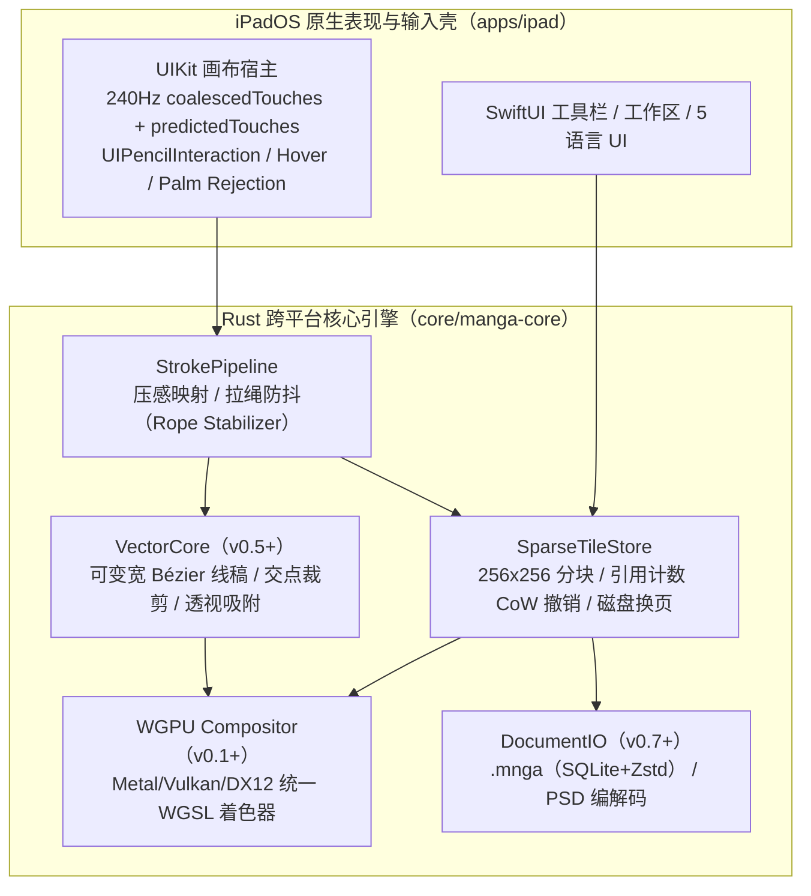

# 02. 技术架构选型与跨平台对比（RFC）

**语言 / Language**: [English](../en/02-architecture-and-tech-stack.md) | **简体中文**

---

## 1. 绘图软件与普通 App 的本质差异

评估 iPad 漫画创作软件的技术栈（特别是对比 **纯原生 iPadOS** 与 **Flutter 跨平台**），绝不能套用普通信息流/表单应用的标准。决定画师是否愿意每天连续创作 6 小时的核心是以下四项底层硬指标：

1. **笔尖到像素延迟（Pencil-to-Photon Latency）**：iPad Pro 120Hz ProMotion 下的行业标杆为 **≤ 9ms**。这要求直接捕获 UIKit 240Hz `coalescedTouches`（合并高采样点）、实时渲染 `predictedTouches`（系统级预测点）并在后续帧用 `estimatedPropertiesExpectingUpdates` 修正压感与倾角。
2. **Apple Pencil Pro 硬件专属能力**：悬停预览（`UIHoverGestureRecognizer`）、轻捏（`UIPencilInteraction` Squeeze）、笔杆旋转（`rollAngle`）、触觉反馈（Haptics）及系统级防误触（Palm Rejection）。
3. **超大画布分块显存与虚拟内存（Tiled GPU Canvas）**：一张 B4 600DPI 印刷级漫画页高达 `6071 × 8598` 像素，单层 16-bit RGBA 约占 400MB，30 个图层即超过 12GB 内存。必须构建 `256×256` 稀疏瓦片（Sparse Tile）显存池 + 写时复制（Copy-on-Write）撤销栈 + 磁盘换页（Disk Paging），无法依赖通用 2D UI 画布 API。
4. **不同硬件平台的差异化交互范式**：iPad（无笔身按键、依赖屏上双指手势与轻捏）、Android 平板（S-Pen/星闪笔实体侧键 + Android `FrontBufferedRenderer`）、桌面数位屏（高密度键盘快捷键 + WinTab/Windows Ink）在物理习惯上截然不同。

---

## 2. 三大技术路线硬核对比

| 评估维度 | 方案 A：纯原生 iPadOS (`Swift + UIKit/SwiftUI + Metal`) | 方案 B：纯 Flutter 跨平台 (`Dart + Impeller + 桥接插件`) | **方案 C（推荐）：薄原生壳 + 共享跨平台核心引擎** (`iPadOS 原生壳` + `Rust + wgpu 核心引擎`) |
| :--- | :--- | :--- | :--- |
| **Apple Pencil 延迟与手感** | ⭐⭐⭐⭐⭐ **极致（≤ 9ms）** 直连 `UITouch` 240Hz 采样、`predictedTouches` 与 `CAMetalLayer` | ⭐⭐ **存在底层硬伤** Flutter 在 120Hz iPad 上存在 3–4 帧管线延迟（如 `flutter#175790`）；框架不暴露 `predictedTouches`；重度画布仍需绕过 Impeller 写原生 `PlatformView`/`Texture` | ⭐⭐⭐⭐⭐ **极致（≤ 9ms）** UIKit 原生层零损耗采集 240Hz 与预测点，直接送入 Rust 核心，经 `wgpu` 直出 `CAMetalLayer`（底层直调 Metal） |
| **Apple Pencil Pro 支持** | ⭐⭐⭐⭐⭐ **首日原生支持** Squeeze、Hover、Barrel Roll、Haptics 开箱即用 | ⭐⭐ **滞后且脆弱** 依赖三方插件，且存在 Hover 误报为鼠标（`flutter#195249`）等边缘问题 | ⭐⭐⭐⭐⭐ **首日原生支持** UI 壳即原生 SwiftUI/UIKit，苹果新硬件 API 零延迟跟进 |
| **超大画布性能与内存** | ⭐⭐⭐⭐⭐ **顶级** 直接掌控 Metal Shaders 与显存池 | ⭐⭐⭐ **受限** Dart `CustomPainter` 扛不住 600DPI 多图层；采用 `Texture` Widget 桥接会引入额外合成拷贝并退化为双端原生维护 | ⭐⭐⭐⭐⭐ **顶级** Rust 无 GC 停顿；`wgpu` 在 iPadOS 编译为 Metal，Android 编译为 Vulkan，Windows 编译为 DX12，WGSL 着色器全端共用 |
| **前瞻跨平台扩展** *(macOS / Android / Windows)* | ⭐⭐ **局限苹果生态** 扩展 macOS 极快；迁移 Android/Windows 时核心引擎需重写 | ⭐⭐⭐⭐⭐ **UI 代码复用最高** 但强行用一套 UI 覆盖平板触控与桌面键鼠，易陷入「两边都不顺手」的体验妥协 | ⭐⭐⭐⭐ **80% 核心零重写 + 100% 原生体验** 文档模型、Tile 换页、笔刷防抖、矢量线稿、网点、PSD 读写全在 Rust 核复用；各平台仅维护薄原生 UI 壳 |
| **端侧 AI 集成** | ⭐⭐⭐⭐⭐ **极佳** 零拷贝直连 CoreML / Core AI（ANE 功耗低 10×） | ⭐⭐ **繁琐** 需通过 MethodChannel/FFI 反复拷贝大图纹理，易触发 OOM | ⭐⭐⭐⭐⭐ **极佳** 通过 `AIProvider` 抽象：iPad/Mac 走 CoreML/Core AI，Android 走 NNAPI，桌面走 ONNX Runtime / ComfyUI |
| **前期开发门槛（0.x）** | ⭐⭐⭐⭐⭐ **最快上线** 单语言 Swift + MSL，Xcode Instruments 调试最顺滑 | ⭐⭐⭐ **UI 快、画布坑深** 早期按钮快，一旦进入笔刷/防误触/Tile 显存便陷入复杂原生桥接 | ⭐⭐⭐ **初期桥接略高，长期复利极大** 需维护 `Swift ↔ Rust (C-ABI / UniFFI)` 边界，但从 `v0.5` 到跨平台阶段收益巨大 |

### 2.1 为什么最终结论是「方案 C（薄原生壳 + Rust/`wgpu` 内核）」？

> **核心原则：底层核心引擎必须跨平台统一（确保笔刷手感、矢量几何、`.mnga` 文档 100% 一致），但上层 UI 与手写笔输入必须按硬件平台原生定制（用户体验为先）。**

- **关于 Flutter**：Flutter + Impeller 在常规 120fps 业务 App 中表现优秀，但在专业绘画软件的**主画布与手写笔延迟**上处于结构性劣势——最终您依然不得不把最难的画布、笔刷、Tile 显存和 Pencil Pro 事件写成原生代码，Flutter 反而成了多出来的一层桥接负担。
- **关于方案 A 降级路径**：如果初期只有 1 位纯 Swift 开发者且希望在 3 个月内验证 iPad `v0.1–v0.3` 原型，可以先用纯 Swift + Metal 实现，但务必在代码结构上严格隔离「画布状态机 / 笔迹数学 / 文件格式」模块，以便后期平滑下沉至 Rust 内核。

---

## 3. 核心架构分层设计

### 3.1 关键内存与性能预算

| 指标 | 目标值（iPad Pro M2/M4, 8GB–16GB RAM） | 工程保障手段 |
| :--- | :--- | :--- |
| 笔迹到屏幕延迟 | `≤ 9ms`（120Hz ProMotion） | 240Hz 采样 + `predictedTouches` 临时叠加层 + 零阻塞 Render Thread |
| 单帧渲染预算 | `< 8.33ms` | 仅重绘脏瓦片（Dirty Tile Rect），不整画布重绘 |
| Tile 规格 | `256 × 256` RGBA8 / RGBA16F | 空白区域不分配内存；非活跃图层冷瓦片 Zstd 压缩换出至临时缓存目录 |
| 撤销/重做内存 | 100 步增量开销 `< 150MB` | 瓦片级写时复制（Copy-on-Write Snapshot），每步仅存被笔触修改的脏瓦片指针 |

---

## 4. MIT 开源协议依赖合规清单

为确保本项目永远可以**自由上架 Apple App Store、自由二次开发与商用**，CI 阶段应对依赖树执行协议审计：

| 合规分类 | 允许 / 禁止协议 | 推荐开源组件示例 |
| :--- | :--- | :--- |
| **✅ 严格允许** | MIT、Apache-2.0、BSD-2/3、Zlib、ISC、MPL-2.0（文件级） | Rust `wgpu`、`kurbo`、`tiny-skia`、`zstd`、`rusqlite`、`uniffi`；`ONNX Runtime`（MIT）；Apple 原生框架（Metal / UIKit / SwiftUI / CoreML / Core AI） |
| **❌ 严禁引入** | GPLv2、GPLv3、AGPL、LGPL（静态链接于 iOS）、闭源商业 SDK | Krita 源码、MyPaint GPL 组件、GPL 编解码版 FFmpeg、闭源笔刷商业引擎 |

---

## 5. 推荐开发工具链

- **硬件**：Apple Silicon Mac（M2/M3/M4）+ 支持 120Hz ProMotion 与 Apple Pencil Pro/2 的真机 iPad（**笔刷手感与压感曲线必须在真机调优**）。
- **工具链**：
  - `Xcode` + `Instruments`（Metal System Trace / Allocations 内存峰值剖析）
  - `Rust (cargo, rust-analyzer, clippy)` + `UniFFI` / `cbindgen`
  - `Python 3.12`（用于 `scripts/i18n_check.py` 多语言校验与自动化构建脚本）
