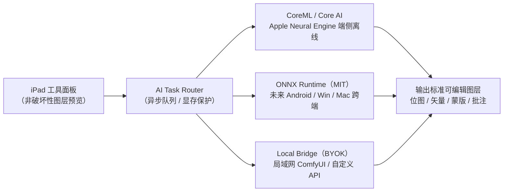

# 03. AI 辅助创作者工具集产品规格（Artist-in-the-Loop）

**语言 / Language**: [English](../en/03-ai-assistant-spec.md) | **简体中文**

---

## 1. 画师友好 AI 公约（设计底线）

二次元创作者普遍对「一键代画」「黑盒吞噬画风」「未经授权抓取作品训练」抱有强烈警惕。本项目的所有 AI 能力必须在代码与产品层面严格履行以下**四项不可逾越的底线**：

1. **辅助而非替代（Artist-in-the-Loop）**：AI 仅负责消灭机械、重复、耗腕的工程工序（铺底色、清杂线、提取背景线稿、打阴影初稿、连载查漏），绝不喧宾夺主替代画师的构图与笔触表达。
2. **100% 非破坏性可编辑输出**：所有 AI 结果必须输出为独立的**标准图层、矢量路径、选区蒙版或批注标记**，画师可随时用笔刷修改、调节不透明度或一键删除，绝不覆写原始线稿层。
3. **端侧离线优先（Local-First）**：核心辅助模型基于 Apple **CoreML / Core AI（Apple Neural Engine 加速）** 在 iPad 本地离线运行——**断网可用、零云端上传、零订阅费、绝不收集画作用于任何模型训练**。
4. **模块化按需下载 + 开放桥接（BYOK）**：主程序保持轻量，AI 模型包由用户按需单独下载或随时卸载；重型扩展工作流通过开放协议对接用户自建的局域网 **ComfyUI** 或自定义 API。

---

## 2. 六大核心 AI 辅助工具规格（`v1.1` – `v1.4`）

### 工具 1：语义感知一键分图层铺底色（Smart Flatting，`v1.1`）
- **痛点**：二次元赛璐璐漫画最枯燥的机械工序——逐个部位点油漆桶、修补线稿缺口、清除边缘白边、手动拆皮肤/头发/衣服图层。
- **交互流程**：
  1. 画师选中「参考线稿层」，点击 **AI 智能铺底色**。
  2. 端侧分割模型识别封闭/半封闭区域并按语义（皮肤、头发、瞳孔、服饰、配饰）自动生成对应命名的色块图层（默认置于线稿层下方）。
  3. 自动执行 1–2px 抗锯齿边缘扩张，彻底消灭白边；若绑定了角色色卡，自动吸取角色固有色。
- **技术路径**：端侧轻量分割模型（如 `MobileSAM` / `SAM2-Tiny` CoreML 量化版）+ 传统形态学闭口填充与颜色扩散算法。

### 工具 2：离线照片/3D 转黑白漫画背景（开源 LT 转换，`v1.1`）
- **痛点**：绘制教室、街道、室内道具等漫画背景耗时极长，而 CSP 的 LT 转换功能仅在昂贵的 EX 订阅版中提供。
- **交互流程**：
  1. 导入实拍照片或内置轻量 3D 场景视角。
  2. 一键拆分生成三层结构：`背景纯线稿层（可调线宽阈值）` + `程序化网点层（非破坏性可调 LPI/角度）` + `纯黑实心阴影层`。
  3. 画师可直接在结果上用笔刷局部擦除或补线，快速融入个人画风。
- **技术路径**：端侧边缘/深度/法线估计模型（CoreML）+ GPU 程序化半调网点着色器（Halftone WGSL Shader）。

### 工具 3：风格保留型草稿清稿与矢量化（Lineart Clean-up，`v1.2`）
- **痛点**：草稿阶段动态自然，但描精草/勾线极度消耗手腕，且传统全自动提线往往丢失画师原有的顿笔与粗细节奏。
- **交互流程**：
  1. 在草稿层上使用「AI 清稿圈选笔」框选局部或整图，调节「忠实度滑条（保留草稿笔触 ↔ 极简干净线）」。
  2. 生成新的**可编辑矢量线稿图层**，自动拟合可变线宽 Bézier 中心线，支持直接用矢量交点橡皮擦二次精修。
  3. 同步开启「断口雷达」：以淡青色微光高亮提示 `< 4px` 未闭合线稿缺口。

### 工具 4：3D 光源球引导自动赛璐璐二分（Light-Guided Cel Shading，`v1.2`）
- **痛点**：条漫与页漫连载每话动辄数十格，反复构思受光面、二分阴影与反光极易审美疲劳。
- **交互流程**：
  1. 在画布上直接用 Apple Pencil 拖动一枚可视化 **3D 光源球**（支持调节方位角、仰角、软硬边与阴影色温）。
  2. 实时在独立「正片叠底（Multiply）」图层预览并烘焙锐利的赛璐璐一分/二分阴影，同时可选生成「滤色/发光」轮廓边缘光图层。
- **技术路径**：端侧线稿法线图估计（Normal Map Estimation）+ 实时 Metal/wgpu 二值化光照着色器。

### 工具 5：拍照/草图提姿 3D 二次元比例人偶（`v1.3`）
- **痛点**：复杂仰视/俯视动态与手部特写容易画崩，外部 3D 摆姿软件切换繁琐且写实比例不适配二次元画风。
- **交互流程**：
  1. 直接导入参考照片或随手画火柴人草图，端侧姿态估计自动驱动内置轻量 3D 二次元人偶（支持 5/6/7/8 头身与男女/萌系比例切换）。
  2. 支持手部预设库微调，并与画布 1/2/3 点透视尺自动同步相机焦距与地平线。

### 工具 6：连载角色一致性巡检 & 本地工作流桥接（`v1.4`）
- **痛点**：长篇连载经常画漏角色发卡、纽扣或画反异色瞳；进阶技术向画师希望调用自己电脑上部署的 ComfyUI 工作流。
- **交互流程**：
  1. **AI 连载编辑巡检**：对照作者建立的「角色设定卡（三视图 + 色卡 + 配饰清单）」，扫描当前漫画页并仅以**可忽略的批注气泡**提示潜在穿帮（例如「第 3 格缺少左耳耳环」），绝不篡改画面。
  2. **开放本地桥接（BYOK / ComfyUI Bridge）**：支持输入局域网 ComfyUI 服务器地址或兼容 OpenAI/HTTP 的自定义推理接口，将当前选区/线稿作为输入发送至用户自有算力节点，返回结果自动作为新图层贴回画布。

---

## 3. 统一推理抽象架构（`AIProvider`）

- **内存安全保护**：iPad 在执行大画布（如 600DPI）AI 推理前，自动按分格框或当前选区裁剪 ROI（Region of Interest）送入推理，防止全图推理触发 iPadOS 内存上限（Jetsam）闪退。
