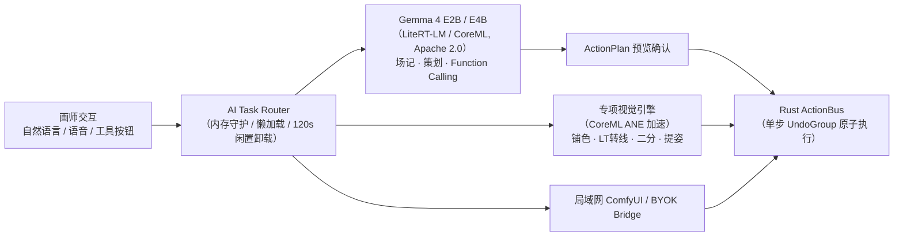

# 03. AI 辅助创作者工具集产品规格（含内嵌本地 Gemma 4 驱动中心）

**语言 / Language**: [English](../en/03-ai-assistant-spec.md) | **简体中文**

---

## 1. 画师友好 AI 公约（不可逾越的底线）

二次元创作者对「一键代画」「黑盒吞噬画风」「云端窃取作品训练」抱有高度警惕。本项目所有 AI 能力在代码与产品层面严格履行四项底线：

1. **辅助而非替代（Artist-in-the-Loop）**：AI 只接管场记、策划整理、批处理重复劳动与机械铺色/提线工序，**绝不替代画师的构图与个人笔触**。
2. **100% 非破坏性可编辑 + 一键整组撤回**：视觉类输出必须落盘为标准可编辑图层/矢量/蒙版；本地大模型驱动的复杂工作流必须先展示**可审阅的执行计划（ActionPlan）**，执行后支持单步一键整组撤回。
3. **端侧离线优先（Local-First）**：内嵌轻量本地模型（首选 **Gemma 4 E2B / E4B，Apache 2.0 协议**）与专项视觉模型全部在 iPad 本地离线运行——**断网可用、零云端上传、零订阅费、零画作训练**。
4. **按需下载 + 开放桥接（BYOK）**：模型包按需独立下载/卸载，不膨胀主程序体积；进阶画师可按需连接局域网 **ComfyUI** 或自定义推理端点。

---

## 2. 支柱一：内嵌本地多模态大模型驱动中心（Gemma 4 E2B / E4B）

依托 **Gemma 4 轻量端侧版（E2B 适配 8GB iPad / E4B 适配 16GB iPad Pro，Apache 2.0 协议）** 原生具备的 **文本 + 图像视觉 + 语音输入 + 140+ 语种 + 原生 Function Calling（结构化工具调用）** 能力，打造画师贴身的离线「副导演 / 场记 / 自动化总控大脑」：

### 能力 A：智能场记（Script Supervisor & Continuity Log）
解决长篇日漫/条漫连载中设定遗忘、跨页穿帮、返工核对耗时的核心痛点：
- **结构化场记本（随 `.mnga` 工程持久化）**：按「章节 → 页/条漫段 → 分格（Panel）」自动维护轻量 SQLite 场记表，记录：
  - 出场角色列表、当前服装/配饰状态（如「第 3 页起右袖破损、左耳戴银耳环」）；
  - 场景地点、时间段（黄昏/室内夜灯）、主光源方向；
  - 关键道具流转与剧情伏笔备注。
- **手不离笔语音速记**：利用 Gemma 4 原生音频输入，画师可边用 Apple Pencil 勾线边口述（支持普通话/粤语/英语/西语）：*「记场记：第 5 格男主眼镜摔裂了，这一话后面都要画裂纹」*，模型自动抽取结构化条目写入场记表。
- **多模态视觉穿帮巡检**：在当前页画完线稿或平涂后，将分格缩略图与对应角色设定卡、上一页场记一同送入 Gemma 4 视觉上下文，仅以**可忽略的批注气泡**提醒潜在遗漏（如「第 4 格未检测到女主发卡」），绝不篡改像素。

### 能力 B：剧情与分镜策划助手（Story & Storyboard Planner）
解决独立画师与同人作者从「灵感大纲」到「落地分格」卡壳、多语种出海台词排版繁琐的痛点：
- **大纲拆解分镜脚本**：输入一段剧情文本或语音灵感，Gemma 4 根据所选格式（**黑白页漫 4–6 格/页翻页悬念节奏** 或 **全彩条漫竖屏滑动节奏**）生成结构化分镜表（每格景别、镜头角度、动作提示、对白与拟声词建议）。
- **一键落盘分格占位草图框架**：确认策划表后，直接驱动 `ActionBus` 在画布上批量建立对应页数、分格框文件夹与待填气泡文本层，画师立即提笔起草稿。
- **5 语言气泡台词本土化校对**：基于 Gemma 4 原生多语能力，辅助将简体中文/英文台词润色为自然流畅的**繁体中文、地道粤语口语（港漫风可选）与西班牙语**，并自动估算气泡字数防止排版溢出。

### 能力 C：复杂重复工作流驱动引擎（Function-Calling Action Driver）
将漫画制作中大量重复点选菜单的枯燥操作，变为「一句话 / 一段语音 → 确定性宏计划 → 一键执行」：

| 典型画师自然语言 / 语音指令 | Gemma 4 Function Calling 生成的确定性 `ActionPlan` | 覆盖场景 |
| :--- | :--- | :--- |
| *「新建 4 页 B4 600DPI 日漫草稿，每页建好草图、矢量线稿、网点、气泡四个图层」* | `create_pages(count=4, preset="B4_600DPI")` → `batch_create_layers(["Sketch", "VectorInk", "Screentone", "Bubble"])` | 黑白页漫 |
| *「把所有叫 Sketch 的草图图层批量改淡蓝色、不透明度 30% 并锁定」* | `find_layers(pattern="Sketch*")` → `set_layer_tint("#4DA6FF")` → `set_layer_opacity(0.30)` → `set_layer_lock(true)` | 双线通用 |
| *「对当前页第 2 到 5 格，以线稿层为参考层，按小樱色卡跑一次闭口扩张填色，并在上方建正片叠底阴影层」* | `select_panels(2..5)` → `run_smart_flatting(ref="VectorInk", sheet="Sakura", expand_px=2)` → `create_layer("Shadow", blend="Multiply", clipping=true)` | 全彩条漫 / 插画 |
| *「把这 8 页的网点层统一从 60LPI 调成 55LPI，并导出 600DPI 印刷用 PSD」* | `find_layers(type="Screentone")` → `update_screentone(lpi=55)` → `export_psd(dpi=600)` | 黑白页漫 |
| *「把当前条漫按 800×1280 切片，分别导出简体、繁体粤语和西班牙语三个版本」* | `for locale in ["zh-Hans","yue-Hant","es"]: toggle_bubble_locale(locale) -> export_webtoon_slices(800, 1280)` | 全彩条漫 + 5 语言 |

> **安全护栏**：Gemma 4 仅拥有注册在白名单内的 `ActionBus` 工具调用权限；任何涉及批量修改或导出的计划必须先弹出**预览确认条**，执行过程包装在单个 `UndoGroup` 内，画师双指轻点即可完整回滚。

---

## 3. 支柱二：专项端侧视觉与图形辅助工具（`v1.1` – `v1.4`）

| 专项工具 | 服务主线 | 核心能力描述 | 端侧技术路径 |
| :--- | :--- | :--- | :--- |
| **1. 语义感知一键分图层铺底色（Smart Flatting）** | 全彩条漫 / 插画 | 基于参考线稿层一键按「皮肤/头发/瞳孔/服饰/配饰」拆层平涂，带 1–2px 防白边扩张与角色色卡自动吸色 | CoreML 量化 `MobileSAM` / `SAM2-Tiny` + 形态学闭口填充 |
| **2. 离线照片/3D 转黑白漫画背景（开源 LT 转换）** | 黑白页漫 | 导入实拍照片或 3D 房间视角，一键拆出「背景纯线稿层 + 非破坏性可调 LPI 网点层 + 纯黑阴影层」 | CoreML 边缘/深度估计 + WGSL 程序化半调网点着色器 |
| **3. 风格保留型草稿清稿 & 矢量化** | 双线通用 | 保留画师原有起收笔节奏，将杂乱草稿提纯为可调线宽的**矢量线稿层**，并附带 `< 4px` 断口雷达高亮 | 轻量线稿提取模型 + MIT 自研 Bézier 中心线拟合 |
| **4. 3D 光源球引导自动赛璐璐二分** | 全彩条漫 / 插画 | 画布直接拖放 3D 光源球，实时在独立 `Multiply` 图层生成锐利赛璐璐一分/二分阴影与轮廓高光 | 端侧线稿法线估计 + 实时 Metal/`wgpu` 二值光照着色器 |
| **5. 拍照/火柴人提姿 3D 二次元人偶** | 双线通用 | 拍照或画火柴人一键对齐内置 5–8 头身二次元 3D 人偶与手部库，并与 1/2/3 点透视尺自动锁焦 | 端侧轻量姿态估计（CoreML） + Metal 轻量骨骼渲染 |
| **6. 开放本地桥接（BYOK / ComfyUI Bridge）** | 进阶扩展 | 支持对接用户自建局域网 ComfyUI 或自定义 HTTP 端点，选区送出、结果作为新图层无损贴回 | 标准 JSON/WebSocket 插件桥接协议 |

---

## 4. 统一本地 AI 调度架构（内存与功耗保护）

