# 04. 分阶段整体开发规划（`v0.1–v0.9` → `v1.x`）

**语言 / Language**: [English](../en/04-roadmap.md) | **简体中文**

---

## 1. 迭代策略总览（黑白页漫 × 全彩条漫/插画 双线并重）

本项目正式确立**首阶段（`0.x`）双线并重策略**，并分两大演进阶段推进：

- **双线一等公民定位**：
  - **线 A — 黑白页漫（日漫/同人本）**：原生支持 B4/A4 600DPI 印刷规格（出血/裁切线）、G 笔出锋与拉绳防抖、矢量线稿层与矢量交点橡皮、分格框文件夹、GPU 非破坏性网点纸、中/日文竖排气泡。
  - **线 B — 全彩条漫/二次元插画（Webtoon & Illustration）**：原生支持超长条漫画布与 4K 插画规格、丰富赛璐璐图层混合模式、剪切蒙版/Alpha 锁定/参考图层、闭口识别与边缘扩张防白边油漆桶、条漫长图切片导出。
- **Pre-1.0 系列（`v0.1` – `v0.9`）**：聚焦搭建包含上述双线全部常用核心功能的高性能 iPad 基础框架，同时在 `v0.7–v0.8` 沉淀确定性 `ActionBus` 命令总线与工程场记元数据，为 `1.x` 本地 AI 驱动打好地基。
- **1.x 正式版系列（`v1.0` – `v1.5+`）**：在 `v1.0` 完成**整体 UI 视觉与交互体系升级**；在 `v1.1–v1.4` 接入**内嵌本地 Gemma 4（E2B/E4B）场记/策划/工作流驱动中心**与专项视觉 AI 工具集；在 `v1.5+` 依托 Rust/`wgpu` 内核向 macOS、Android 平板与 Windows 延伸。

> 详细的逐版本工程任务拆解（含任务 ID、模块路径与 DoD 验收标准）请见 [06. 开发任务细化清单](./06-development-tasks.md)。

```mermaid
flowchart LR
    subgraph Pre1["Pre-1.0 系列（v0.1 - v0.9）：黑白页漫 × 全彩条漫双线基础框架"]
        V01["v0.1 双模画布内核"] --> V02["v0.2 笔刷与防抖"]
        V02 --> V03["v0.3 赛璐璐图层栈"]
        V03 --> V04["v0.4 选区与防白边填色"]
        V04 --> V05["v0.5 矢量线稿与尺规"]
        V05 --> V06["v0.6 分格/网点/气泡/切片"]
        V06 --> V07["v0.7 .mnga/PSD/ActionBus"]
        V07 --> V08["v0.8 Pencil Pro与5语言"]
        V08 --> V09["v0.9 双线压测与Beta"]
    end

    subgraph V1X["1.x 正式版系列：UI 升级 + Gemma 4 本地 AI 驱动 + 跨端"]
        V10["v1.0 UI全面升级"] --> V11["v1.1 Gemma4场记策划+AI铺色/LT"]
        V11 --> V12["v1.2 Gemma4批处理驱动+清稿二分"]
        V12 --> V13["v1.3 3D人偶与多页/条漫工程"]
        V13 --> V14["v1.4 视觉穿帮巡检+ComfyUI桥接"]
        V14 --> V15["v1.5+ 多端生态"]
    end

    V09 --> V10
```

---

## 2. Pre-1.0 系列详细里程碑（`v0.1` – `v0.9`）

| 版本 | 里程碑主题 | 核心交付功能（双线并重） | 验收基准（Definition of Done） |
| :--- | :--- | :--- | :--- |
| **`v0.1`** | **Hello Stroke：双模画布基座与 i18n 地基** | • `256×256` 稀疏分块画布（`core/manga-core`）+ `wgpu`（Metal）瓦片合成 • UIKit 240Hz `coalescedTouches` + `predictedTouches` + 防误触 • **双线新建画布预设**：B4/A4 600DPI 页漫模板（含出血/裁切参考线）+ 800×12800 条漫/4K 插画模板 • `en` + `zh-Hans` 双基准 i18n 目录与 CI 校验 | 120Hz iPad Pro 真机稳定 120fps（`< 8.33ms`），手掌贴屏零误触 |
| **`v0.2`** | **二次元笔刷引擎与拉绳防抖** | • GPU 笔刷盖章引擎 + 压感/倾角/速度/Barrel Roll 曲线 • 双模式防抖（滑动加权 + 拉绳防抖 Stabilizer） • 8 支双线核心预设：G 笔、圆笔（页漫勾线）、铅笔、实心平涂笔、软喷枪、水彩混色笔（彩漫/插画）、硬/软橡皮 | 慢速拉长弧线无毛刺；G 笔出锋自然、平涂实心笔边缘干净无锯齿 |
| **`v0.3`** | **赛璐璐图层栈、蒙版与 CoW 撤销** | • 完整图层树（文件夹分组、显隐、锁定、图层标签色与草稿淡蓝着染） • **全彩核心**：剪切蒙版（Clipping Mask）、Alpha 锁定、参考图层、12+ 混合模式（正片叠底/滤色/发光减淡/线性加深等） • Tile 级写时复制（CoW）增量 Undo/Redo（100+ 步） | 4K 画布 30 图层连续撤销/重做 50 步耗时 `< 16ms` |
| **`v0.4`** | **选区、变形与防白边填色** | • 套索、框选、魔棒（参考图层感知、羽化/反选/扩张收缩） • **全彩条漫刚需**：闭口识别油漆桶（Close Gap 1–8px）+ 边缘扩张（Expand 1–3px 消灭白边）+ 涂抹封闭区填充 • 自由变换（缩放/旋转/透视扭曲）与基础液化 | 含 3px 断口的二次元线稿一键铺色零漏色、零白边 |
| **`v0.5`** | **矢量线稿层与漫画尺规系统** | • **黑白页漫核心**：可变线宽 Bézier 矢量线稿层（无损缩放、局部加粗减细） • **矢量交点橡皮擦**（一笔清除头发/衣褶交叉出头线） • 对称尺、平行尺、1/2/3 点透视尺（笔触吸附）、集中线/速度线尺规 | 矢量线稿放大 400% 锐利无锯齿；交叉出头线一次精准擦除 |
| **`v0.6`** | **分格、网点纸、多语气泡与条漫切片** | • **页漫闭环**：分格框文件夹（斜切/均分自动蒙版）+ 非破坏性 GPU 程序化网点纸（实时 LPI/角度/形状） • **双线文字气泡**：中/日文竖排（含标点挤压）+ 英/西横排（完整重音字形），支持多语言气泡图层分组 • **条漫预览与导出**：长画布手机阅读预览框 + 按平台规格一键切片导出 | 独立跑通「1 页 4 格黑白日漫」与「1 话 5 格全彩条漫切片」双端到端流程 |
| **`v0.7`** | **CPFF v1.0 `.prj` 工程、`.mnga`、PSD 与 `ActionBus`** | • **《创作工程文件框架 V1.0》**：同名 `.prj` XML 主控、大纲/分场/多语字典/多发行版目录与 Git/Git LFS 兼容（见 [07. CPFF v1.0](./07-creative-project-framework-v1.md)） • `.mnga` 开源画稿格式 + 多层 PSD 导入导出 + 延时回放（Timelapse MP4） • **确定性 `ActionBus` 命令总线**：统一封装图层/页面/填色/导出批处理接口（为 `1.x` Gemma 4 驱动奠基） | 工程可直接推送 GitHub/GitLab 协作；导出 PSD 在 CSP/PS 无损还原；`ActionBus` 批处理支持单步整组撤回 |
| **`v0.8`** | **iPad 触控、Pencil Pro 与 5 语言流水线** | • 双指撤回、三指重做、长按吸色、悬浮参考图小窗 • Apple Pencil Pro 轻捏（Squeeze）径向快捷盘 + 悬停（Hover）笔尖轮廓预览 • 蓝牙键盘与左手单手控制器映射 • **5 语言应用内即时切换**（`en`/`zh-Hans`/`zh-Hant`/`yue-Hant`/`es`）+ 自动翻译同步脚本 | 不点顶部菜单完成 80% 高频切换；5 语言即时切换零缺词 |
| **`v0.9`** | **Pre-1.0 双线极限压测、多语 QA 与 Beta** | • **页漫压测**：B4 600DPI 50+ 图层磁盘 Tile 换页稳态测试 • **条漫压测**：`1600×25600` 超长彩漫多图层滚动与切片内存压测 • 5 语言（重点西语/粤语/繁体）11 寸竖屏与 Split View 分屏零截断 QA • 中英双语 `CONTRIBUTING` 与 TestFlight 公开 Beta | 8GB iPad 上页漫与条漫两类重度工程均连续 2 小时零崩溃、零 UI 溢出 |

---

## 3. 1.x 正式版系列里程碑（`v1.0` – `v1.5+`）

| 版本 | 里程碑主题 | 核心创新与升级内容 |
| :--- | :--- | :--- |
| **`v1.0`** | **整体 UI 视觉升级与正式版发布** | 全新专业设计系统（极暗/护眼深灰/浅色主题、自定义左右手布局）；**双工作区模式一键切换**（*专注插画/条漫模式* vs *专业漫画工作台模式*）；5 语言精调定稿；开源笔刷/网点社区规范上线 |
| **`v1.1`** | **内嵌本地 Gemma 4（Phase 1）+ AI 铺色/LT** | • **集成内嵌本地 Gemma 4 E2B/E4B（Apache 2.0，LiteRT-LM/CoreML）**：上线离线**智能场记本（含语音手不离笔速记）**与**剧情/分镜策划助手（含 5 语言台词本土化润色）** • 专项视觉工具：**端侧语义一键分图层铺底色（全彩线）** + **开源离线照片转黑白漫画背景 LT 转换（页漫线）** • 模型包按需下载/卸载与 120s 闲置释放内存守护 |
| **`v1.2`** | **Gemma 4 复杂工作流驱动 + 清稿/光影二分** | • **Gemma 4 Function-Calling 工作流总控**：一句文字/语音驱动 `ActionBus` 执行跨页批处理（批建图层/草稿染蓝/批量改网点 LPI/多语种条漫批量切片导出），全程预览确认 + 单步一键整组撤回 • 专项视觉工具：**风格保留型草稿清稿 → 矢量线稿层** + **3D 光源球引导自动赛璐璐二分阴影** |
| **`v1.3`** | **3D 二次元人偶与多页/条漫连载工程** | • 内置二次元比例可摆拍 3D 人偶（拍照/火柴人提姿 + 手部库 + 透视尺联动） • 完整多页章节对页视图（含出版装订顺序）与条漫整话分集管理 |
| **`v1.4`** | **多模态场记穿帮巡检与 ComfyUI 桥接** | • **Gemma 4 视觉场记巡检**：对照角色设定卡与前页场记，以非破坏性批注气泡提醒漏画饰品/瞳色冲突/道具状态矛盾 • **开放局域网 ComfyUI / BYOK 桥接插件** |
| **`v1.5+`** | **多硬件平台延伸与开源脚本生态** | 复用 Rust/`wgpu` 核心与 LiteRT-LM 本地 AI 抽象，逐步发布 **macOS 原生版**、**Android 平板版（S-Pen/星闪笔低延迟）**与 **Windows 版（Windows Ink）**；开放 Lua/WASM 社区插件 API |
