# 04. 分阶段整体开发规划（`v0.1–v0.9` → `v1.x`）

**语言 / Language**: [English](../en/04-roadmap.md) | **简体中文**

---

## 1. 迭代策略总览

本项目采用**「先夯实底层骨架、后做视觉跃升与 AI 创新」**的双大阶段演进模式：

- **Pre-1.0 系列（`v0.1` – `v0.9`）**：聚焦搭建**包含二次元常用核心功能的高性能 iPad 基础框架**。UI 坚持简洁直观的工程化原型布局，将绝大多数研发精力集中于低延迟笔触、大画布内存稳定、矢量线稿、防白边填色、分格网点与 PSD 互通。
- **1.x 正式版系列（`v1.0` – `v1.5+`）**：在 `v1.0` 完成**整体 UI 视觉设计与交互体系升级**；随后在 `v1.1–v1.4` 密集落地**二次元 AI 辅助工具集**与连载管理；在 `v1.5+` 基于前期解耦的 Rust/`wgpu` 内核向 macOS、Android 平板与 Windows 扩展。

```mermaid
flowchart LR
    subgraph Pre1["Pre-1.0 系列（v0.1 - v0.9）：iPad 基础工具框架"]
        V01["v0.1 画布内核"] --> V02["v0.2 笔刷防抖"]
        V02 --> V03["v0.3 图层混合"]
        V03 --> V04["v0.4 选区填色"]
        V04 --> V05["v0.5 矢量尺规"]
        V05 --> V06["v0.6 分格网点"]
        V06 --> V07["v0.7 文档PSD"]
        V07 --> V08["v0.8 触控多语"]
        V08 --> V09["v0.9 压测Beta"]
    end

    subgraph V1X["1.x 正式版系列：UI 升级 + AI 创新 + 跨平台"]
        V10["v1.0 UI全面升级"] --> V11["v1.1 AI铺色/LT"]
        V11 --> V12["v1.2 AI清稿/光影"]
        V12 --> V13["v1.3 3D人偶/多页"]
        V13 --> V14["v1.4 巡检/ComfyUI"]
        V14 --> V15["v1.5+ 多端生态"]
    end

    V09 --> V10
```

---

## 2. Pre-1.0 系列详细里程碑（`v0.1` – `v0.9`）

### `v0.1` — Hello Stroke：低延迟画布基座与 i18n 地基
- **核心目标**：跑通 Apple Pencil 落笔到 GPU 出帧的极低延迟闭环，确立双基准 i18n 规范。
- **交付清单**：
  - `256×256` 稀疏分块画布数据结构（`core/manga-core`）与 `wgpu`（Metal 后端）瓦片渲染管线。
  - UIKit 画布宿主接入 `coalescedTouches`（240Hz）与 `predictedTouches` 预测点渲染。
  - 1 支基础硬圆笔 + 橡皮；双指无级缩放、平移、旋转；系统级防误触（Palm Rejection）。
  - 零硬编码 UI 文案基座：建立 `en` + `zh-Hans` 双基准词条与校验脚本。
- **验收基准**：120Hz iPad Pro 真机快速画圈稳定 120fps（帧时间 `< 8.33ms`），手掌贴屏零误触。

### `v0.2` — 二次元笔刷引擎与拉绳防抖
- **核心目标**：做出让二次元画师觉得「G 笔勾线真顺手」的笔刷手感。
- **交付清单**：
  - GPU 笔刷盖章引擎（笔尖纹理、间距、旋转、硬度、散射、混色基础）。
  - 压感 / 倾角 / 运笔速度 / Apple Pencil Pro 笔杆旋转（Barrel Roll）自定义响应曲线。
  - **双模式防抖**：滑动加权平均 + 拉绳防抖（Rope Stabilizer）。
  - 内置 8 支二次元常用预设：G 笔、圆笔、自动铅笔、实心平涂笔、软喷枪、模糊笔、硬橡皮、软橡皮。
- **验收基准**：慢速拉长弧线平滑无抖动锯齿；G 笔起收笔出锋自然。

### `v0.3` — 图层栈、蒙版与写时复制撤销
- **核心目标**：构建支撑二次元多层赛璐璐绘制的完整图层引擎。
- **交付清单**：
  - 图层树：位图层、文件夹分组、显隐、不透明度、锁定。
  - **高频核心**：剪切蒙版（Clipping Mask）、Alpha 锁定、参考图层（Reference Layer）标记。
  - 12+ 常用混合模式（正常、正片叠底、滤色、叠加、发光减淡、线性加深、强光、色相/饱和度等）。
  - 瓦片级写时复制（Copy-on-Write）增量撤销/重做栈（支持 100+ 步且低内存）。
- **验收基准**：4K 画布 30 图层连续撤销/重做 50 步耗时 `< 16ms`，无显存泄漏。

### `v0.4` — 选区、自由变形与防白边填色
- **核心目标**：对标 ibisPaint 与 CSP，解决二次元铺色最核心的「填色效率」问题。
- **交付清单**：
  - 套索、矩形/椭圆选区、魔棒（支持引用参考图层、羽化、反选、扩张/收缩）。
  - **闭口识别油漆桶**：支持设置缺口闭合阈值（Close Gap）与边缘像素扩张（Expand 1–3px），彻底消除白边；支持涂抹封闭区批量填充。
  - 自由变换（缩放、旋转、透视扭曲、水平/垂直翻转）与基础液化微调工具。
- **验收基准**：含 3px 微小断口的线稿一键填色无漏色、线稿边缘零白边。

### `v0.5` — 矢量线稿图层与漫画尺规系统
- **核心目标**：补齐 Procreate 最大短板，建立专业漫画线稿能力。
- **交付清单**：
  - **矢量线稿层**：存储带压感宽度曲线的 Bézier 中心线，支持无损缩放与局部线宽加粗/减细。
  - **矢量交点橡皮擦**：自动计算线段交点，一笔精准擦除头发/衣褶交叉出头线段。
  - 对称尺、平行线尺、1/2/3 点透视尺（支持笔触自动吸附）、同心圆与集中线尺规。
- **验收基准**：矢量线稿放大 400% 边缘锐利无锯齿；交叉出头线一次擦净。

### `v0.6` — 漫画分格、非破坏性网点纸与多语种气泡
- **核心目标**：跑通一页完整日漫/彩漫的页面级制作闭环。
- **交付清单**：
  - **分格框文件夹（Frame Border Folder）**：一键斜切/均分格线，格内图层自动蒙版裁切不溢出。
  - **GPU 程序化网点纸图层**：非破坏性实时调节圆点/线条/噪点、线数（LPI）、角度与浓度。
  - 漫画对话框气泡模板 + **中/日文竖排（含标点挤压）与英文/西班牙语横排（完整重音字形）**文字工具。
- **验收基准**：端到端完成 1 页 4 格黑白漫画（含分格、网点与双语气泡）并无损导出。

### `v0.7` — 开放文档格式 `.mnga`、多层 PSD 互通与过程回放
- **核心目标**：建立可靠的数据持久化与行业软件协作能力。
- **交付清单**：
  - 开源开放文档格式 `.mnga`（SQLite/ZIP + Zstd 压缩 Tile + JSON 元数据，支持后台增量自动保存与断电恢复）。
  - 导出 PNG / JPG / PDF，以及**多层 PSD 导入导出**（兼容 CSP / Photoshop 图层结构与混合模式）。
  - 零卡顿**过程回放录制（Timelapse）**与 MP4 导出。
  - 本地画廊管理、作品分组与 Files App / iCloud Drive 集成。
- **验收基准**：导出的多层 PSD 在 CSP/PS 中打开混合模式与透明度一致；强制杀进程重启后画作零丢失。

### `v0.8` — iPad 触控手势、Apple Pencil Pro 与 5 语言流水线
- **核心目标**：将日常绘制效率提升至接近肌肉记忆水平，并正式激活 5 语言切换。
- **交付清单**：
  - 完整触控手势：双指轻点撤回、三指轻点重做、长按吸色、双指快速捏合复位视图。
  - **Apple Pencil Pro 深度调优**：轻捏（Squeeze）呼出自定义径向快捷盘、悬停（Hover）实时预览笔尖轮廓与旋转方向。
  - 悬浮参考图小窗（支持直接吸色）、蓝牙键盘与左手单手控制器快捷键自定义。
  - **5 语言应用内即时切换**：基于 `en`/`zh-Hans` 双基准与术语词典，补齐 `zh-Hant` / `yue-Hant` / `es` 词条。
- **验收基准**：熟练画师全程不点击顶部菜单即可完成 80% 线稿与铺色切换；5 语言即时切换零缺词。

### `v0.9` — Pre-1.0 性能压测、多语 UI 防截断与公开 Beta
- **核心目标**：达到可交付真实连载画师日常使用的稳定性标准。
- **交付清单**：
  - B4 600DPI（`6071×8598`）超大画布磁盘虚拟内存换页压测与冷瓦片自动回收。
  - 自动化视觉回归测试（关键滤镜/混合模式/PSD 渲染比对）。
  - **5 语言全屏与分屏（Split View）布局核验**：重点排查并微调西班牙语长文案、繁体中文与粤语 UI 溢出。
  - 完善中英双语开源贡献指南，开启 TestFlight 公开 Beta 测试。
- **验收基准**：8GB 内存 iPad 流畅运行 B4 600DPI 50+ 图层连续绘制 2 小时零崩溃；5 语言零文案截断。

---

## 3. 1.x 正式版系列里程碑（`v1.0` – `v1.5+`）

| 版本 | 主题 | 核心内容与创新特色 |
| :--- | :--- | :--- |
| **`v1.0`** | **整体 UI 视觉升级与正式版发布** | 全新专业设计系统（极暗/护眼深灰/浅色主题、自定义左右手布局）；**双工作区模式一键切换**（*专注插画模式* vs *漫画工作台模式*）；5 语言精调定稿；开源笔刷/网点社区规范正式发布 |
| **`v1.1`** | **AI 辅助工具集 Phase 1** | 端侧离线**语义智能分图层铺底色（Smart Flatting）**；**开源离线照片/3D 转黑白漫画背景（LT 转换）**；端侧模型按需下载管理器 |
| **`v1.2`** | **AI 辅助工具集 Phase 2** | **风格保留型草稿清稿 → 矢量线稿层**；实时断口闭合雷达；**3D 光源球引导自动赛璐璐二分阴影**（独立正片叠底与边缘光图层） |
| **`v1.3`** | **3D 二次元人偶与多页连载** | 轻量 3D 二次元比例人偶（含拍照/火柴人提姿与手部预设库）；**多页章节管理视图**（对页、出血/裁切线）；**条漫（Webtoon）长画布预览与切片导出** |
| **`v1.4`** | **角色设定巡检与开放工作流** | 角色设定卡与色卡管理；**AI 连载一致性巡检助手**（仅批注提醒穿帮，不改画面）；**局域网 ComfyUI / 自定义 API 桥接插件（BYOK）** |
| **`v1.5+`** | **多硬件平台延伸与插件生态** | 复用 Rust/`wgpu` 核心引擎扩展至 **macOS 原生版**、**Android 平板版（S-Pen/星闪笔低延迟）**与 **Windows 版（Windows Ink）**；开放 Lua/WASM 轻量脚本插件接口 |
