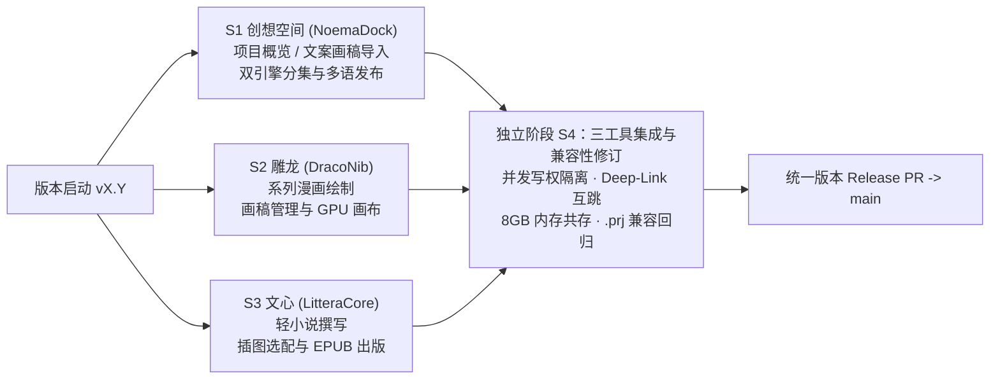

# 04. 分阶段整体开发规划（`v0.1–v0.9` → `v1.x`）

**语言 / Language**: [English](../en/04-roadmap.md) | **简体中文**

---

## 1. 迭代策略总览（黑白页漫 × 全彩条漫/插画 双线并重）

本项目正式确立**首阶段（`0.x`）双线并重策略**，并分两大演进阶段推进：

- **双线一等公民定位**：
  - **线 A — 黑白页漫（日漫/同人本）**：原生支持 B4/A4 600DPI 印刷规格（出血/裁切线）、G 笔出锋与拉绳防抖、矢量线稿层与矢量交点橡皮、分格框文件夹、GPU 非破坏性网点纸、中/日文竖排气泡。
  - **线 B — 全彩条漫/二次元插画（Webtoon & Illustration）**：原生支持超长条漫画布与 4K 插画规格、丰富赛璐璐图层混合模式、剪切蒙版/Alpha 锁定/参考图层、闭口识别与边缘扩张防白边油漆桶、条漫长图切片导出。
- **Pre-1.0 系列（`v0.1` – `v0.9`）**：聚焦搭建双线全部核心功能的高性能引擎，并于 **`v0.8–v0.9` 完成第一波次 Apple 三端同出（iPad · 触摸屏 MacBook · iPhone Duo 折叠双形态）** 联合公测；同时沉淀确定性 `ActionBus`、CPFF v1.0 `.prj` 与 `platform.rs` 姿态引擎。
- **1.x 正式版系列（`v1.0` – `v1.5+`）**：在 `v1.0` 于 Apple 三端同步发布**整体 UI 升级 + 小说 × 漫画双引擎并进 + 本地 Gemma 4 双向参考稿**；自 `v1.1` 起分阶段产出第二波次全生态兼容版：**`v1.1` Android Pad / 折叠屏手机** → **`v1.2` 触摸屏 Windows Notebook / 2-in-1 Pad** → **`v1.3` 触摸屏 Linux Notebook / Pad**，并逐步补齐专项视觉 AI 与插件生态。

> 详细的逐版本工程任务拆解（含任务 ID、模块路径与 DoD 验收标准）请见 [06. 开发任务细化清单](./06-development-tasks.md)。

### 1.1 三独立工具套件与每版本「3+1 四段式」PR 发布纪律

> **命名留置说明**：以下三款工具的中文名、英文名与西语名目前均作为**暂定开发代号**使用，待后续发版前最终品牌确认后再通过专项 PR 定稿。

为兼顾系统内存/显存占用与专业专注体验，本项目基于同一套 CPFF v1.0（`.prj`）文件体系，拆分为三个**既可单独低耗运行、又可同屏并发协同**的独立工具，且**每个版本 `vX.Y` 必须拆分为 4 个明确子项目，全部完成后才统一发起版本 PR 发布**：

| 阶段范围 | `S1` 创想空间 (`NoemaDock`，暂定代号) | `S2` 雕龙 (`DracoNib`，暂定代号) | `S3` 文心 (`LitteraCore`，暂定代号) | `S4` 集成兼容修订阶段（通过后统一 PR） |
| :--- | :--- | :--- | :--- | :--- |
| **`v0.1`–`v0.3`** | `.prj` 读写、新建工程向导、项目概览、5 语言基座 | 低延迟 `256×256` 稀疏画布、240Hz 笔刷防抖、13 混合赛璐璐图层 | 轻小说纯文本/MD 基础编辑、章节挂载、共享大纲/圣经只读窗 | 校验 `manga-core` Feature 裁剪、三工具共享 `.prj` 写权隔离与 CI 门禁 |
| **`v0.4`–`v0.6`** | 文案与画稿批量导入、分集/分话目录管理、5 语字典与气泡巡检 | 防白边闭口填色、矢量线稿 + 交点橡皮、尺规、分格、网点、条漫切片 | 多语小说章节管理、字典专有名词联想、`<DivergenceNote>` 有意分歧标记 | 校验「雕龙」脚本与「创想空间」词条同步、「文心」正文与漫画零相互覆写 |
| **`v0.7`–`v0.9`** | 多发行版打包中心、Git+LFS 同步、Apple 三端（iPad/MacBook 触摸/iPhone Duo）工程同步 | `.mnga`/PSD、`ActionBus`、Pencil Pro、MacBook 直触与 iPhone Duo 适配 | 轻小说插图管理（自选漫画页或定制插图）、EPUB3/MD 导出、iPhone Duo 单手写作 | **Wave 1 三端三工具联合兼容修订**：并发热刷新、Deep-Link 互跳、8GB 三开内存压测 → Beta PR |
| **`v1.0`** | 正式版 UI、双引擎状态仪表盘、Gemma 4 本地模型包管理 | 正式版画布 UI、画布内嵌「小说→漫画 AI 中间稿」半透明参考窗 | 正式版轻小说工坊、并排「漫画→小说 AI 参考稿」对照写作（`ai_assist/` 隔离） | **`v1.0` 正式版总闸门**：AI 红线审计、双终稿解耦回归、Apple 三端同步正式 PR |
| **`v1.1`–`v1.4`** | Wave 2 三平台（`v1.1` Android / `v1.2` Win / `v1.3` Linux）发布中心、多卷连载与场记总览 | 智能铺底色、离线 LT、Gemma 4 批处理宏、清稿矢量化、3D 人偶、视觉穿帮巡检、ComfyUI | 语音速记场记、5 语言小说润色、多卷轻小说排版与高分插图联动 | 每版交付前针对目标平台（Android 折叠 / Win 2-in-1 / Linux Wayland）完成 S4 三工具联调 → PR |

---

## 2. Pre-1.0 系列详细里程碑（`v0.1` – `v0.9`）

| 版本 | 里程碑主题 | 核心交付功能（双线并重 + Wave 1 Apple 三端） | 验收基准（Definition of Done） |
| :--- | :--- | :--- | :--- |
| **`v0.1`** | **Hello Stroke：双模画布基座与 i18n 地基** | • `256×256` 稀疏分块画布（`core/manga-core`）+ `wgpu`（Metal）瓦片合成 • UIKit 240Hz `coalescedTouches` + `predictedTouches` + 防误触 • **双线新建画布预设**：B4/A4 600DPI 页漫模板（含出血/裁切参考线）+ 800×12800 条漫/4K 插画模板 • `en` + `zh-Hans` 双基准 i18n 目录与 CI 校验 | 120Hz iPad Pro 真机稳定 120fps（`< 8.33ms`），手掌贴屏零误触 |
| **`v0.2`** | **二次元笔刷引擎与拉绳防抖** | • GPU 笔刷盖章引擎 + 压感/倾角/速度/Barrel Roll 曲线 • 双模式防抖（滑动加权 + 拉绳防抖 Stabilizer） • 8 支双线核心预设：G 笔、圆笔（页漫勾线）、铅笔、实心平涂笔、软喷枪、水彩混色笔（彩漫/插画）、硬/软橡皮 | 慢速拉长弧线无毛刺；G 笔出锋自然、平涂实心笔边缘干净无锯齿 |
| **`v0.3`** | **赛璐璐图层栈、蒙版与 CoW 撤销** | • 完整图层树（文件夹分组、显隐、锁定、图层标签色与草稿淡蓝着染） • **全彩核心**：剪切蒙版（Clipping Mask）、Alpha 锁定、参考图层、12+ 混合模式（正片叠底/滤色/发光减淡/线性加深等） • Tile 级写时复制（CoW）增量 Undo/Redo（100+ 步） | 4K 画布 30 图层连续撤销/重做 50 步耗时 `< 16ms` |
| **`v0.4`** | **选区、变形与防白边填色** | • 套索、框选、魔棒（参考图层感知、羽化/反选/扩张收缩） • **全彩条漫刚需**：闭口识别油漆桶（Close Gap 1–8px）+ 边缘扩张（Expand 1–3px 消灭白边）+ 涂抹封闭区填充 • 自由变换（缩放/旋转/透视扭曲）与基础液化 | 含 3px 断口的二次元线稿一键铺色零漏色、零白边 |
| **`v0.5`** | **矢量线稿层与漫画尺规系统** | • **黑白页漫核心**：可变线宽 Bézier 矢量线稿层（无损缩放、局部加粗减细） • **矢量交点橡皮擦**（一笔清除头发/衣褶交叉出头线） • 对称尺、平行尺、1/2/3 点透视尺（笔触吸附）、集中线/速度线尺规 | 矢量线稿放大 400% 锐利无锯齿；交叉出头线一次精准擦除 |
| **`v0.6`** | **分格、网点纸、多语气泡与条漫切片** | • **页漫闭环**：分格框文件夹（斜切/均分自动蒙版）+ 非破坏性 GPU 程序化网点纸（实时 LPI/角度/形状） • **双线文字气泡**：中/日文竖排（含标点挤压）+ 英/西横排（完整重音字形），支持多语言气泡图层分组 • **条漫预览与导出**：长画布手机阅读预览框 + 按平台规格一键切片导出 | 独立跑通「1 页 4 格黑白日漫」与「1 话 5 格全彩条漫切片」双端到端流程 |
| **`v0.7`** | **CPFF v1.0 `.prj` 工程、`.mnga`、PSD 与 `ActionBus`** | • **《创作工程文件框架 V1.0》**：同名 `.prj` XML 主控、大纲/分场/多语字典/多发行版目录与 Git/Git LFS 兼容（见 [07. CPFF v1.0](./07-creative-project-framework-v1.md)） • `.mnga` 开源画稿格式 + 多层 PSD 导入导出 + 延时回放（Timelapse MP4） • **确定性 `ActionBus` 命令总线**：统一封装图层/页面/填色/导出批处理接口（为 `1.x` Gemma 4 驱动奠基） | 工程可直接推送 GitHub/GitLab 协作；导出 PSD 在 CSP/PS 无损还原；`ActionBus` 批处理支持单步整组撤回 |
| **`v0.8`** | **Apple 三端触控/折叠适配与 5 语言流水线** | • **iPad**：双指撤回/三指重做、Pencil Pro 轻捏径向盘与悬停轮廓、参考图小窗 • **触摸屏 MacBook**：屏幕直接多点触控防误触 + 触控板手势 + 桌面键盘快捷键融合 • **iPhone Duo**：折叠态单手轻小说/语音场记/速写 ↔ 展开态铰链避让双联画布 • **5 语言应用内即时切换**（`en`/`zh-Hans`/`zh-Hant`/`yue-Hant`/`es`） | 不点顶部菜单完成 80% 高频切换；三端 5 语言即时切换零缺词 |
| **`v0.9`** | **Pre-1.0 Apple 三端联合 Beta（iPad / 触摸屏 MacBook / iPhone Duo）** | • **三端同步产出**：完成 **iPad**、**触摸屏 MacBook**、**iPhone Duo** 三个目标平台的 Beta 包与 PR 流水线 • **双线极限压测**：B4 600DPI 50+ 图层与 `1600×25600` 彩漫磁盘换页稳态测试 • 5 语言（重点西语/粤语/繁体）在 iPad 分屏、Mac 触控大屏与 iPhone Duo 折叠/展开态零截断 QA | 三端均通过 2 小时双线重度压测零崩溃、零 UI 溢出，正式进入 TestFlight / 公测 |

---

## 3. 1.x 正式版系列里程碑（`v1.0` – `v1.5+`）

| 版本 | 里程碑主题 | 核心创新、AI 能力与 Wave 2 跨平台交付 |
| :--- | :--- | :--- |
| **`v1.0`** | **Apple 三端正式版 + 小说 × 漫画双引擎并进** | • **iPad · 触摸屏 MacBook · iPhone Duo 三端同步正式发布** • **全新专业设计系统与三工作区一键切换**：*专注插画/条漫* ↔ *专业漫画工作台* ↔ **小说 × 漫画双引擎并行**（iPhone Duo 展开态天然适配左小说右画布），5 语言精调定稿 • **轻小说创作引擎 + 内嵌本地 Gemma 4（E2B/E4B）双向 AI 参考稿**：一键生成隔离在 `ai_assist/`（`role="ai_reference_only"`）的双向参考稿，**人工小说终稿与漫画原稿完全解耦独立**，轻小说支持自选漫画页或单独定制插图导出 EPUB/Markdown |
| **`v1.1`** | **Android Pad / 折叠屏兼容版 + Gemma 4 语音场记 & 铺色/LT** | • **Wave 2 首个跨生态平台**：正式产出 **`apps/android/`（Android Pad & 折叠屏手机）**——Jetpack Compose + `WindowManager` 折叠态/半折 Tabletop 模式 + S-Pen/星闪 M-Pencil/USI 2.0 低延迟前缓冲 + Vulkan `wgpu` + 5 语言 `strings.xml` • **离线智能场记本（语音速记 + `<DivergenceNote>` 感知）** + **端侧语义一键铺底色** + **开源离线 LT 转换** |
| **`v1.2`** | **触摸屏 Windows 兼容版 + Gemma 4 批处理驱动 & 清稿/二分** | • **Wave 2 第二平台**：正式产出 **`apps/windows/`（触摸屏 Windows Notebook / 2-in-1 Pad）**——WinUI 3 + `WM_POINTER`/Windows Ink 压感防误触 + 2-in-1 平板模式自动切换 + DirectX 12 `wgpu` + MSIX/Portable 包 • **Gemma 4 Function-Calling 批处理驱动（`ActionBus` 预览 + 单步撤回）** + **风格保留草稿清稿矢量化** + **3D 光源球赛璐璐二分** |
| **`v1.3`** | **触摸屏 Linux 兼容版 + 3D 二次元人偶 & 连载工程** | • **Wave 2 第三平台**：正式产出 **`apps/linux/`（触摸屏 Linux Notebook / Pad）**——Rust 原生直连 `manga-core` + GTK4/Wayland `zwp_tablet_v2` 压感 + `libinput` 多点触控 + Vulkan `wgpu` + Flatpak/AppImage 包 • 内置二次元比例 3D 人偶（联动小说→漫画自动摆姿占位）+ 多页章节对页视图与条漫分集/轻小说多卷管理 |
| **`v1.4`** | **多模态场记穿帮巡检与 ComfyUI 桥接** | • **Gemma 4 视觉场记巡检**（尊重 `<DivergenceNote>`，非破坏性批注提醒设定遗漏） • **开放局域网 ComfyUI / BYOK 桥接插件**（全六端可用，可选生成小说→漫画视觉草图隔离存放于 `ai_assist/`） |
| **`v1.5+`** | **六端全能力对齐与开源脚本生态** | iPad、触摸屏 MacBook、iPhone Duo、Android Pad/折叠屏、Windows 触摸本/Pad、Linux 触摸本/Pad 全六端 `.prj` Git 无缝接力；开放 Lua/WASM 社区插件 API |
