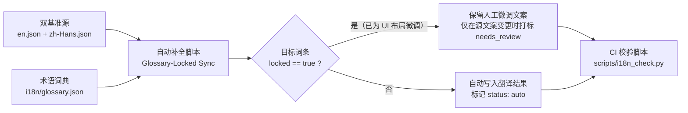

# 05. 多语言国际化（i18n / L10n）与中英双语文档规范

**语言 / Language**: [English](../en/05-i18n-and-l10n-guide.md) | **简体中文**

---

## 1. 支持范围与双基准源策略

本项目遵循**「英文（`en`）+ 中文简体（`zh-Hans`）双基准源」**原则：
- **项目文档**：根目录 README 与 `docs/` 下全部架构/规划文档均 1:1 维护 **英文版（`docs/en/`）** 与 **中文简体版（`docs/zh-CN/`）**。
- **应用程序界面（App UI）**：至少覆盖 **5 种语言**，一切以 `en` 和 `zh-Hans` 为人工精校基准源，其余 3 种语言由自动翻译流水线结合专业绘画术语词典生成，并支持针对界面布局的人工微调锁定。

| 语言版本 | Locale 代码（BCP-47 / iPadOS） | 基准角色 | 自动翻译首选源 | 关键本地化与布局要点 |
| :--- | :--- | :--- | :--- | :--- |
| **英文版** | `en` | **基准源 #1** | 人工维护 | 国际 MIT 开源社区通用标准；西班牙语翻译首选源 |
| **中文简体版** | `zh-Hans` | **基准源 #2** | 人工维护 | 国内二次元画师标准术语；繁体中文与繁体粤语转换/翻译首选源 |
| **繁体中文版** | `zh-Hant`（`zh-Hant-TW` 习惯） | 自动补全 + 术语微调 | `zh-Hans` + `en` | 严格区分专业绘图术语差异，避免机械繁简字替换 |
| **繁体粤语版** | `yue-Hant`（兼容 `zh-HK`） | 自动补全 + 粤语润色微调 | `zh-Hans` + `zh-Hant` | iPadOS 需内置应用内语言切换并支持 `zh-HK → yue-Hant` 回退；兼顾港粤自然操作用语与专业美术术语准确度 |
| **西班牙语版** | `es`（中性通用西语） | 自动补全 + **重点布局微调** | `en` | 文本长度通常比英文长 **25%–40%**、比中文长 **2–3 倍**，是防截断布局测试的最高优先级语言 |

---

## 2. 绘画专业核心术语对照规范（节选）

完整机器可读词典维护在 [`i18n/glossary.json`](../../i18n/glossary.json) 中，自动翻译流水线必须强制锁定以下专业词汇：

| 英文 (`en`) | 中文简体 (`zh-Hans`) | 繁体中文 (`zh-Hant`) | 繁体粤语 (`yue-Hant`) | 西班牙语 (`es`) | 备注 |
| :--- | :--- | :--- | :--- | :--- | :--- |
| Layer | 图层 | 圖層 | 圖層 | Capa | 简短高频 |
| Clipping Mask | 剪切蒙版 | 剪裁遮色片 | 剪裁遮罩 | Máscara de recorte | 西语超长，工具栏需用 `short` Key 或纯图标 |
| Reference Layer | 参考图层 | 參考圖層 | 參考圖層 | Capa de referencia | 同上 |
| Vector Layer | 矢量图层 | 向量圖層 | 向量圖層 | Capa vectorial | 注意「矢量」与「向量」地区术语区分 |
| Stabilizer | 防抖 | 防手震 | 防震修正 | Estabilizador | 笔刷防抖核心术语 |
| Screentone | 网点纸 | 網點紙 | 網點紙 | Trama | 西语 `Trama` 紧凑适合按钮 |
| Close Gap | 间隙闭合 | 封閉間隙 | 填補空隙 | Cerrar huecos | 二次元油漆桶高频设置 |
| Selection | 选区 | 選取範圍 | 揀選範圍 | Selección | 粤语界面动词自然用「揀選」 |
| Undo / Redo | 撤销 / 重做 | 復原 / 重做 | 撤銷 / 重做 | Deshacer / Rehacer | 保持单按钮短文案 |

---

## 3. 自动翻译补全与「人工布局微调保护」机制

为了解决「自动翻译会覆盖掉人工针对 UI 长度精心微调的文案」这一常见痛点，本项目在 [`i18n/locales/*.json`](../../i18n/locales/) 中为每条目标语词条设计了显式状态元数据：

```json
{
  "tool.clipping_mask.short": {
    "value": "Máscara",
    "status": "tuned",
    "locked": true,
    "max_chars": 12
  }
}
```



---

## 4. 界面布局防爆设计规范（特别是西班牙语与窄分屏）

1. **图标优先原则（Icon-First Canvas Chrome）**：主画布周边的常用笔刷/橡皮/套索/油漆桶工具条坚持采用**高辨识度图标 + Apple Pencil 悬停/长按浮层标题**，不把长文本硬塞进窄按钮。
2. **双粒度 Key 拆分（`.short` vs `.full`）**：
   - `*.short`：用于工具条、分段控件（Segmented Control）与紧凑标签，强制携带 `max_chars` 上限预算，CI 自动检查是否越界。
   - `*.full`：用于下拉菜单、设置详情页与提示弹窗，允许完整表达（如 `Máscara de recorte`）。
3. **SwiftUI 自适应组件策略**：
   - 侧边栏与弹窗宽度采用弹性范围（`minWidth`–`maxWidth`），允许最多 2 行换行或轻度字号缩放（`minimumScaleFactor(0.85)`）。
   - 在 `v0.9` Beta 与 `v1.0` UI 升级阶段，必须覆盖 **iPad 11 寸竖屏 + 1/3 Split View 分屏** 下的西语、繁体与粤语真机截图回归检查。
4. **字体栈兜底**：iPadOS 明确按 Locale 优先匹配系统字形（`PingFang SC` / `PingFang TC` / `PingFang HK` 含香港粤语常用字 / `SF Pro` 含完整西语重音 `¡ ¿ ñ á é í ó ú ü`）。

---

## 5. CI 自动化校验命令

每次提交 PR 或修改 `i18n/` 目录后，运行以下命令验证 5 语言完整性：

```bash
python3 scripts/i18n_check.py
```

校验覆盖：
1. 所有 5 个语言包的 Key 集合与 `en.json` / `zh-Hans.json` 100% 一致（零缺失、零孤立冗余键）。
2. 无空字符串，且元数据 `status` / `locked` 合法。
3. 格式化占位符（如 `{count}`、`{percent}`）在 5 种语言中完全匹配。
4. 所有带 `max_chars` 的紧凑 UI 词条（重点保护 `es` 西语按钮）严格在长度预算内。
