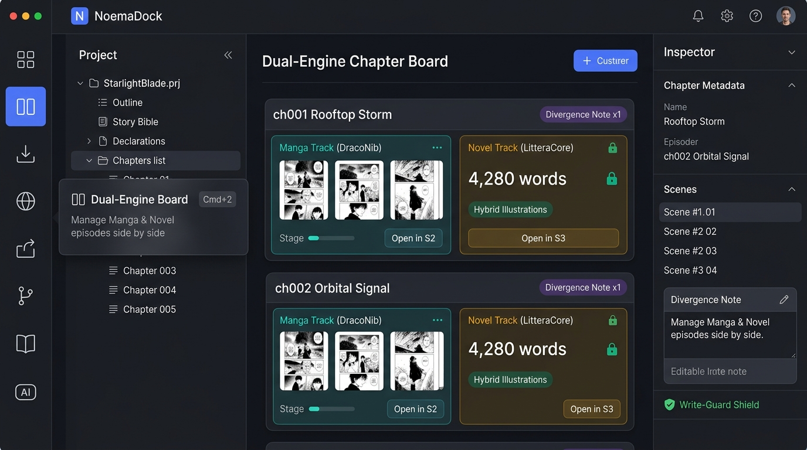
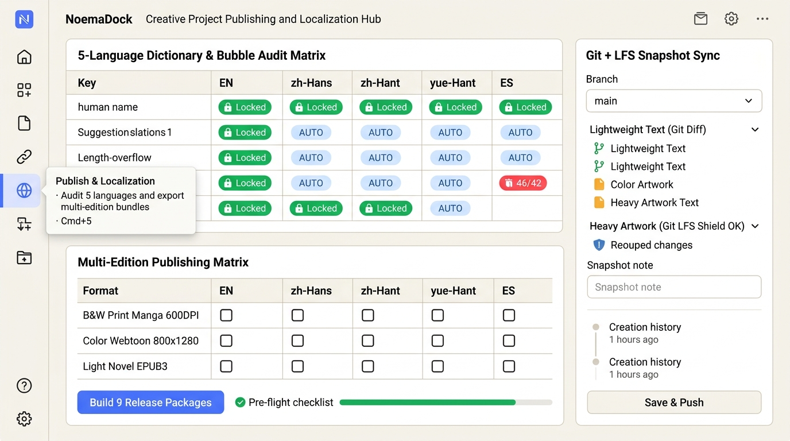
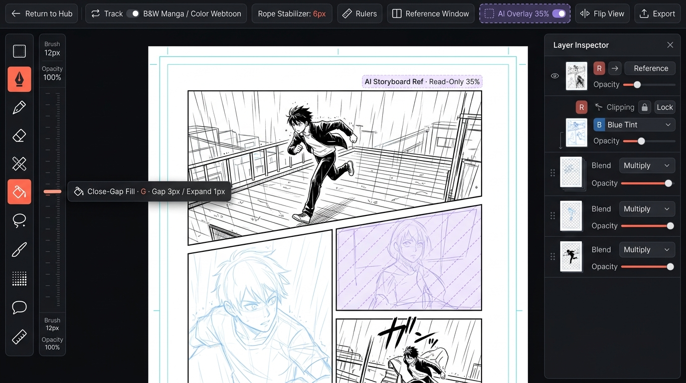
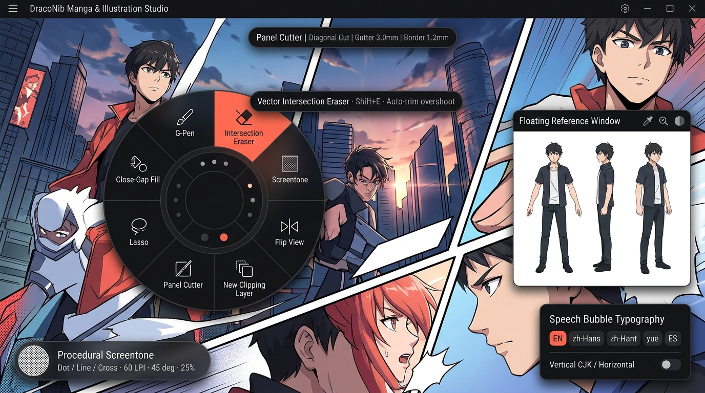
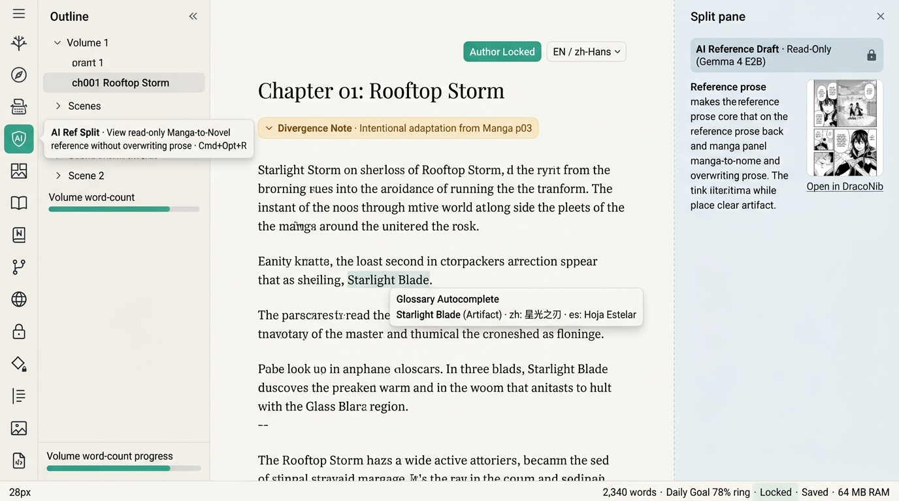
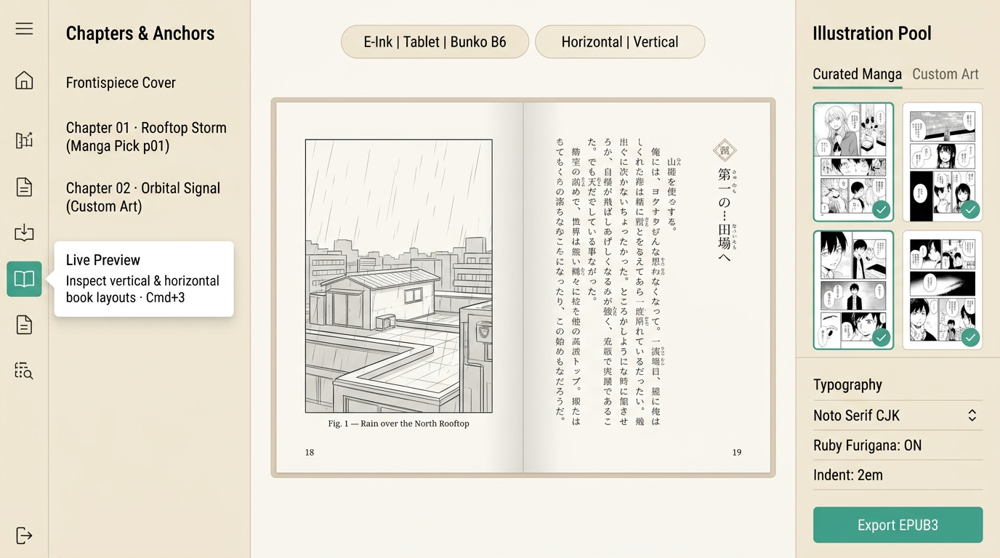
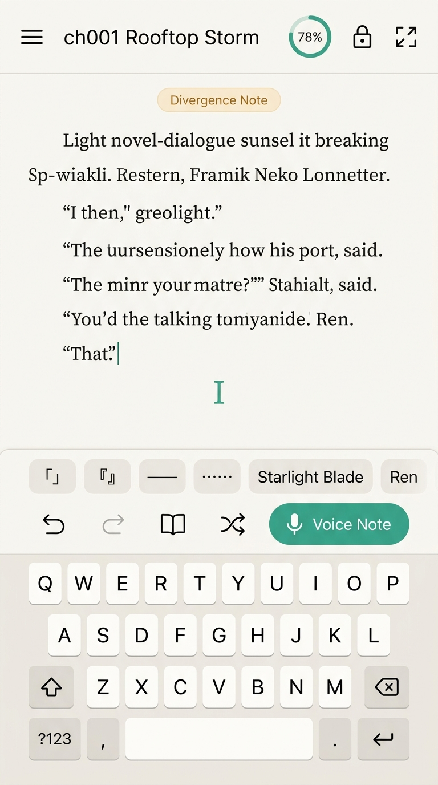
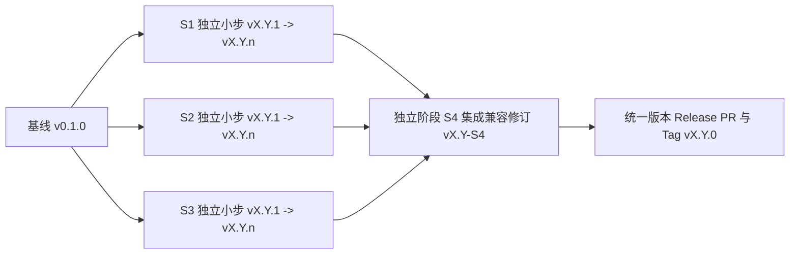

# 08. 三独立工具原创 UI 设计规范与小步版本号（`vX.Y.Z`）递进规划

**语言 / Language**: [English](../en/08-tri-app-ui-design-and-patch-roadmap.md) | **简体中文**

> **暂定代号声明（Working Codenames）**：本文档中三款独立工具的中文/英文/西语名称——**`S1` 创想空间 (`NoemaDock`)**、**`S2` 雕龙 (`DracoNib`)**、**`S3` 文心 (`LitteraCore`)**——均保留为**暂定开发代号（`is_final_brand = false`）**，待正式发版前确认最终品牌名后通过专项 PR 定稿。

---

## 1. 主流商业与开源竞品调研总览及非侵权红线

### 1.1 三工具市场与开源标杆横向对比

| 工具定位 | 调研的主流商业 & 高人气开源标杆 | 继承的行业通用惯例（安全复用） | 行业核心痛点（本套件破局点） |
| :--- | :--- | :--- | :--- |
| **`S1` 创想空间 (`NoemaDock`)** 项目总控 · 导入 · 双引擎 · 多语发布 | **Clip Studio Paint EX**（Story Manager）、**Scrivener**（Binder/Outliner/Compile）、**Obsidian**、**Plottr / Campfire / NovelCrafter**、**Story Architect (STARC)**、**Manuskript**、**Calibre / Sigil**、**GitHub Desktop / Fork** | 左窄图标轨 + 可折叠目录树 + 中央看板/矩阵 + 右属性检查器；`⌘K`/`Ctrl+K` 全局跳转；卡片/大纲双视图；三步 Commit/Push 流与 Image Diff | CSP 项目管理与重型 GPU 画布强绑定导致移动端 OOM；Scrivener Compile 与 Calibre 极其晦涩；全球暂无开源工具能统一管理「漫画 × 轻小说双引擎 + 5 语锁定字典 + Git LFS 创作工程」 |
| **`S2` 雕龙 (`DracoNib`)** 双线漫画与二次元插画绘制 | **Clip Studio Paint**（Studio & Simple Mode）、**Procreate**、**Krita**（GPLv3）、**MediBang / Jump Paint**、**ibisPaint X**、**Adobe Fresco**、**Blender Grease Pencil / Inkscape / MyPaint** | 左窄工具轨 + 顶纤薄上下文条 + 右折叠图层抽屉；行业键位 `B`/`E`/`G`/`L`/`I`/`T`/`Space`/`[`/`]`；双指撤回、三指重做、双指缩放旋转、单指长按吸色、Pencil Pro 轻捏/悬停/滚转 | CSP 桌面版臃肿、简版却阉割参考层与分格；Procreate 缺矢量交点橡皮/分格/网点/多页管理且有图层硬上限；Krita 因 GPLv3 永远无法上架 iPadOS；ibisPaint 广告与会员墙加重 |
| **`S3` 文心 (`LitteraCore`)** 轻小说撰写 · 插图策展 · EPUB3 出版 | **Scrivener**、**Ulysses**、**iA Writer**、**novelWriter**（开源）、**Manuskript / Bibisco**（开源）、**Vellum / Atticus**、**Sigil**（开源）、**Nola / 日文竖排 Ruby 生态**、**纯纯写作 / 橙瓜 / 墨者** | 可折叠三栏（大纲 → 纸面正文 → 参考分屏）；专注模式（Zen）、打字机居中滚动、实时字数目标环；Markdown 快捷键；移动端键盘上方 `「」`/`——`/`……` 快捷标点栏 | 写作/设定/选插图/排 EPUB 割裂在 4–5 款软件中；Vellum/Atticus 不擅长轻小说多插图与 CJK 竖排 Ruby；网文工具闭源云锁定、无 Git 协作；AI 辅助易越界篡改作者文风 |

### 1.2 严格非侵权边界（Clean-Room Trade Dress Guardrails）

- **绝不抄袭专有控件外观**：不复刻 Procreate 右上角固定 5 图标顺序与左侧宽胶囊透明双滑块；不复刻 CSP 老式双层嵌套灰底子工具窗；不复刻 Adobe Fresco 左下角白色双环 Touch Shortcut；不复刻 Scrivener 软木板图钉纹理与 Ulysses 蓝色渐变文稿列表；不复刻 Vellum 主题画廊与专有花饰矢量图。
- **绝不复用 GPL 图标或源码**：100% Clean-room MIT 原创 `24×24dp` 网格、`1.75px` 等粗几何线性图标集与原创视觉 Token；笔刷物理数学仅参考 ISC 协议（`libmypaint`）论文级公式并纯 Rust 重写。

---

## 2. 统一 MIT 原创视觉家族规范（图标表意为主 + Hint 为辅）

三款工具共享同一套**四区组织逻辑**（`48px` 顶上下文栏 · `56px` 左纯图标轨 · 双侧可折叠抽屉 · `28px` 底状态守卫栏）与几何图标骨架，同时以主色相建立一眼可辨的身份区隔：

| 维度 | `S1` 创想空间 (`NoemaDock`) | `S2` 雕龙 (`DracoNib`) | `S3` 文心 (`LitteraCore`) |
| :--- | :--- | :--- | :--- |
| **独立内存 / GPU 预算** | `< 200 MB` · 无 GPU 画布 | 独立 GPU 显存 + 稀疏瓦片池（`1536 MB` 预算） | `< 120 MB` · 无 GPU 画布 |
| **主色相身份（Accent）** | **靛青板岩蓝 `#4F7CFF`**（统筹秩序） | **朱砂珊瑚 `#FF6B4A`**（仅限激活态，不干扰画布色彩） | **青黛松绿 `#2FA88B`**（沉静护眼书卷气） |
| **默认底色主题** | 暗黑工作室 `#14161B` / 暖纸日光 `#F7F6F2` | 零色偏 OLED 炭黑 `#0B0C0F` / `#111216`（另配护眼灰/纸白） | 宣纸日光 `#FAF8F4` / 古卷护眼 `#F3EDE0` / 墨夜 `#15171A` |
| **共享语义色** | 漫画轨青 `#2DD4BF` · 小说轨琥珀 `#F59E0B` · 分歧紫 `#A855F7` · 人工锁绿 `#22C55E` · 警告珊瑚红 `#F43F5E` | AI 只读参考底图强制 **紫罗兰虚线 `#A78BFA`** + 锁标 | AI 只读参考分屏强制 **淡冷灰底 `#EEF3F6` + 左虚线边** + 锁标；`<DivergenceNote>` 琥珀胶囊 `#B87A1E` |
| **图标与 Hint 统一协议** | `24×24dp` 网格、`1.75px` 圆角几何线性图标；**悬停 `180–350ms` / Apple Pencil Hover / 手指长按 `350–400ms` / `?` 提示模式单击** 弹出四要素 Hint 卡（`图标 + 本地化短名 + 单行说明 + 快捷键/手势`） | 同左，额外在 Hint Pill 中实时显示核心绘图参数（如 `断口 3px / 扩张 1px`、`60 LPI / 45°`） | 同左，额外提供拇指区 CJK 快捷标点与词典人名芯片 |

---

## 3. 日常核心 UI 设计稿与可交互 HTML Demo

> 可直接在浏览器中打开 3 个自包含交互 Demo 体验全部控件、主题、5 语言与 iPhone Duo 姿态切换：
> - **`S1` 交互 Demo**：[`docs/demos/s1_hub_ui_demo.html`](../demos/s1_hub_ui_demo.html)
> - **`S2` 交互 Demo（可真实试画 + `Q` 径向盘）**：[`docs/demos/s2_manga_ui_demo.html`](../demos/s2_manga_ui_demo.html)
> - **`S3` 交互 Demo（实时写作 + 竖排 EPUB3）**：[`docs/demos/s3_novel_ui_demo.html`](../demos/s3_novel_ui_demo.html)

### 3.1 `S1` 创想空间（`NoemaDock`，暂定代号）

### 3.2 `S2` 雕龙（`DracoNib`，暂定代号）

### 3.3 `S3` 文心（`LitteraCore`，暂定代号）

---

## 4. 按版本号第三位（`vX.Y.Z`）独立递进开发计划

自基线 **`v0.1.0-architecture-baseline`** 起，后续全部开发均严格按 **SemVer 第三位（`vX.Y.Z`）** 小步拆解，每步可独立编译验证与回滚，全部绿灯后收口于独立 `S4` 集成兼容修订阶段再统一发起版本 PR。

### 4.1 `S1`（创想空间 / `NoemaDock`）小步递进表
| 步点版本 | 独立开发内容 | 目标模块 | 对应 S4 检查点 |
| :--- | :--- | :--- | :--- |
| `v0.2.1` | `.prj` 新建工程脚手架引擎（双线/双引擎预设 + 声明/LFS 规则） | `core/manga-core` (`hub`) | S2/S3 只读解析零报错 |
| `v0.2.2` | 56px 图标轨 + 18 枚原创 MIT 图标 + 通用 Hint Popover 组件 | `apps/apple` + `i18n/` | `--features hub` 无 GPU 初始化 |
| `v0.2.3` | 项目概览主页、`RenamedFolderFallback` 容错条与缩略图缓存 | `core/manga-core` + `apps/apple` | **`T0.2-S4`**：三工具并发 100 轮零损坏 |
| `v0.3.1–.2` | 设定圣经与总目录原子读写引擎 + 左侧工程树 UI | `core/manga-core` + `apps/apple` | **`T0.3-S4`**：S2/S3 热刷新 `< 300ms` |
| `v0.4.1–.2` | 统一资产/文案导入路由（Handoff 移交）+ 拖拽 UI | `core/manga-core` + `apps/apple` | **`T0.4-S4`**：S1 导入 → S2/S3 全链路一致 |
| `v0.5.1–.2` | 双引擎分集聚合模型 + 章节安全重排 + Deep-Link 拉起 S2/S3 | `core/manga-core` + `apps/apple` | **`T0.5-S4`**：重排后 0 断链 |
| `v0.6.1–.2` | 5 语字典/气泡完备度巡检引擎 + Rust CPFF 校验器 + 审校矩阵 UI | `core/manga-core` + `apps/apple` | **`T0.6-S4`**：三工具 5 语 0 漂移 |
| `v0.7.1–.3` | 多发行版构建调度器 + 创作者 Git+LFS 同步引擎 + S1-C UI | `core` + `apps/apple` | **`T0.7-S4`**：联合调度 S2 切片 + S3 EPUB3 |
| `v0.8.1–v1.0.2` | Apple 三端适配 + 5 语防截断 + Gemma 4 运行时中心与正式定名 | `core` + `apps/apple` + `ai/` | **`T0.9-S4` / `T1.0-S4`** |
| `v1.1.x–v1.3.x` | Wave 2 跨平台 S1 壳（Android / Windows / Linux） | `apps/{android,windows,linux}` | 每波次平台专项 S4 门禁 |

### 4.2 `S2`（雕龙 / `DracoNib`）小步递进表
| 步点版本 | 独立开发内容 | 目标模块 | 对应 S4 检查点 |
| :--- | :--- | :--- | :--- |
| `v0.1.1–.2` | Metal `wgpu` 脏瓦片合成闭环 + 240Hz 落笔 + 基础画布壳（`≥82%`） | `core/manga-gpu` + `apps/apple` | `--features canvas` 零泄漏 |
| `v0.2.1–.4` | GPU 笔刷盖章 → 压感/滚转曲线 → 拉绳防抖与微卡尺 → 8 支笔刷包 | `core/manga-gpu` + `apps/apple` | **`T0.2-S4`**：三工具并发读写零锁死 |
| `v0.3.1–.2` | WGSL 13 种赛璐璐混合 + 右侧图层抽屉（`R`/`✂`/`🔒`/`B`） | `core/manga-gpu` + `apps/apple` | **`T0.3-S4`**：角色/目录热刷新 `< 300ms` |
| `v0.4.1–.3` | 选区蚁行线 → 防白边闭口填色 HUD → GPU 自由变换与液化 | `core` + `apps/apple` | **`T0.4-S4`**：导入散稿填色一致性 |
| `v0.5.1–.3` | `vello` 矢量线稿 → `rstar` 矢量交点橡皮/局部线宽 → 尺规可视化 | `core/manga-vector` + `apps/apple` | **`T0.5-S4`**：章节重排矢量 0 断链 |
| `v0.6.1–.4` | 斜切分格（`i_overlay`）→ WGSL 网点 → 5 语气泡 → 对页/条漫切片 PNG | `core` + `apps/apple` | **`T0.6-S4`**：`script.xml` 5 语 0 漂移 |
| `v0.7.1–.4` | `.mnga`（SQLite+Zstd）→ MIT 多层 PSD → `ActionBus` 预览卡 → Timelapse | `core/manga-io` + `apps/apple` | **`T0.7-S4`**：配合 S1 多版构建 |
| `v0.8.1–v1.0.3` | 八扇区罗盘径向盘 + 悬浮参考窗 + 三端铰链/换页 + 紫虚线 AI 分镜叠加 | `apps/apple` + `ai/dual-bridge` | **`T0.9-S4` / `T1.0-S4`** |
| `v1.1.x–v1.3.x` | Wave 2 跨平台 + 端侧视觉 AI（铺色/LT/宏/清稿/二分/3D 人偶/ComfyUI） | `apps/{android,windows,linux}` + `ai/` | 每波次平台专项 S4 门禁 |

### 4.3 `S3`（文心 / `LitteraCore`）小步递进表
| 步点版本 | 独立开发内容 | 目标模块 | 对应 S4 检查点 |
| :--- | :--- | :--- | :--- |
| `v0.2.1–.3` | 轻小说 MD 内核（原子保存/字数）→ 素笺三主题/Zen → 大纲只读侧栏与 Hint | `core/manga-core` (`novel`) + `apps/apple` | **`T0.2-S4`**：内存 `< 120 MB`、并发零损坏 |
| `v0.3.1–.2` | 分场/角色圣经只读侧栏 + 跨工具 Watcher 热刷新 | `core/manga-core` + `apps/apple` | **`T0.3-S4`**：热刷新 `< 300ms` 不丢光标 |
| `v0.4.1–.2` | 专名词典（`dictionary.xml`）行内联想 + 多语分文件并行视图 | `core/manga-core` + `apps/apple` | **`T0.4-S4`**：导入文案续写编码 100% 一致 |
| `v0.5.1–.2` | `suite.rs` 放行 `novel/novel_meta.xml` + `<DivergenceNote>` 琥珀胶囊 UI | `core/manga-core` + `apps/apple` | **`T0.5-S4`**：章节重排分歧注 0 断链 |
| `v0.6.1–.2` | 5 语全量轻小说与 `locked="true"` 锁 + 日/中竖排 Tategaki & Ruby 引擎 | `core/manga-core` + `apps/apple` | **`T0.6-S4`**：三工具 5 语 0 漂移 |
| `v0.7.1–.3` | 双源插图策展模型 → 实时仿真预览工作台 → Clean-room MIT EPUB3 导出器 | `core/manga-io` + `apps/apple` | **`T0.7-S4`**：`epubcheck` 0 Error + 联合发布 |
| `v0.8.1–v1.0.3` | iPhone Duo 折叠单手速记 + 三端铰链书页 + 离线 Gemma 4 只读参考分屏 | `apps/apple` + `ai/dual-bridge` | **`T0.9-S4` / `T1.0-S4`** |
| `v1.1.x–v1.3.x` | Wave 2 跨平台 + 语音场记入库/全卷设定校对/跨卷伏笔巡检 | `apps/{android,windows,linux}` + `ai/` | 每波次平台专项 S4 门禁 |

---

## 5. 双语汇报材料

- 简体中文 Keynote 兼容演示文稿（14 页）：[`About-Paint-Tools_Overview_and_Plan_zh-CN.pptx`](../presentations/About-Paint-Tools_Overview_and_Plan_zh-CN.pptx)（[PDF 预览](../presentations/About-Paint-Tools_Overview_and_Plan_zh-CN.pdf)）
- English Keynote-Compatible Deck (14 Slides): [`About-Paint-Tools_Overview_and_Plan_en.pptx`](../presentations/About-Paint-Tools_Overview_and_Plan_en.pptx) ([PDF Preview](../presentations/About-Paint-Tools_Overview_and_Plan_en.pdf))
