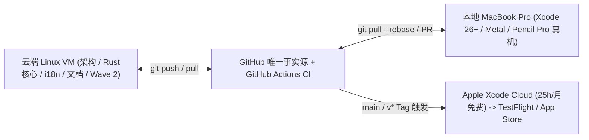

# 09. Apple 平台 MacBook Pro 本地 Xcode 联动开发与 Xcode Cloud 评估指南

**语言 / Language**: [English](../en/09-apple-xcode-and-cloud-dev-guide.md) | **简体中文**

> **适用范围**：Wave 1 Apple 三端（**iPad · 触摸屏 MacBook · iPhone Duo**）与三独立工具（暂定代号：`S1 创想空间/NoemaDock`、`S2 雕龙/DracoNib`、`S3 文心/LitteraCore`）。

---

## 1. 基于现有成果的 MacBook Pro + Xcode 落地开发流程

### 1.1 仓库现有 Apple 底座
当前基线（`v0.1.0-architecture-baseline`）已在仓库中准备好完整的跨语言底座：
- Rust 核心引擎与三模块 Feature 裁剪：[`core/manga-core/Cargo.toml`](../../core/manga-core/Cargo.toml)
- 零警告 C11 FFI 头文件：[`core/manga-core/include/manga_core.h`](../../core/manga-core/include/manga_core.h)
- Swift RAII 桥接与 `SuiteAppKind`：[`apps/apple/Shared/Sources/MangaCoreBridge.swift`](../../apps/apple/Shared/Sources/MangaCoreBridge.swift)
- 三硬件 Target 工程描述：[`apps/apple/project.yml`](../../apps/apple/project.yml) 与 5 语言 [`Localizable.xcstrings`](../../apps/apple/Shared/Resources/Localizable.xcstrings)

### 1.2 核心升级：打包三切片 `MangaCore.xcframework`
为同时支持真机 iPad（`aarch64-apple-ios`）、Apple Silicon 模拟器（`aarch64-apple-ios-sim`）与 macOS 原生（`aarch64-apple-darwin`），建议在 MacBook Pro 上通过统一脚本构建 `XCFramework`：

```bash
cargo build --manifest-path core/Cargo.toml -p manga-core --release --target aarch64-apple-ios
cargo build --manifest-path core/Cargo.toml -p manga-core --release --target aarch64-apple-ios-sim
cargo build --manifest-path core/Cargo.toml -p manga-core --release --target aarch64-apple-darwin

xcodebuild -create-xcframework \
  -library core/target/aarch64-apple-ios/release/libmanga_core.a     -headers core/manga-core/include \
  -library core/target/aarch64-apple-ios-sim/release/libmanga_core.a -headers core/manga-core/include \
  -library core/target/aarch64-apple-darwin/release/libmanga_core.a  -headers core/manga-core/include \
  -output apps/apple/Frameworks/MangaCore.xcframework
```

### 1.3 Xcode 26+ 与跨语言 AI 辅助编程双层协同
1. **层 A（Xcode 26+ 原生 Coding Intelligence / 26.3+ Agentic Coding + MCP）**：专精 SwiftUI 界面还原、Metal 着色器调试、Swift 6 并发纠错与 5 语言实时 Canvas 预览。
2. **层 B（跨语言 AI 代理：Antigravity / Claude Code / Cursor + Xcode MCP）**：同步联动修改 `core/manga-core`（Rust）→ `manga_core.h` → `MangaCoreBridge.swift` → `i18n/locales/*.json`（同步 `.xcstrings`）并一键验证。
3. **真机与性能剖析**：通过 USB-C/无线连接真机 iPad Pro 实测 240Hz Apple Pencil Pro 延迟（目标 `≤ 9ms`），用 **Metal Frame Capture** 与 **Instruments（Allocations/Jetsam）** 验收 `S1 < 200 MB`、`S3 < 120 MB` 与 `S2` 8GB 连续绘制 2 小时零闪退。

---

## 2. MacBook Pro 硬件要求、工具链安装与云端开发环境衔接

### 2.1 硬件配置建议（需兼顾 Xcode + Rust + 本地 Gemma 4）

| 配置档位 | Apple Silicon 芯片 | 统一内存 | SSD | 适用说明 |
| :--- | :--- | :--- | :--- | :--- |
| **最低可用门槛** | M2 Pro / M3 | **24 GB** | **512 GB** | 满足单 Target + 模拟器 + Gemma 4 E2B 基础测试（避开 16GB 以下） |
| **推荐主力配置** | **M4 Pro**（12–14 核） | **36 GB / 48 GB** | **1 TB** | 流畅并发 Xcode + Rust + AI 代理 + 三工具同开 + **Gemma 4 E4B** 推理 |
| **理想旗舰配置** | M4 Max | **64 GB+** | **2 TB** | 适合 Wave 2 多端模拟与 `v1.1`–`v1.4` 视觉 AI（MobileSAM/LT/3D）调优 |

### 2.2 一键工具链安装清单
```bash
xcode-select --install && sudo xcodebuild -license accept
xcodebuild -downloadPlatform iOS
brew install git git-lfs gh xcodegen python3 jq
curl --proto '=https' --tlsv1.2 -sSf https://sh.rustup.rs | sh
rustup target add aarch64-apple-ios aarch64-apple-ios-sim aarch64-apple-darwin
git lfs install
git clone https://github.com/70sDushuren/About-Paint-Tools.git
```

### 2.3 与云端 Linux VM 开发环境的双向接力架构



- **职责分工**：云端负责 Rust 平台无关内核、CPFF/i18n/双语文档与跨平台校验；MacBook Pro 负责 Metal 渲染、SwiftUI/UIKit/AppKit 原生交互与真机手感剖析。
- **防冲突原则**：`Localizable.xcstrings` 严禁仅在 Xcode 侧手改源词条，一律通过 `i18n/locales/*.json` + `scripts/i18n_sync.py --export-xcstrings --export-android` 单源同步。

---

## 3. Apple 云端开发环境（Xcode Cloud）评估与配置指南

### 3.1 可行性结论
- **概念厘清**：Apple 官方不提供“网页版远程 Mac 桌面 IDE”；Apple 官方云端服务是 **Xcode Cloud**（原生云端 CI/CD：构建、并行模拟器 XCTest、自动签名、公证、TestFlight 与 App Store 分发）。
- **成本与推荐架构**：**Apple Developer Program（\$99/年）免费赠送 25 计算小时/月**（超额 \$49.99/100h）。推荐 **「本地 MacBook Pro + GitHub Actions（全平台 Rust/i18n/Android/Win/Linux CI）+ Xcode Cloud（免费 25h/月专攻 Apple 自动签名与 TestFlight）」** 双云混合架构。

### 3.2 Xcode Cloud 接入本 Rust + XcodeGen 仓库的 4 步实操
1. **保持 `project.yml` 为日常唯一真相源**：日常开发期（`v0.2`–`v0.8`）将 `/apps/apple/*.xcodeproj/` 与 `/apps/apple/Frameworks/` 留在 `.gitignore` 避免 `.pbxproj` 冲突；正式开通 Xcode Cloud Workflow（`v0.9+`）时，既可由 `ci_post_clone.sh` 自动调用 `xcodegen`，也可按 App Store Connect 扫描要求对轻量 `MangaStudioApple.xcodeproj` 执行一次 `git add -f` 入库。
2. **配置 `apps/apple/ci_scripts/ci_post_clone.sh`（`chmod +x`）**：在云端自动安装最小化 `rustup` + 3 个 Apple Targets，跑 `cargo test -p manga-core`，通过 `scripts/dev.sh build-rust --force` 组装 `MangaCore.xcframework` 并按需生成 `.xcodeproj`。
3. **配置 3 条 Workflow**（`Xcode → Integrate → Xcode Cloud → Create Workflow`）：
   - `Wave1-Beta-TestFlight`：`main` 或 `v0.9*-beta*` 触发 → 自动签名并分发至 TestFlight；
   - `Wave1-Release-Store`：通过 `S4` 门禁打标 `v1.0.*` → 全量 XCTest + App Store Connect 提审与 macOS 公证。
4. **预留语义化 Bundle ID 与共享 App Group**：
   - `org.aboutpainttools.suite.hub`（S1） / `org.aboutpainttools.suite.manga`（S2） / `org.aboutpainttools.suite.novel`（S3）
   - 共享 App Group：`group.org.aboutpainttools.shared`（跨工具共享 `.prj` 书签权限与单份本地 Gemma 4 离线模型权重缓存）。

---

## 4. 统一工作流驱动（`Makefile` + `scripts/dev.sh`）与日常操作手册

为消除 MacBook Pro 本地 Xcode 与云端 Linux VM 之间的零散命令行操作，仓库根目录提供了统一的 [`Makefile`](../../Makefile) 与 [`scripts/dev.sh`](../../scripts/dev.sh)，并在 [`apps/apple/project.yml`](../../apps/apple/project.yml) 中为全部 Apple Target 配置了增量 `preBuildScripts` 钩子。

### 4.1 单工程多 Target：无需切换子项目即可产出三款 App
- **开发期只打开 1 个工程**：`apps/apple/project.yml` → `MangaStudioApple.xcodeproj`，在 Xcode 顶部栏直接切换 Scheme 即可调试不同硬件形态与独立产品（`S1`/`S2`/`S3` 共享 `Shared/Sources/` 桥接与公共组件）。
- **发版期独立安装**：三款 App 使用独立 Bundle ID、独立进程预算与独立 URL Scheme（`noemadock://`、`draconib://`、`litteracore://`），可在 iPad / Mac 上分屏并行。

### 4.2 Terminal 与 Xcode 窗口黄金分工
- **Terminal（统一 4 指令）**：负责拉取同步、Rust 增量编译、XcodeGen 工程刷新与带门禁的 Git 提交。
- **Xcode 窗口**：负责选择 Scheme/设备、按 **`⌘R`** 真机/模拟器运行、**`⌥⌘Enter`** SwiftUI 实时预览、**`⌘7` / `⌘I`** 内存与 Metal GPU 帧率剖析。
- **Xcode 内自动增量同步**：各 Target 已内置 `Sync Rust MangaCore XCFramework (Incremental)` 构建前脚本，基于 `core/` 内容 SHA-256 指纹判断：仅改 Swift 时 **< 50ms 跳过**，改过 Rust 时按 `⌘R` 自动重编三切片 XCFramework。

### 4.3 日常 4 条一键指令（可在仓库任意子目录运行 `scripts/dev.sh`，或在根目录运行 `make`）

| 指令 | 作用 |
| :--- | :--- |
| `make sync` | 自动回到根目录 → 工作区干净时 `git pull --rebase` → 按指纹增量更新 `MangaCore.xcframework` → `xcodegen generate` → 打开 Xcode |
| `make run-mac` / `make run-ipad` / `make run-duo` | 命令行直接调用 `xcodebuild` 编译（Mac 自动启动 `.app`），便于本机 Antigravity 自动化验证 |
| `make check` | 一键执行与 GitHub Actions 完全一致的全套门禁（5 语 i18n、双端词条同步、CPFF v1.0、C11 零警告、Rust 全测、3 个 Feature 分片与 `S4` 集成检查） |
| `make push MSG="feat(...): ..."` | 自动先跑 `make check`，全绿后才 `commit` → `git pull --rebase` → `git push` |
| `make status` | 查看当前分支、工作区状态与 `MangaCore.xcframework` 是否最新 |

---

## 5. `GoNext` 云-端异步协同执行器（GitOps Relay）

在 [`ops/relay/`](../../ops/relay/README.md) 中内置了一套**只增不改、零合并冲突、带白名单安全锁**的云-端协同执行器：
- **云端发单**：每完成一个云端开发节点，通过 `python3 scripts/relay_tool.py new ...` 在 `ops/relay/orders/` 生成带时间戳的 JSON 声明式任务单（`<YYYYMMDD-HHMMSS>_<slug>.json`），仅允许声明预审白名单内的安全动作（`env-info`、`build-rust`、`xcode-gen`、`build-mac`、`build-ipad`、`build-duo`、`test-mac`、`test-ipad`、`launch-mac`、`open-xcode`、`check`），严禁任意 Shell 注入。
- **MacBook 固定执行与回执**：在本地只需执行固定命令 **`make gonext`**（或开启前台轮询 `make relay-watch` / macOS 后台定时服务 `make relay-install-agent`），自动按时间顺序执行未完成任务单，并将退出码、耗时与精简日志写入同名配对回执 `ops/relay/results/<YYYYMMDD-HHMMSS>_<slug>.result.md` 后自动推回 `origin/main`。
- **完整审计日志与闭环修复**：`orders/` 与 `results/` 按时间戳一一配对永久保留在 Git 历史中；云端拉取回执后若见 `PASS` 则推进下一阶段，若见 `FAIL` 则直接读取裁剪日志修复并派发下一张 `GoNext` 任务单。


