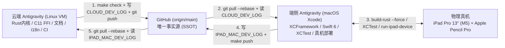

# 11. 云端 Agent × 端侧 Xcode Agent 双代理协同机制规范

**语言 / Language**: [English](../en/11-cloud-local-dual-agent-collaboration.md) | **简体中文** | [中英并排对照版](../bilingual/11-cloud-local-dual-agent-collaboration-bilingual.md)

> **可复用技能文件（Skill）**：[`skills/cloud-local-dual-agent-collab/SKILL.md`](../../skills/cloud-local-dual-agent-collab/SKILL.md)（同时已注册为全局 Antigravity Skill：`cloud-local-dual-agent-collab`，可在本项目后续迭代与任意「云端 Linux + 本地 Xcode/Android/Windows 真机」新项目中直接调用）。

---

## 1. 背景与设计目标

跨平台高性能原生应用（例如本项目的 Rust 核心引擎 `manga-core` + Apple iPadOS/macOS SwiftUI/UIKit/Metal 原生壳）天然存在环境割裂：
- **云端 Linux VM Agent（Cloud Antigravity）**：擅长架构设计、跨平台核心算法（Rust/C11 FFI）、确定性单测、5 语国际化、双语工程文档与全量 CI 门禁，但**没有 macOS Xcode、Metal GPU 与物理 iPad Pro 真机**。
- **端侧 Xcode IDE Agent（Local Antigravity）**：运行在连接了物理 iPad Pro 13" (M5) 的 MacBook Pro 上，擅长 Swift 6 严格并发编译验证、3 切片 `XCFramework` 链接、真机签名部署（`devicectl`）、Apple Pencil Pro 240Hz 手感调试与 XCTest 实测，但不宜承担大规模跨语言重构或长文档同步。

本机制将二者组织为**权责清晰、零合并冲突、可审计、可一键复用于新项目的双代理协同研发体系**。

---

## 2. 总体架构与双模式协同拓扑



本体系提供**两种互补模式**，按研发阶段灵活切换：

| 协同模式 | 适用场景 | 通信载体与触发指令 |
| :--- | :--- | :--- |
| **模式 A：双 Agent 交互式接力（主力模式）** | 活跃的功能开发与真机体验打磨期（例如 `v1.0.0-rc4+` → `v1.0.0-rc5`）：云端与端侧 Agent 交替修改代码，人类在两者之间传递结构化交接指令。 | `origin/main` + **双向单写追加日志**（`ops/cloud-dev-log/CLOUD_DEV_LOG.md` ↔ `ops/local-dev-log/IPAD_MAC_DEV_LOG.md`）+ **`make push`**。 |
| **模式 B：无人值守 `GoNext` GitOps 接力** | 批量里程碑自动化回归（例如夜间自动闭环 10–20 轮构建与 XCTest），无需端侧 Agent 交互改代码。 | `ops/relay/orders/*.json`（云端只写）↔ `ops/relay/results/*.result.md`（Mac 只写）+ **`make gonext` / `make relay-watch` / `make relay-install-agent`**，带时长/单数/死循环五层熔断护栏（见 [Doc 09](./09-apple-xcode-and-cloud-dev-guide.md)）。 |

> **铁律（严禁混用触发命令）**：
> - 端侧 Agent 主动改过代码后，一律用 **`make push MSG="..."`**（或 `git commit && git push`）提交。
> - **绝对不要**在有本地代码改动时执行 **`make gonext`**——`make gonext` 仅用于拉取并执行云端派发的白名单任务单。

---

## 3. 五大核心防冲突与安全机制

### 3.1 双向单写日志隔离（Zero-Conflict Dual Dev Logs）
- **云端专属日志**：[`ops/cloud-dev-log/CLOUD_DEV_LOG.md`](../../ops/cloud-dev-log/CLOUD_DEV_LOG.md) —— 仅云端 Agent 按时间倒序顶部追加，端侧 Agent **只读不改**。
- **端侧专属日志**：[`ops/local-dev-log/IPAD_MAC_DEV_LOG.md`](../../ops/local-dev-log/IPAD_MAC_DEV_LOG.md) —— 仅端侧 Agent 按时间倒序顶部追加，云端 Agent **只读不改**。
- **为何放在 `ops/` 而非 `docs/`**：避开 `scripts/i18n_check.py` 对 `docs/zh-CN/` ↔ `docs/en/` 强制 1:1 双语镜像校验，让端侧高频真机打磨保持零阻塞。

### 3.2 显式 FFI 重建信号（FFI Rebuild Signaling）
- 当云端仅修改 Swift / 文档 / 脚本时，Mac 端按 SHA-256 指纹 `< 50ms` 自动跳过 Rust 编译。
- **只要云端修改了 `core/manga-core/` 或 `manga_core.h`（增改 C11 FFI 符号）**，云端必须在 `CLOUD_DEV_LOG.md` 当条顶部醒目标注需要强制重编三切片 `XCFramework`，端侧接力第一步即执行：
  ```bash
  ./scripts/dev.sh build-rust --force && ./scripts/dev.sh xcode-gen
  ```
  彻底杜绝“头文件已更新但链接到旧 `.a` 静态库导致 Undefined symbol”问题。

### 3.3 不被工程生成覆盖的持久化签名隔离（Persistent Local Signing）
- 仓库追踪 [`apps/apple/BaseSigning.xcconfig`](../../apps/apple/BaseSigning.xcconfig)，末尾通过 `#include? "LocalSigning.xcconfig"` 条件引入本地文件。
- `apps/apple/LocalSigning.xcconfig` 已加入 [`.gitignore`](../../.gitignore)，由一次性命令 `make ipad-setup-signing TEAM_ID=<10位TeamID>` 生成。
- 效果：**个人 Team ID 永不泄漏到公开 Git 仓库**，且无论运行多少次 `make sync` / `xcodegen generate`，端侧真机签名永不丢失。

### 3.4 回合纪律与并发冲突无损恢复（Turn Discipline & Temp Branch Fallback）
- **常态回合制**：任一方推完并交棒后，暂停向 `main` 抢推新提交，确保对方始终 `fast-forward` 无冲突推送。
- **并发编辑兜底**：若双方在未 `git pull` 前同时改到了同一文件（例如 `project.yml` 与 `Assets.xcassets/`）：
  1. 端侧**不在 `main` 上强行 rebase**，而是直接推到临时分支 `local/<slug>`；
  2. 云端拉取临时分支，择优无损合并（例如保留端侧实机生成的 11 尺寸精美 AppIcon 并合并云端新配置），跑通 `make check` 后合入 `main` 并删除远程临时分支；
  3. 端侧切回 `main` 删除本地临时分支并 `git pull --rebase`。

### 3.5 跨平台代码边界与产物卫生（Boundary & Artifact Hygiene）
- 严禁将 `UIKit` / `AppKit` 符号裸露写入 `apps/apple/Shared/Sources/`（必须包裹在 `#if canImport(...)` / `#if os(...)` 内）。
- 严禁强行提交（`git add -f`）`.xcodeproj/`、`Frameworks/`、`DerivedData/` 或 `LocalSigning.xcconfig`。

---

## 4. 真实实战验证案例（`v1.0.0-rc4+` → `v1.0.0-rc5`）

本机制已在 `About-Paint-Tools` 真机迭代中完成完整闭环验证：
1. **并发图标冲突无损合并（`b7c4c70`）**：端侧先改了 `project.yml` 与 11 尺寸 AppIcon，通过临时分支 `local/ipad-pro-deploy` 交由云端无损合并并自动清理分支。
2. **端侧 5 项 iPad Pro 体验打磨回传（`e3eeb98`）**：端侧 Xcode Agent 完成套索选区栏、工具聚焦属性栏、双指平移、`S2+S3` 同屏双创与吸色放大镜，记录在 `IPAD_MAC_DEV_LOG.md` 并提出云端 Rust 选区局部浮动变形需求。
3. **云端 Rust FFI + 三项升级交付（`01d93c2`）**：云端拉取日志后新增 2 个 Rust C11 FFI 接口、双指自由旋转、多画布画廊与相册导入，跑通 73/73 Rust 单测并写入 `CLOUD_DEV_LOG.md`。
4. **端侧接力验证与真机实装（`74ca465`）**：端侧 Xcode Agent 按 `CLOUD_DEV_LOG.md` 强制重编 `XCFramework`，秒级捕获并修正 1 处枚举名（`.webtoonStrip` → `.webtoonStrip800`），**48/48 Apple Silicon XCTest 全绿**并成功装上物理 iPad Pro 13" (M5)。

---

## 5. 新项目 5 分钟复用指南

在任何新的跨端项目中（Apple / Android / Windows / Linux），只需 4 步即可直接启用同款双 Agent 协同体系：
1. 复制 [`skills/cloud-local-dual-agent-collab/SKILL.md`](../../skills/cloud-local-dual-agent-collab/SKILL.md) 到新仓库的 `skills/` 目录（并在 Antigravity 中直接引用已注册的全局 Skill `cloud-local-dual-agent-collab`）。
2. 初始化 `ops/cloud-dev-log/CLOUD_DEV_LOG.md` 与 `ops/local-dev-log/LOCAL_DEV_LOG.md`，顶部声明单写权规则。
3. 配置 `BaseSigning.xcconfig`（含 `#include? "LocalSigning.xcconfig"`）并在 `.gitignore` 中忽略本地签名与工程构建产物。
4. 在 `Makefile` 中提供统一入口 `make check`、`make sync`、`make push MSG="..."` 与真机部署目标；如需夜间无人值守批量验证，可叠加引入 `gitops-gonext-relay-setup` 技能。
